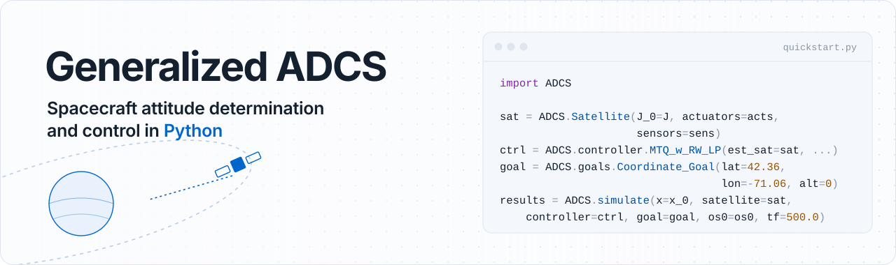
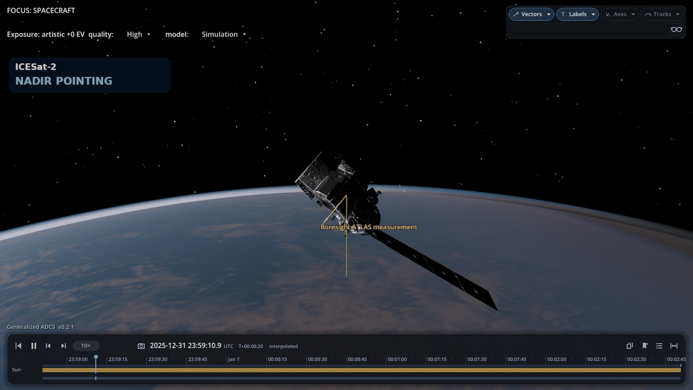
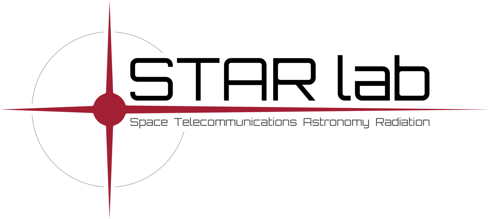

<p align="center">
  <picture>
    <source media="(prefers-color-scheme: dark)" srcset="assets/banner-dark.svg">
    
  </picture>
</p>

<p align="center">
  <a href="https://pypi.org/project/generalized-adcs/"></a>
  <a href="https://pypi.org/project/generalized-adcs/"></a>
  <a href="https://github.com/nscheuer/Generalized_ADCS/actions/workflows/ci.yml"></a>
  <a href="https://github.com/nscheuer/Generalized_ADCS/actions/workflows/sphinx.yml"></a>
  <a href="LICENSE"></a>
</p>

<p align="center">
  <b><a href="https://nscheuer.github.io/Generalized_ADCS/">Documentation</a></b> ·
  <b><a href="https://nscheuer.github.io/Generalized_ADCS/installation/index.html">Installation</a></b> ·
  <b><a href="#quickstart">Quickstart</a></b> ·
  <b><a href="https://nscheuer.github.io/Generalized_ADCS/tutorials/index.html">Tutorials</a></b> ·
  <b><a href="https://nscheuer.github.io/Generalized_ADCS/papers/index.html">Papers</a></b> ·
  <b><a href="https://nscheuer.github.io/Generalized_ADCS/release_notes/index.html">Release notes</a></b> ·
  <b><a href="CONTRIBUTING.md">Contributing</a></b>
</p>

---

**Generalized ADCS** is a Python framework for satellite **attitude determination and control (ADCS)**, designed for **research, prototyping, and flight-software development**. It emphasizes generality, modularity, and transparency: spacecraft, actuators, sensors, estimators, controllers and goals are interchangeable pieces you combine in a few lines, with no black-box solvers. It is built for aerospace students, researchers, and engineers.

> [!NOTE]
> Generalized ADCS and its simulations and results are provided for research and development purposes only. They do not guarantee mission success, flight readiness, or performance in any particular application. Validate all software, models, and results independently before use. See the [About page](https://nscheuer.github.io/Generalized_ADCS/contributing/about.html) for the full disclaimer.

<p align="center">
  
</p>

## Contents

- [Quickstart](#quickstart)
- [Features](#features)
- [How a simulation fits together](#how-a-simulation-fits-together)
- [Learn with the tutorials](#learn-with-the-tutorials)
- [Installation options](#installation-options)
- [Repository map](#repository-map)
- [Papers and citing](#papers-and-citing)
- [Contributing](#contributing)
- [Acknowledgements and license](#acknowledgements-and-license)

## Quickstart

Install from PyPI (Python 3.10 or newer) and run the bundled example, which propagates a freely rotating spacecraft for 30 seconds:

```bash
pip install generalized-adcs
python -m ADCS.examples.basic_simulation
```

```text
Final angular velocity [rad/s]: [0.         0.         0.01745329]
Final attitude quaternion [scalar, x, y, z]: [0.96814764 0.         0.         0.25038   ]
```

A closed-loop example: a 10 kg spacecraft with one reaction wheel and three magnetorquers points its boresight at a ground coordinate (Boston) for 500 seconds, using the mixed wheel and magnetorquer LP allocation controller.

```python
import numpy as np
import matplotlib.pyplot as plt
import ADCS

# 1 reaction wheel + 3 magnetorquers, 3 magnetometers
acts = [ADCS.RW(axis=np.array([1, 0, 0]), max_torque=0.0023, J=5.7e-6, h=0.0, h_max=0.0036)]
acts += [ADCS.MTQ(axis, max_torque=0.2) for axis in np.eye(3)]
sens = [ADCS.MTM(axis) for axis in np.eye(3)]

satellite = ADCS.Satellite(mass=10, J_0=np.diag([0.03, 0.03, 0.01]),
                           actuators=acts, sensors=sens, boresight=np.array([0, 0, 1]))
x_0 = ADCS.State.from_array(np.array([0.01, -0.02, 0.01] + [1, 0, 0, 0] + [0.0]))  # w, q, h

controller = ADCS.controller.MTQ_w_RW_LP(est_sat=satellite, p_gain=0.00005, d_gain=0.002,
                                         c_gain=0.001, h_target=np.array([0, 0, 0]))
goal = ADCS.goals.Coordinate_Goal(lat=42.36, lon=-71.06, alt=0)  # point the boresight at Boston
os0 = ADCS.Orbital_State(ephem=ADCS.Ephemeris(), J2000=0.22,
                         R=np.array([5000, 0, 5000]), V=np.array([0, 7.5, 0]))

results = ADCS.simulate(x=x_0, satellite=satellite, controller=controller,
                        goal=goal, os0=os0, dt=1.0, tf=500.0)

ADCS.plot(results, ADCS.plots.TargetPlot(), ADCS.plots.AngularVelocityPlot(), layout=(2, 1))
plt.savefig("quickstart.png")
```

<p align="center">
  
</p>

> [!TIP]
> Spacecraft states use `ADCS.State`, with named `w`, `q`, and `h` arrays. Use `from_array` and `as_array` only at numerical-library boundaries. The [tutorials](https://nscheuer.github.io/Generalized_ADCS/tutorials/index.html) build up from here. For the PyVista 3-D animation (`ADCS.plots.AnimationPlot`), install the `viz` extra: `pip install "generalized-adcs[viz]"`.

## Features

| Area | What's included |
|---|---|
| **Python-first, built for research** | Easy to inspect, debug, modify and extend with custom algorithms. Numba-accelerated numerical kernels for demanding simulations, and Monte Carlo support for statistical analysis and robustness testing. |
| **Generalized 6-DOF dynamics** | Attitude propagation with SciPy's `solve_ivp` (RK45). Fully configurable inertia, geometry and external disturbances. Underactuated and overactuated spacecraft. |
| **Flexible orbit propagation** | Initialize orbits from position vectors, orbital elements or TLEs. Keplerian, SGP4 and RK4 propagation. Atmospheric drag, solar radiation pressure and J2 perturbations. |
| **Attitude estimation** | Plug-and-play EKF, MEKF, UKF and SRUKF frameworks, with real-time sensor bias and disturbance estimation. |
| **Attitude control and optimization** | PD, LQR, projection-based and magnetorquer-only feedback controllers. LP and QP control allocation for underactuated systems. ALTRO-based trajectory optimization. |
| **Sensor and actuator models** | Configurable noise and bias. Gyroscopes, magnetometers, sun sensors, star trackers, Earth horizon sensors and GPS; reaction wheels and magnetorquers. A growing [catalog of preconfigured CubeSat-scale hardware](https://nscheuer.github.io/Generalized_ADCS/satellite_factory/index.html) in `ADCS/satellite_factory`. |

## How a simulation fits together

<p align="center">
  <picture>
    <source media="(prefers-color-scheme: dark)" srcset="assets/architecture-dark.svg">
    
  </picture>
</p>

`ADCS.simulate` takes a true `Satellite`, an initial `State` and `Orbital_State`, and optionally a `controller`, an attitude `estimator`, an `orbit_estimator`, a `goal` (or `GoalList`) and an `Environment`. It returns `SimulationResults`, which you can plot with `ADCS.plot`, animate with the Godot viewer, or save and load later. Every piece is swapped through configuration, not code restructuring.

## Learn with the tutorials

The [tutorials](https://nscheuer.github.io/Generalized_ADCS/tutorials/index.html) go from first principles to full missions. Most tutorial scripts live in [`examples/tutorials/`](examples/tutorials), so clone the repository to run them.

| | Section | What it covers |
|:-:|---|---|
| 1 | [Spacecraft Dynamics](https://nscheuer.github.io/Generalized_ADCS/tutorials/1_0_spacecraft_dynamics.html) | Coordinate frames, Euler's equations, the Dzhanibekov effect |
| 2 | [Torques on a Spacecraft](https://nscheuer.github.io/Generalized_ADCS/tutorials/2_0_torques_on_a_spacecraft.html) | Environment and geometry, drag, SRP, gravity gradient, residual dipole, reaction wheels, magnetorquers |
| 3 | [Forces on a Spacecraft](https://nscheuer.github.io/Generalized_ADCS/tutorials/3_0_forces_on_a_spacecraft.html) | J2 perturbation, drag with SGP4 |
| 4 | [Controlling Spacecraft](https://nscheuer.github.io/Generalized_ADCS/tutorials/4_0_controlling_spacecraft.html) | PD control, types of goals, goal lists, magnetorquer-only and underactuated 3+1 control, momentum management |
| 5 | [Attitude Sensors](https://nscheuer.github.io/Generalized_ADCS/tutorials/5_0_attitude_sensors.html) | Noise, bias, gyroscope, magnetometer, sun sensor, star tracker, GPS |
| 6 | [Estimators](https://nscheuer.github.io/Generalized_ADCS/tutorials/6_0_estimators.html) | Attitude determination, Kalman filtering, bias / dipole / disturbance estimation, sensor occlusion, warm starts |
| 7 | [Monte Carlo](https://nscheuer.github.io/Generalized_ADCS/tutorials/7_0_monte_carlo.html) | Randomized orbits, attitudes and goals; validation |
| 8 | [Simulating Your First Mission](https://nscheuer.github.io/Generalized_ADCS/tutorials/8_0_simulating_first_mission.html) | Launch and deployment, detumbling, pointing |
| 9 | [Advanced Topics](https://nscheuer.github.io/Generalized_ADCS/tutorials/9_0_advanced_topics.html) | Plan-and-track, SALTRO trajectory optimization, remote execution |

The package also ships three short examples you can run without cloning: `python -m ADCS.examples.basic_simulation`, `ADCS.examples.orbit_elements` and `ADCS.examples.environment_field`.

## Installation options

| | pip install | Clone the repository |
|---|:-:|:-:|
| Core ADCS framework and plotting | ✅ | ✅ |
| Bundled `ADCS.examples` | ✅ | ✅ |
| Full `examples/` collection, tutorial and debug scripts | ❌ | ✅ |
| Offline documentation | ❌ | ✅ |
| Optional C++ add-ons (trajectory planner, SALTRO) | ❌ | ✅ |

```bash
# from source (Linux / macOS / WSL; see the docs for Windows)
git clone https://github.com/nscheuer/Generalized_ADCS.git
cd Generalized_ADCS
python3 -m venv .venv
.venv/bin/python -m pip install -e .
.venv/bin/python -m ADCS.examples.basic_simulation
```

<details>
<summary><b>Optional extras</b></summary>

Install with `pip install "generalized-adcs[<extra>]"`.

| Extra | What it adds |
|---|---|
| `viz` | 3-D orbit animation: PyVista orbit plots, Godot asset texture processing, Pillow-based rendering and export |
| `viz-video` | MP4 export from the Godot viewer when no `ffmpeg` is on `PATH` |
| `viz-mesh` | Spacecraft model import (glTF/STL) with level-of-detail decimation |
| `viz-assets` | Rebuilding the viewer's texture assets |
| `nrlmsise` | The NRLMSISE-00 atmosphere model (via `pymsis`) |
| `ppigrf` | The legacy geomagnetic field model, selectable with `magnetic_model="igrf_ppigrf"` to reproduce results from 0.1.8 and earlier |
| `dev` | Test and lint tooling |
| `docs` | Documentation build |
| `cpp` | Build toolchain for the optional C++ add-ons |

For bit-reproducible paper campaigns, install the exact pins instead: `pip install -r requirements-repro.txt`.

</details>

> [!IMPORTANT]
> The `cpp` extra only installs compilers and bindings. The trajectory planner (`tplaunch` / `pysat`) and SALTRO (`saltro_py`) add-ons live in the `OldPlanner` and `SALTRO` git submodules, so they need a clone of the repository. Neither is needed for the pure-Python framework. Build instructions: [trajectory planner](https://nscheuer.github.io/Generalized_ADCS/installation/trajectory_planner_addon.html) · [SALTRO](https://nscheuer.github.io/Generalized_ADCS/installation/saltro_addon.html).

## Repository map

| Path | What's there |
|---|---|
| [`ADCS/`](ADCS) | The package: dynamics, orbits, environment, hardware models, estimators, controllers, goals, simulation, plotting and the Godot viewer |
| [`ADCS/satellite_factory/`](ADCS/satellite_factory) | Preconfigured satellites, actuators and sensors |
| [`examples/`](examples) | Tutorial scripts plus controller, estimator, Monte Carlo, remote-execution and save/load examples |
| [`docs/`](docs) | Sphinx source for the [documentation site](https://nscheuer.github.io/Generalized_ADCS/) |
| [`testing/`](testing) | The pytest suite |
| [`papers/`](papers) | Scripts and pipelines behind the published papers, including the SSC26 Colab quickstart notebook |
| [`debug/`](debug) | Debug scripts for controllers, estimators, orbits, flight software and remote execution |
| `SALTRO/`, `OldPlanner/` | Git submodules for the optional C++ trajectory-optimization add-ons |
| [`assets/`](assets) | README images, and the script that draws them |

## Papers and citing

| Venue | Paper |
|---|---|
| SmallSat Europe 2026, Amsterdam | [A Modular Open-Source ADCS Framework for Small Satellite Development and Testing](https://nscheuer.github.io/Generalized_ADCS/papers/package.html) |
| 40th Small Satellite Conference 2026, Salt Lake City (Poster Session 2) | [Generalized Attitude Control for Small Spacecraft](https://nscheuer.github.io/Generalized_ADCS/papers/generalized_acs.html) |
| 40th Small Satellite Conference 2026, Salt Lake City (Flash Talks Session 3) | [A Feasibility-Aware Attitude Trajectory Planner for Small Satellites](https://nscheuer.github.io/Generalized_ADCS/papers/planner.html) |
| MIT PhD Thesis, 2025 | [Computational Methods to Improve Satellite Attitude Determination and Control with a Focus on Autonomy, Generalizability, and Underactuation](https://dspace.mit.edu/handle/1721.1/158874) |
| 38th Small Satellite Conference 2024, Logan | [Generalized Attitude Estimation for Spacecraft](https://digitalcommons.usu.edu/smallsat/2024/all2024/37/) |
| Journal of Guidance, Control, and Dynamics, 2022 | [Method for Pointing Spacecraft While Minimizing Change in Orientation](https://arc.aiaa.org/doi/10.2514/1.G006429) |
| 34th Small Satellite Conference 2020, Logan | [BeaverCube: Coastal Imaging with VIS/LWIR CubeSats](https://digitalcommons.usu.edu/smallsat/2020/all2020/126/) |

This project is based on the PhD research of **Patrick McKeen** ([dissertation](https://dspace.mit.edu/handle/1721.1/158874) · [source code](https://github.com/patrickmckeen/PhD_Dissertation_Code)). Sources for the algorithms and models used in the package are listed on the [Citations page](https://nscheuer.github.io/Generalized_ADCS/contributing/citations.html).

<details>
<summary><b>BibTeX</b></summary>

```bibtex
@inproceedings{mckeen2026modular,
  title     = {A Modular Open-Source ADCS Framework for Small Satellite Development and Testing},
  author    = {McKeen, Patrick and Scheuer, Niclas Bennet Darith and Cahoy, Kerri},
  booktitle = {SmallSat Europe 2026},
  year      = {2026},
  address   = {Amsterdam, Netherlands},
  url       = {https://smallsateurope.com/paper/a-modular-open-source-adcs-framework-for-small-satellite-development-and-testing/},
}

@inproceedings{mckeen2026generalized,
  title     = {Generalized Attitude Control for Small Spacecraft},
  author    = {McKeen, Patrick and Scheuer, Niclas and Cahoy, Kerri},
  booktitle = {Proceedings of the 40th Annual Small Satellite Conference},
  number    = {SSC26-P2-54},
  year      = {2026},
  address   = {Salt Lake City, UT},
  url       = {https://digitalcommons.usu.edu/smallsat/2026/all2026/253/},
}

@inproceedings{mckeen2026feasibility,
  title     = {A Feasibility-Aware Attitude Trajectory Planner for Small Satellites},
  author    = {McKeen, Patrick and Scheuer, Niclas and Cahoy, Kerri},
  booktitle = {Proceedings of the 40th Annual Small Satellite Conference},
  year      = {2026},
  address   = {Salt Lake City, UT},
  url       = {https://digitalcommons.usu.edu/smallsat/2026/all2026/227/},
}
```

</details>

## Contributing

Contributions from students, researchers and industry engineers are welcome: new controllers, sensor models and estimators, simulation scenarios and benchmarks, tests, documentation, bug fixes and visualization. Start with [CONTRIBUTING.md](CONTRIBUTING.md), then see the [testing](https://nscheuer.github.io/Generalized_ADCS/contributing/testing.html) and [documentation](https://nscheuer.github.io/Generalized_ADCS/contributing/documentation.html) guides.

- Questions and ideas: [GitHub Discussions](https://github.com/nscheuer/Generalized_ADCS/discussions)
- Bugs and feature requests: [GitHub Issues](https://github.com/nscheuer/Generalized_ADCS/issues)
- Community standards: [Code of Conduct](CODE_OF_CONDUCT.md) · [Maintainers](MAINTAINERS.md)

## Acknowledgements and license

Generalized ADCS was created by **Niclas Scheuer**, **Patrick McKeen**, and **William Goldman**.

<p>
  <a href="https://aeroastro.mit.edu/starlab/"></a>
  &nbsp;&nbsp;
  <a href="https://aeroastro.mit.edu/small-satellite-collaborative/"></a>
</p>

Released under the [MIT License](LICENSE).
