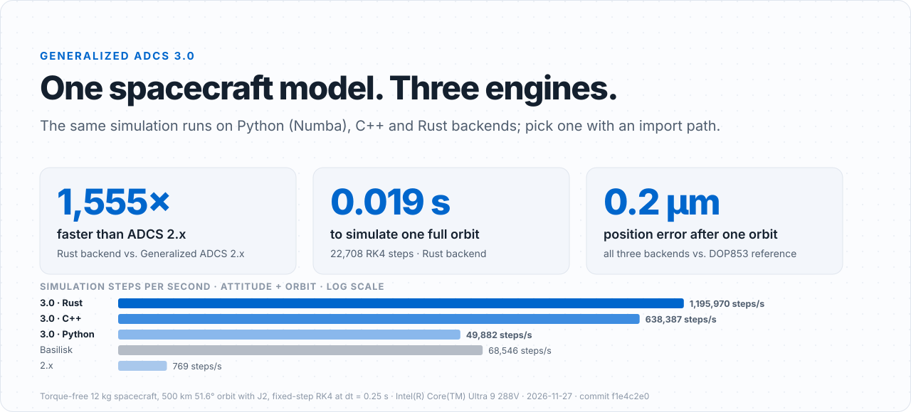
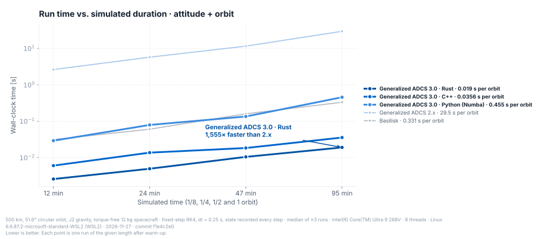
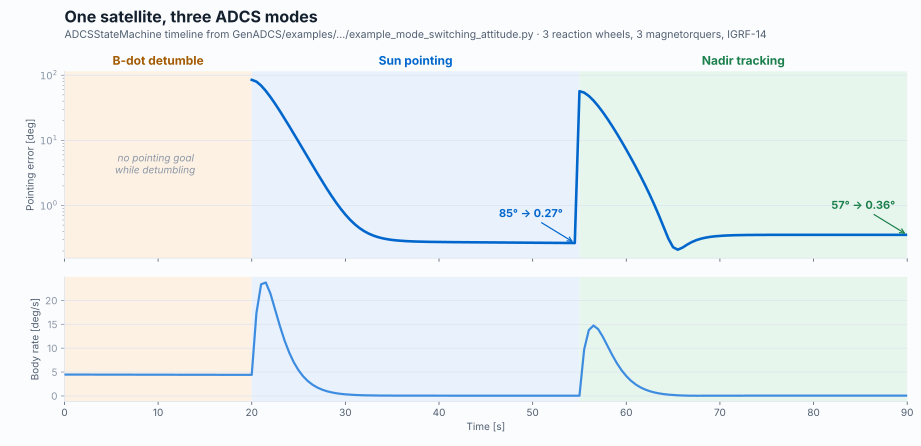
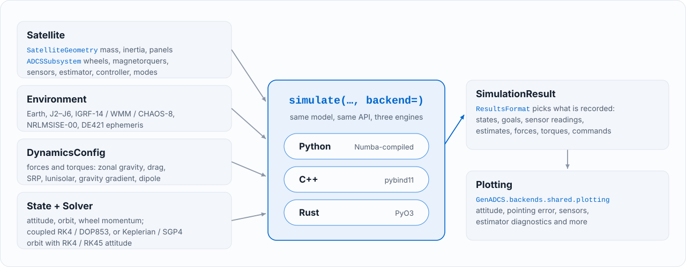

<p align="center">
  <picture>
    <source media="(prefers-color-scheme: dark)" srcset="assets/logo-dark.svg">
    
  </picture>
</p>

<h1 align="center">Generalized ADCS</h1>

<p align="center">
  <em>Spacecraft attitude determination and control. One model, three engines: Python, C++ and Rust.</em>
</p>

<p align="center">
  <a href="https://github.com/nscheuer/Generalized_ADCS/actions/workflows/ci-python.yml"></a>
  <a href="https://github.com/nscheuer/Generalized_ADCS/actions/workflows/ci-cpp.yml"></a>
  <a href="https://github.com/nscheuer/Generalized_ADCS/actions/workflows/ci-rust.yml"></a>
  <a href="https://github.com/nscheuer/Generalized_ADCS/actions/workflows/ci-integration.yml"></a>
  
  <a href="LICENSE"></a>
</p>

<p align="center">
  <picture>
    <source media="(prefers-color-scheme: dark)" srcset="assets/hero-dark.svg">
    
  </picture>
</p>

<p align="center">
  <strong>Generalized ADCS 3.0: rebuilt with Python, C++ and Rust backends.</strong><br>
  <strong>One orbit with attitude in 0.019 s &middot; 1,555&times; faster than 2.x &middot; 0.2&nbsp;&micro;m error after one orbit</strong><br>
  <sub>Rust backend; C++ is 830&times; and Python (Numba) 65&times; faster than 2.x. Torque-free 12 kg spacecraft, 500 km 51.6&deg; orbit with J2, fixed-step RK4 at dt = 0.25 s, Intel(R) Core(TM) Ultra 9 288V, 2026-11-27. <a href="#numbers">Details</a>.</sub>
</p>

<p align="center">
  <sub><a href="https://nscheuer.github.io/Generalized_ADCS/">Documentation</a> &middot; <a href="benchmarks">Benchmarks</a> &middot; <a href="GenADCS/examples">Examples</a> &middot; <a href="#papers-and-citing">Papers</a> &middot; <a href="CONTRIBUTING.md">Contributing</a></sub>
</p>

---

A satellite has to know which way it is pointing and turn to point somewhere else, with whatever sensors and actuators it happens to carry. Generalized ADCS simulates exactly that: the spacecraft, its orbit and environment, its sensors, estimators and controllers, in a few lines of code and with no black-box solvers. It is a framework for **research, prototyping and flight-software development**, built for aerospace students, researchers and engineers.

Version 3.0 rebuilds the core. The spacecraft, environment, forces and torques, sensors, actuators, estimators and propagators exist in **Python** (compiled with Numba), **C++** and **Rust**, behind the same module layout. Prototype in Python, then switch one import path and run the same simulation on a native engine. Controllers, pointing goals and mission logic currently live in the Python backend.

> [!NOTE]
> Generalized ADCS and its simulations and results are provided for research and development purposes only. They do not guarantee mission success, flight readiness, or performance in any particular application. Validate all software, models, and results independently before use.

## Numbers

<p align="center">
  <picture>
    <source media="(prefers-color-scheme: dark)" srcset="benchmarks/results/speed-dark.svg">
    
  </picture>
</p>

<p align="center">
  <picture>
    <source media="(prefers-color-scheme: dark)" srcset="benchmarks/results/speedup-dark.svg">
    
  </picture>
</p>

The same scenario runs on every tool: a torque-free 12 kg spacecraft on a 500 km, 51.6&deg; circular orbit with J2 gravity, fixed-step RK4 at dt = 0.25 s, the full state recorded at every step. Generalized ADCS 3.0 is compared with its predecessor and with two established tools, [Basilisk](https://github.com/AVSLab/basilisk) and [Orekit](https://www.orekit.org/). Every tool's final state is checked against a high-precision reference integration of the same equations, so speed never comes at the cost of a different answer.

<!-- benchmarks:start -->
<!-- Generated by benchmarks/make_charts.py from benchmarks/results/results.json; do not edit by hand. -->

> One full orbit (95 simulated minutes, 22,708 steps) with attitude takes **0.019 s** on the Rust backend, **1,555× faster** than Generalized ADCS 2.x (Intel(R) Core(TM) Ultra 9 288V, 2026-11-27).

| Tool | Attitude + orbit [steps/s] | Orbit only [steps/s] | Position error, 1 orbit [m] | Attitude error, 1 orbit [deg] |
|:--|:-:|:-:|:-:|:-:|
| **Generalized ADCS 3.0 · Rust** | **1,195,970** | **1,192,751** | **2.08e-07** | **1.1e-08** |
| **Generalized ADCS 3.0 · C++** | **638,387** | **634,512** | **2.04e-07** | **1.1e-08** |
| **Generalized ADCS 3.0 · Python (Numba)** | **49,882** | **92,275** | **2.04e-07** | **1.1e-08** |
| Generalized ADCS 2.x | 769 | 8,355 | 2.22e-04 | 9.4e-11 |
| Basilisk | 68,546 | 80,377 | 2.09e-07 | 1.0e-08 |
| Orekit | — | 354,683 | 2.00e-07 | — |

<!-- benchmarks:end -->

<details>
<summary><b>Run time vs. simulated duration, method and fairness notes</b></summary>

<p align="center">
  <picture>
    <source media="(prefers-color-scheme: dark)" srcset="benchmarks/results/scaling-dark.svg">
    
  </picture>
</p>

Speed is the wall-clock time of the propagation call, including each tool's per-step state recording, after an untimed setup and warm-up (median of at least three runs). Accuracy is measured against SciPy's DOP853 at a relative tolerance of 1e-13 on the same equations. Generalized ADCS 3.0 and Basilisk always integrate attitude together with the orbit; Orekit has no rigid-body attitude dynamics, so it runs the orbit-only scenario; 2.x integrates attitude with SciPy's adaptive RK45. Per-tool settings, scripts and instructions to reproduce every number: [`benchmarks/`](benchmarks).

</details>

## Same model, three engines

Pick the engine with the module path. The rest of the script does not change:

```python
from importlib import import_module

import numpy as np

backend = "python"  # or "cpp" / "rust" once those backends are built
B = lambda module: import_module(f"GenADCS.backends.{backend}.{module}")
state, hardware, env = B("state"), B("hardware"), B("environment")

# A 12 kg spacecraft tumbling on a 500 km orbit with J2 gravity
geometry = hardware.SatelliteGeometry(mass=12.0, inertia=np.diag((0.13, 0.10, 0.05)), panels=[])
satellite = hardware.Satellite(geometry=geometry)
environment = env.Environment(planetary_body=env.Earth())
dynamics = B("config").DynamicsConfig(
    forces=[B("dynamics").ZonalForceModel(geometry, environment, degrees=(2,))], torques=[])
initial = state.State(
    attitude=state.AttitudeState(orientation=(1.0, 0.0, 0.0, 0.0), rates=(0.01, -0.015, 0.02)),
    orbit=state.OrbitalState.from_cartesian(position=(6_878_137.0, 0.0, 0.0),
                                            velocity=(0.0, 7_612.6, 0.0), julian_date=2_461_000.5),
)
solver = B("solver").CoupledSolver(B("propagation").CoupledRK4Propagator(dt=0.25), tf=5_677.0)

result = B("simulate").simulate(satellite, environment, dynamics, initial, solver,
                                backend={"python": "Python", "cpp": "C", "rust": "Rust"}[backend])
run = result.satellites["sat_000"]
print(f"{backend}: {len(run.times_s):,} samples, final attitude {np.round(run.fields['satellite_attitude'][-1], 6)}")
```

```text
python: 22,709 samples, final attitude [ 0.746253 -0.434755  0.003847  0.504063]
```

Build the native backends and change `backend` to `"cpp"` or `"rust"`: the output is the same, digit for digit. The test suite holds the three backends to that: beyond per-backend unit tests, it runs conformance and differential tests that compare them with each other. This script is [`GenADCS/examples/quickstart.py`](GenADCS/examples/quickstart.py).

## One satellite, three modes

<p align="center">
  <picture>
    <source media="(prefers-color-scheme: dark)" srcset="assets/timeline-dark.svg">
    
  </picture>
</p>

An `ADCSStateMachine` runs the spacecraft through a timeline of modes, each a goal plus a controller: a `BDot` detumble, then Sun pointing, then nadir tracking. The pointing modes use an `AttitudeController` built from parts: `MRPFeedbackLinearized` feedback, a `Passthrough` feedforward, and an `L2Allocator` that splits the commanded torque over three reaction wheels. Swap any part, or the whole controller, without touching the rest. Controllers, goals and state machines are part of the Python backend, so this example runs there. It is [`example_mode_switching_attitude.py`](GenADCS/examples/hardware/ADCS_subsystem/controllers/example_mode_switching_attitude.py); the chart is drawn from its output by [`assets/readme_figures.py`](assets/readme_figures.py).

## What's inside

| Area | Included | Also in C++ and Rust |
|---|---|:-:|
| **Sensors** | gyroscope, magnetometer, accelerometer, autonomous star tracker, coarse and fine sun sensors, fine Earth sensor, GNSS | ✅ |
| **Actuators** | reaction wheels, magnetorquers | ✅ |
| **Estimators** | EKF, MEKF, sequential UKF, sequential square-root UKF, batched UKF | ✅ |
| **Environment** | Earth, IGRF-14, WMM and CHAOS-8 magnetic fields, NRLMSISE-00 atmosphere, DE421 ephemeris, J2&ndash;J6 gravity | ✅ |
| **Forces and torques** | zonal gravity, projected-area drag and solar radiation pressure, lunisolar third-body, gravity gradient, residual dipole | ✅ |
| **Propagation** | coupled RK4 and DOP853; Keplerian orbit with RK4 or reference attitude | ✅ |
| | SGP4 orbit, adaptive RK45 attitude | Python |
| **Noise and bias models** | white, Gauss-Markov, flicker, quantization and uniform noise; fixed, linear-drift, random-walk and scale-factor bias | Python |
| **Control** | `BDot`, `BCross`; `AttitudeController` = feedback (`MRPFeedbackLinearized`) + feedforward + allocator (`L2Allocator`, `LInfinityAllocator`); momentum desaturation (`HoganSchaubManagement`) | Python |
| **Goals** | Sun, nadir, zenith, velocity, along-track, cross-track, coordinate, quaternion, vector, two-vector, angular rate | Python |
| **Mission logic** | ADCS and on-board-computer state machines, mode timelines, telecommands, FDIR monitors | Python |
| **Results and plots** | `ResultsFormat` chooses from 65 recorded quantities; `GenADCS.backends.shared.plotting` draws them | shared |

## How it works

<p align="center">
  <picture>
    <source media="(prefers-color-scheme: dark)" srcset="assets/architecture-dark.svg">
    
  </picture>
</p>

You describe four things: the **satellite** (geometry plus an `ADCSSubsystem` with its sensors, actuators, estimator, controller and modes), the **environment**, the **forces and torques** to include, and the **initial state** with a **solver**. `simulate()` integrates them on the backend you chose and returns a `SimulationResult` holding exactly the quantities you asked `ResultsFormat` to record.

## Install

Generalized ADCS 3.0 builds from source and needs Python 3.10 or newer. The Python backend is two `pip` commands:

```bash
git clone https://github.com/nscheuer/Generalized_ADCS.git
cd Generalized_ADCS
python3 -m venv venv && source venv/bin/activate
python -m pip install -r requirements.txt
python -m pip install --no-deps -e .

python GenADCS/examples/quickstart.py
```

The C++ and Rust backends are optional and build with [`just`](https://github.com/casey/just) recipes, from the same activated environment (CMake and pybind11 already come from `requirements.txt`):

```bash
just -f build.cpp.just build    # needs a C++17 compiler, Ninja, sccache and Eigen
just -f build.rust.just build   # needs Cargo (rustup) and sccache
```

Each recipe also has a `test` target, for example `just -f build.rust.just test`; `just -f build.python.just test` runs the Python suite. More examples, from controllers and estimators to plotting and the on-board-computer state machine: [`GenADCS/examples/`](GenADCS/examples).

## FAQ

**Which backend should I use?**
Start with Python: it builds with nothing but Python, its source is plain Python, and it is the only backend with the controllers, goals and mission logic so far. Move to C++ or Rust when speed matters; in the benchmark they run one orbit in 0.036 s and 0.019 s against 0.455 s for Python.

**Do the three backends give the same answer?**
Where a model exists in several backends, they implement the same equations and are tested against each other; on the quickstart they agree to every printed digit. After one orbit all three are within 0.2 &micro;m of the high-precision reference.

**Do I need a C++ or Rust toolchain?**
Only for those backends. The Python backend builds with `just -f build.python.just build` alone.

**How were the benchmark numbers measured?**
On one machine (Intel(R) Core(TM) Ultra 9 288V, 2026-11-27), with every tool in its own virtual environment and the same scenario, constants and step size. The scripts, per-tool settings and raw results are in [`benchmarks/`](benchmarks); run them on your machine with `python3 benchmarks/run_all.py`.

**Where is 2.x?**
Generalized ADCS 2.x, the `ADCS` package, is on PyPI as [`generalized-adcs`](https://pypi.org/project/generalized-adcs/) 0.2.2, with its documentation and tutorials at [nscheuer.github.io/Generalized_ADCS](https://nscheuer.github.io/Generalized_ADCS/).

## Papers and citing

| Venue | Paper |
|---|---|
| SmallSat Europe 2026, Amsterdam | [A Modular Open-Source ADCS Framework for Small Satellite Development and Testing](https://nscheuer.github.io/Generalized_ADCS/papers/package.html) |
| 40th Small Satellite Conference 2026, Salt Lake City (Poster Session 2) | [Generalized Attitude Control for Small Spacecraft](https://nscheuer.github.io/Generalized_ADCS/papers/generalized_acs.html) |
| 40th Small Satellite Conference 2026, Salt Lake City (Flash Talks Session 3) | [A Feasibility-Aware Attitude Trajectory Planner for Small Satellites](https://nscheuer.github.io/Generalized_ADCS/papers/planner.html) |
| MIT PhD Thesis, 2025 | [Computational Methods to Improve Satellite Attitude Determination and Control with a Focus on Autonomy, Generalizability, and Underactuation](https://dspace.mit.edu/handle/1721.1/158874) |
| 38th Small Satellite Conference 2024, Logan | [Generalized Attitude Estimation for Spacecraft](https://digitalcommons.usu.edu/smallsat/2024/all2024/37/) |
| Journal of Guidance, Control, and Dynamics, 2022 | [Method for Pointing Spacecraft While Minimizing Change in Orientation](https://arc.aiaa.org/doi/10.2514/1.G006429) |
| 34th Small Satellite Conference 2020, Logan | [BeaverCube: Coastal Imaging with VIS/LWIR CubeSats](https://digitalcommons.usu.edu/smallsat/2020/all2020/126/) |

This project is based on the PhD research of **Patrick McKeen** ([dissertation](https://dspace.mit.edu/handle/1721.1/158874) · [source code](https://github.com/patrickmckeen/PhD_Dissertation_Code)). Sources for the algorithms and models used in the package are listed on the [Citations page](https://nscheuer.github.io/Generalized_ADCS/contributing/citations.html).

<details>
<summary><b>BibTeX</b></summary>

```bibtex
@inproceedings{mckeen2026modular,
  title     = {A Modular Open-Source ADCS Framework for Small Satellite Development and Testing},
  author    = {McKeen, Patrick and Scheuer, Niclas Bennet Darith and Cahoy, Kerri},
  booktitle = {SmallSat Europe 2026},
  year      = {2026},
  address   = {Amsterdam, Netherlands},
  url       = {https://smallsateurope.com/paper/a-modular-open-source-adcs-framework-for-small-satellite-development-and-testing/},
}

@inproceedings{mckeen2026generalized,
  title     = {Generalized Attitude Control for Small Spacecraft},
  author    = {McKeen, Patrick and Scheuer, Niclas and Cahoy, Kerri},
  booktitle = {Proceedings of the 40th Annual Small Satellite Conference},
  number    = {SSC26-P2-54},
  year      = {2026},
  address   = {Salt Lake City, UT},
  url       = {https://digitalcommons.usu.edu/smallsat/2026/all2026/253/},
}

@inproceedings{mckeen2026feasibility,
  title     = {A Feasibility-Aware Attitude Trajectory Planner for Small Satellites},
  author    = {McKeen, Patrick and Scheuer, Niclas and Cahoy, Kerri},
  booktitle = {Proceedings of the 40th Annual Small Satellite Conference},
  year      = {2026},
  address   = {Salt Lake City, UT},
  url       = {https://digitalcommons.usu.edu/smallsat/2026/all2026/227/},
}
```

</details>

## Contributing

Contributions are welcome: new models, sensors, estimators, controllers, tests, documentation and benchmarks. Start with [CONTRIBUTING.md](CONTRIBUTING.md). Questions and ideas go to [Discussions](https://github.com/nscheuer/Generalized_ADCS/discussions), bugs to [Issues](https://github.com/nscheuer/Generalized_ADCS/issues). Community standards: [Code of Conduct](CODE_OF_CONDUCT.md) &middot; [Maintainers](MAINTAINERS.md).

## Acknowledgements and license

Generalized ADCS was created by **Niclas Scheuer**, **Patrick McKeen**, and **William Goldman**.

<p>
  <a href="https://aeroastro.mit.edu/starlab/"></a>
  &nbsp;&nbsp;
  <a href="https://aeroastro.mit.edu/small-satellite-collaborative/"></a>
</p>

Released under the [MIT License](LICENSE).
