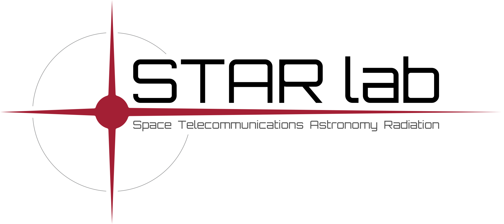
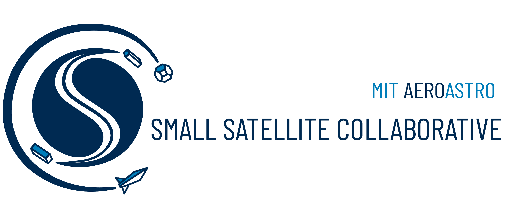
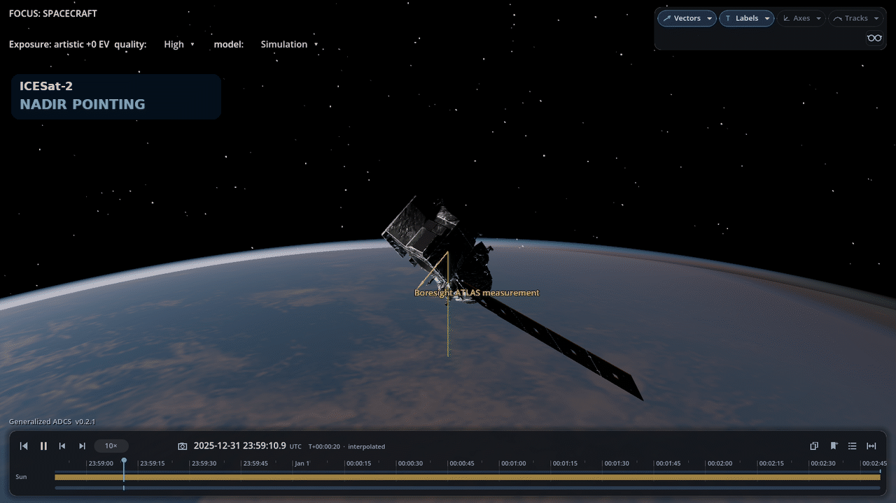

# 🚀 Generalized ADCS

<p>
  <a href="https://aeroastro.mit.edu/starlab/">
    
  </a>
  <a href="https://aeroastro.mit.edu/small-satellite-collaborative/">
    
  </a>
</p>

<strong>Generalized ADCS</strong> is a Python framework for satellite attitude determination
and control (ADCS), designed for **research, prototyping, and flight-software development**.
The framework emphasizes generality, modularity, and transparency for modern spacecraft
control and estimation workflows.

<p align="center">
  <a href="https://nscheuer.github.io/Generalized_ADCS/index.html">🛠 Documentation</a> •
  <a href="https://nscheuer.github.io/Generalized_ADCS/installation/index.html">📘 Installation</a> •
  <a href="https://nscheuer.github.io/Generalized_ADCS/tutorials/index.html">🧪 Tutorials</a> •
  <a href="https://nscheuer.github.io/Generalized_ADCS/contributing/index.html">🤝 Contributing</a>
</p>

<p align="center">
  
</p>


## ✨ Key Features

<details>
  <summary>✅ Python-first, designed for research and experimentation</summary>

  - Built in Python for accessibility, rapid prototyping, and easy customization.
  - Minimal setup, extensive documentation, and hands-on tutorials.
  - Easy to inspect, debug, modify, and extend with custom algorithms.
  - Numba-accelerated numerical kernels for computationally demanding simulations.
  - Monte Carlo support for statistical analysis and robustness testing.
</details>

<details>
  <summary>✅ Generalized 6-DOF spacecraft dynamics</summary>

  - Attitude propagation using SciPy's <code>solve_ivp</code> with RK45 integration.
  - Fully configurable spacecraft inertia, geometry, and external disturbances.
  - Support for underactuated and overactuated spacecraft configurations.
  - Coming soon: Fast, Numba-accelerated RK4 propagation.
</details>

<details>
  <summary>✅ Flexible orbit propagation</summary>

  - Initialize orbits from position vectors, orbital elements, or TLEs.
  - Keplerian, SGP4, and RK4 orbit propagation.
  - Model atmospheric drag, solar radiation pressure, and J2 perturbations.
</details>

<details>
  <summary>✅ Advanced attitude estimation</summary>

  - Plug-and-play EKF, MEKF, UKF, and SRUKF estimation frameworks.
  - Real-time sensor bias and disturbance estimation.
</details>

<details>
  <summary>✅ Flexible attitude control and optimization</summary>

  - PD, LQR, projection-based, and magnetorquer-only feedback controllers.
  - LP and QP control allocation for underactuated systems.
  - ALTRO-based trajectory optimization.
</details>

<details>
  <summary>✅ Realistic sensor and actuator modeling</summary>

  - Configurable noise and bias models.
  - Sensors: Gyroscopes, magnetometers, sun sensors, star trackers, Earth horizon sensors, and GPS.
  - Actuators: Reaction wheels and magnetorquers.
  - Growing catalog of preconfigured CubeSat-scale hardware models.
  - Explore available models in <code>ADCS/satellite_hardware</code>.
</details>

## 📦 Installation

```bash
pip install generalized-adcs
```

Optional extras: `viz` (3-D orbit animation), `dev` (test tooling), `docs`
(documentation build), `cpp` (toolchain for the optional C++ add-ons).

```bash
pip install "generalized-adcs[viz]"
```

Requires Python 3.10 or newer. For deterministic reproduction of published
campaign results, see `requirements-repro.txt` in the repository.

Optional add-ons:
- trajectory_planner (tplaunch/pysat) and SALTRO (saltro_py) are optional C++ extensions.
- Build instructions are in docs/Install_WSL.md and docs/Install_Windows.md.


## Papers

- [A Modular Open-Source ADCS Framework for Small Satellite Development and Testing](https://nscheuer.github.io/Generalized_ADCS/papers/package.html) — presented at SmallSat Europe 2026 in Amsterdam, Netherlands.
- [Generalized Attitude Control for Small Spacecraft](https://nscheuer.github.io/Generalized_ADCS/papers/generalized_acs.html) — presented at the 40th Annual Small Satellite Conference, Poster Session 2, in Salt Lake City, Utah.
- [A Feasibility-Aware Attitude Trajectory Planner for Small Satellites](https://nscheuer.github.io/Generalized_ADCS/papers/planner.html) — presented at the 40th Annual Small Satellite Conference, Flash Talks Session 3, in Salt Lake City, Utah.

## 📚 Academic Background

This project is based on the PhD research of **Patrick McKeen**:

- 🔗 Source Code:  
  https://github.com/patrickmckeen/PhD_Dissertation_Code
- 📄 Dissertation:  
  *Computational Methods to Improve Satellite Attitude Determination and Control
  with a Focus on Autonomy, Generalizability, and Underactuation*  
  https://dspace.mit.edu/handle/1721.1/158874
