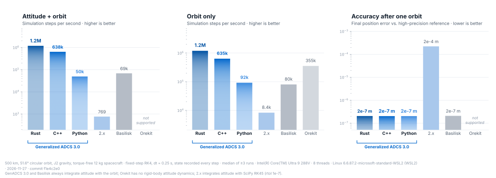
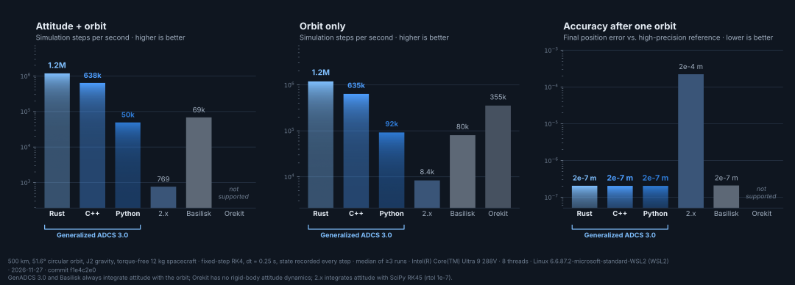
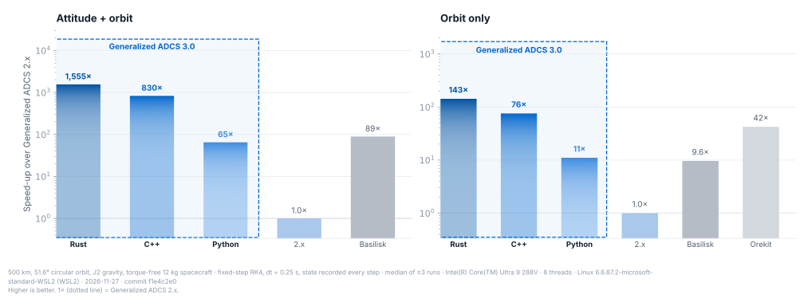
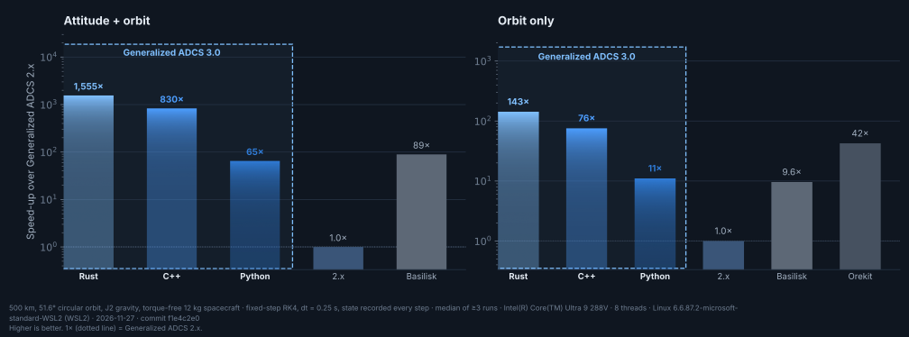
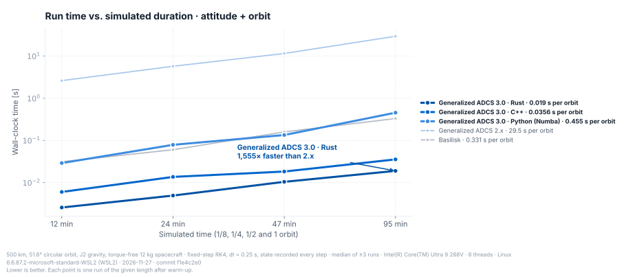
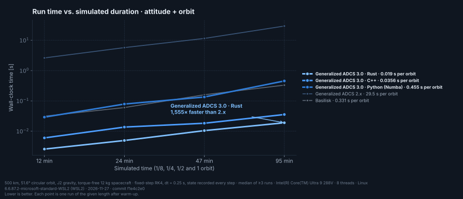

Benchmarks
==========

Speed and accuracy of the GenADCS 3.0 Python (Numba), C++ and Rust backends
against Generalized ADCS 2.x, `Basilisk <https://github.com/AVSLab/basilisk>`__
and `Orekit <https://www.orekit.org/>`__ on one shared scenario: a torque-free
12 kg spacecraft on a 500 km, 51.6° circular orbit with J2 gravity, integrated
with fixed-step RK4 at dt = 0.25 s and the state recorded at every step. Each
chart lists the hardware, date and commit it was measured on.

Speed and accuracy
------------------

Speed-up over 2.x
-----------------

Scaling with simulated duration
-------------------------------

All results
-----------

Headline numbers are for one full orbit (22,708 steps).

.. include:: ../_static/benchmarks/table.inc

Method
------

* **Speed:** wall-clock time of the propagation call, including each tool's
  per-step state recording, after an untimed setup and warm-up. Median of at
  least three runs; fast tools repeat until two seconds of samples are
  collected.
* **Accuracy:** final position and attitude error against a reference that
  integrates the same equations with SciPy's DOP853 at a relative tolerance of
  1e-13.
* **Fairness notes:** GenADCS 3.0 and Basilisk always integrate attitude
  together with the orbit, so their orbit-only runs include attitude. Orekit
  has no rigid-body attitude dynamics, so it runs only the orbit scenario.
  Generalized ADCS 2.x integrates attitude with SciPy's adaptive RK45.

The scripts, per-tool settings and instructions for reproducing these numbers
are in `benchmarks/ <https://github.com/nscheuer/Generalized_ADCS/tree/3_0/playground/benchmarks>`__.
