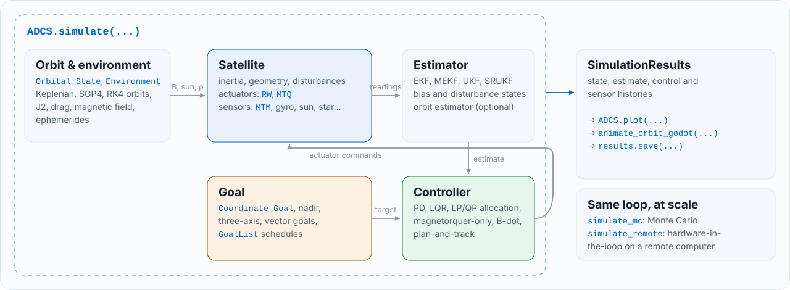
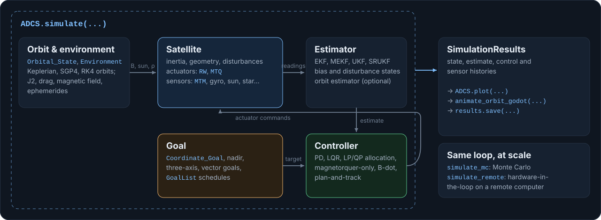

Core Concepts
=============

A Generalized ADCS simulation is built from a few interchangeable pieces. You
describe the spacecraft, where it is, what it should point at, and how it
estimates and controls its attitude; :func:`ADCS.simulate <ADCS.simulate.simulate>`
closes the loop and returns the results. Swapping a controller, an estimator,
a goal or a piece of hardware is a configuration change, not a code
restructuring.

onResults object used for plots, the Godot viewer, and saving. simulate_mc and simulate_remote run the same loop as Monte Carlo campaigns or on remote hardware.

onResults object used for plots, the Godot viewer, and saving. simulate_mc and simulate_remote run the same loop as Monte Carlo campaigns or on remote hardware.

States
------

Spacecraft states use :class:`ADCS.State <ADCS.state.State>`, with named
``w``, ``q``, and ``h`` arrays: body angular velocity, the attitude quaternion,
and any reaction-wheel angular momenta. Estimator inputs and outputs use
:class:`ADCS.EstimatorState <ADCS.state.EstimatorState>`, which adds named bias
and disturbance parameters plus covariance matrices. Use ``from_array`` and
``as_array`` only at numerical-library boundaries; state objects intentionally
do not support NumPy indexing or implicit conversion.

.. code-block:: python

   x_0 = ADCS.State(w=np.deg2rad([0.0, 0.0, 1.0]), q=np.array([1.0, 0.0, 0.0, 0.0]))
   x_0 = ADCS.State.from_array(np.array([0.01, -0.02, 0.01] + [1, 0, 0, 0] + [0.0]))  # w, q, h

The satellite
-------------

:class:`ADCS.Satellite <ADCS.satellite_hardware.satellite.satellite.Satellite>`
is the rigid-body spacecraft model. It bundles the physical properties (mass,
centre of mass ``COM`` and inertia ``J_0``), a list of **actuators**, a list of
**sensors**, a list of **disturbance** models, and one or more named
**boresights**.

Actuators
   Reaction wheels (``ADCS.RW``) and magnetorquers (``ADCS.MTQ``).

Sensors
   Gyroscopes (``ADCS.Gyro``), magnetometers (``ADCS.MTM``), sun sensors
   (``ADCS.SunSensor``), star trackers (``ADCS.StarTracker``,
   ``ADCS.StarTrackerQuaternion``), Earth horizon sensors
   (``ADCS.EarthHorizonSensor``) and GPS (``ADCS.GPS``). Sensors and actuators
   take ``ADCS.Noise`` and ``ADCS.Bias`` models; see
   :doc:`../tutorials/5_1_noise` and :doc:`../tutorials/5_2_bias`.

Disturbances
   Gravity gradient, residual dipole, solar radiation pressure, aerodynamic
   drag (including a Sentman free-molecular model), thrust, propulsion and
   general torques, in :mod:`ADCS.satellite_hardware.disturbances`. Face
   geometry for drag and SRP is described with ``GeometryFace`` and
   ``GeometryConfig`` (see :doc:`../tutorials/2_1_environment_and_geometry`).

You do not have to build hardware from scratch: the
:doc:`../satellite_factory/index` has preconfigured satellites, actuators and
sensors with sources for their parameters.

The orbit and the environment
-----------------------------

:class:`ADCS.Orbital_State <ADCS.orbits.orbital_state.Orbital_State>` holds the
inertial position ``R`` (km) and velocity ``V`` (km/s) at an epoch ``J2000``
in Julian centuries since J2000, together with derived quantities the rest of
the simulation needs: Earth-fixed coordinates, the Sun vector, the geomagnetic
field vector, atmospheric density, and frame transforms.

:class:`ADCS.Environment <ADCS.environment.environment.Environment>` chooses
the models used to evaluate those quantities:

.. list-table::
   :header-rows: 1
   :widths: 25 75

   * - Argument
     - Models
   * - ``magnetic_field``
     - ``IGRF14`` (default), ``WMM2025``, ``CHAOS8``
   * - ``atmosphere``
     - ``SMADAtmosphere``, ``NRLMSISE00`` (``nrlmsise`` extra)
   * - ``ephemeris``
     - ``DE421`` (default), ``DE441``, ``DE442``, ``DE442s``
   * - ``star_catalogue``
     - ``BrightStarCatalog``, ``HipparcosCatalog``

Pass the environment to ``Orbital_State`` or ``simulate()``. The sources for
each model are on the :doc:`../contributing/citations` page.

Goals
-----

A goal maps the current orbital state to a reference that the controller
tracks. Full-attitude goals fix the whole orientation
(``ADCS.goals.Fixed_Attitude_Goal``). Vector goals point one body axis, the
boresight, at something: an inertial direction (``ECI_Goal``), a ground
coordinate (``Coordinate_Goal``), nadir, zenith, the Sun, the velocity
direction, the magnetic field, and their opposites.

:class:`ADCS.GoalList <ADCS.CONOPS.goallist.goallist.GoalList>` switches
between goals over mission time:

.. code-block:: python

   goal_timeline = {0.0: ADCS.goals.Coordinate_Goal(lat=33.75, lon=-84.3885, alt=0),
                    500.0: ADCS.goals.AntiSun_Goal()}
   goallist = ADCS.GoalList(goal_timeline=goal_timeline, time_units="seconds", start_juliantime=0.22)

See :doc:`../tutorials/4_2_types_of_goals`, :doc:`../tutorials/4_3_types_of_goals_ii`
and :doc:`../tutorials/4_4_goal_list`.

Controllers
-----------

A controller computes one command per actuator at each step. All controllers
derive from :class:`ADCS.controller.Controller
<ADCS.controller.controller.Controller>` and receive ``est_sat``, the satellite
model they use for hardware properties. Available controllers include:

.. list-table::
   :header-rows: 1
   :widths: 40 60

   * - Controller
     - Approach
   * - ``BDot``
     - Magnetic detumbling
   * - ``MTQ_Lovera``, ``MTQ_Wisniewski``
     - Magnetorquer-only pointing
   * - ``MTQ_w_RW``
     - Reaction wheels with continuous magnetorquer momentum dumping
   * - ``MTQ_w_RW_LP``, ``MTQ_w_RW_QP``, ``MTQ_w_RW_QPW``, ``MTQ_w_RW_QPG``, ``MTQ_w_RW_QPC``
     - Mixed reaction-wheel and magnetorquer control with LP / QP allocation
   * - ``Plan_and_Track_Exact``, ``Plan_and_Track_LQR``, ``Plan_and_Track_LQR_Disturbed``
     - Trajectory planning and tracking (needs the
       :doc:`trajectory planner add-on <../installation/trajectory_planner_addon>`)
   * - ``SALTRO``
     - SALTRO trajectory optimization (needs the
       :doc:`SALTRO add-on <../installation/saltro_addon>`)

To write your own, subclass ``Controller`` and implement ``find_u`` (see the
"Building a controller" note in :doc:`../tutorials/2_7_reaction_wheel`).

Estimators
----------

Without an estimator, the controller sees the true state. Pass an attitude
``estimator`` to ``simulate()`` to close the loop through simulated sensors.
Attitude estimators are ``ADCS.EKF``, ``ADCS.MEKF``, ``ADCS.UKF`` and
``ADCS.SRUKF``, with ``AugmentedEKF``, ``AugmentedMEKF``, ``AugmentedUKF`` and
``AugmentedSRUKF`` variants that also estimate sensor biases and disturbance
parameters. ``ADCS.WarmStart`` builds an estimator's initial state from its
first readings (see :doc:`../tutorials/6_8_warm_start`). Orbit estimators (``ADCS.Orbit_EKF``, ``ADCS.Orbit_GPS``)
are passed as ``orbit_estimator``. See :doc:`../tutorials/6_0_estimators` and
:doc:`release note 0.2.0 <../release_notes/0_2_0_estimation_framework>`.

Running a simulation
--------------------

:func:`ADCS.simulate <ADCS.simulate.simulate>` advances the true satellite
state with SciPy's ``solve_ivp`` (RK45), propagates the orbit, simulates the
sensors, and runs the estimators, goal and controller you provide:

.. code-block:: python

   results = ADCS.simulate(
       x=x_0,                # initial ADCS.State
       satellite=satellite,  # the true spacecraft
       controller=controller,
       estimator=None,       # optional attitude estimator
       goal=goal,            # a goal or a GoalList
       os0=os0,              # initial ADCS.Orbital_State
       dt=1.0, tf=500.0,     # step and final time [s]
   )

Two variants run the same loop at a larger scale:
``ADCS.simulate_mc`` runs a Monte Carlo ensemble in parallel workers, with
per-run sampling configured through ``ADCS.MCConfig`` (see
:doc:`../tutorials/7_0_monte_carlo`), and ``ADCS.simulate_remote`` runs the
controller or estimator on another computer (see
:doc:`../tutorials/9_3_remote_execution`).

Results
-------

``simulate()`` returns :class:`ADCS.SimulationResults
<ADCS.helpers.simresults.SimulationResults>`, which holds one run (or many,
from ``simulate_mc``). ``results.first()`` gives the first run, with histories
such as ``state_hist``. From there you can:

- plot it: ``ADCS.plot(results, ADCS.plots.TargetPlot(), ...)`` draws any
  combination of panels (attitude, angular rates, control, wheel momentum,
  sensors, orbit, target tracking and more) into one figure;
- animate it in the Godot viewer:
  ``ADCS.helpers.animations.animate_orbit_godot(results=results)``;
- save it and load it later: ``results.save("name")`` and
  ``ADCS.SimulationResults.load(path)``.
