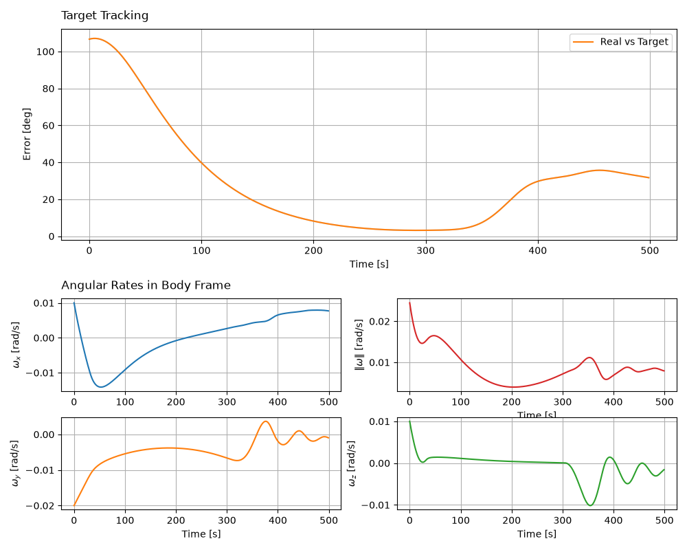

Quickstart
==========

This page takes you from a fresh install to a closed-loop pointing simulation
in a few minutes. It assumes Python 3.10 or newer; see
:doc:`../installation/index` for virtual environments, a source checkout, and
per-OS details.

.. code-block:: bash

   pip install generalized-adcs

1. Run your first simulation
----------------------------

The package ships a small example that propagates a freely rotating spacecraft
for 30 seconds:

.. code-block:: bash

   python -m ADCS.examples.basic_simulation

.. code-block:: text

   Final angular velocity [rad/s]: [0.         0.         0.01745329]
   Final attitude quaternion [scalar, x, y, z]: [0.96814764 0.         0.         0.25038   ]

Progress bars for the orbit propagation and the attitude simulation are
printed while it runs. This is the whole script:

.. literalinclude:: ../../../ADCS/examples/basic_simulation.py
   :language: python
   :caption: ADCS/examples/basic_simulation.py

What each piece does:

``ADCS.Satellite(J_0=...)``
   The rigid-body spacecraft. Here only the inertia matrix is set. A satellite
   can also carry actuators, sensors and disturbance models (see
   :doc:`concepts`).

``ADCS.State(w=..., q=...)``
   The initial physical state: body angular velocity ``w`` in rad/s and the
   attitude quaternion ``q`` in ``[scalar, x, y, z]`` order. The spacecraft
   starts spinning at 1 deg/s about its body *z* axis.

``ADCS.Orbital_State(...)``
   Where the spacecraft is: inertial position ``R`` (km) and velocity ``V``
   (km/s) at an epoch ``J2000`` given in Julian centuries since J2000.

``ADCS.simulate(...)``
   Integrates the attitude dynamics and propagates the orbit with time step
   ``dt`` up to ``tf`` seconds, and returns a ``SimulationResults`` object.
   No controller is given, so the spacecraft keeps spinning freely: the final
   angular velocity is still 0.01745 rad/s (1 deg/s) about *z*.

2. Close the loop
-----------------

Now give the spacecraft hardware, a controller and a goal. This 10 kg
spacecraft has one reaction wheel and three magnetorquers, and points its
boresight at a ground coordinate (Boston) for 500 seconds, using the mixed
reaction-wheel and magnetorquer LP allocation controller.

.. code-block:: python
   :caption: quickstart.py

   import numpy as np
   import matplotlib.pyplot as plt
   import ADCS

   # 1 reaction wheel + 3 magnetorquers, 3 magnetometers
   acts = [ADCS.RW(axis=np.array([1, 0, 0]), max_torque=0.0023, J=5.7e-6, h=0.0, h_max=0.0036)]
   acts += [ADCS.MTQ(axis, max_torque=0.2) for axis in np.eye(3)]
   sens = [ADCS.MTM(axis) for axis in np.eye(3)]

   satellite = ADCS.Satellite(mass=10, J_0=np.diag([0.03, 0.03, 0.01]),
                              actuators=acts, sensors=sens, boresight=np.array([0, 0, 1]))
   x_0 = ADCS.State.from_array(np.array([0.01, -0.02, 0.01] + [1, 0, 0, 0] + [0.0]))  # w, q, h

   controller = ADCS.controller.MTQ_w_RW_LP(est_sat=satellite, p_gain=0.00005, d_gain=0.002,
                                            c_gain=0.001, h_target=np.array([0, 0, 0]))
   goal = ADCS.goals.Coordinate_Goal(lat=42.36, lon=-71.06, alt=0)  # point the boresight at Boston
   os0 = ADCS.Orbital_State(ephem=ADCS.Ephemeris(), J2000=0.22,
                            R=np.array([5000, 0, 5000]), V=np.array([0, 7.5, 0]))

   results = ADCS.simulate(x=x_0, satellite=satellite, controller=controller,
                           goal=goal, os0=os0, dt=1.0, tf=500.0)

   ADCS.plot(results, ADCS.plots.TargetPlot(), ADCS.plots.AngularVelocityPlot(), layout=(2, 1))
   plt.savefig("quickstart.png")

The new pieces:

``ADCS.RW``, ``ADCS.MTQ``, ``ADCS.MTM``
   A reaction wheel, magnetorquers and magnetometers, each along a body axis.
   The wheel's momentum ``h`` becomes part of the state, which is why ``x_0``
   ends with one extra element. Ready-made hardware models are listed in the
   :doc:`../satellite_factory/index`.

``ADCS.controller.MTQ_w_RW_LP``
   The controller computes actuator commands each step. ``est_sat`` is the
   controller's model of the spacecraft; here it is the true satellite.

``ADCS.goals.Coordinate_Goal``
   What to point at. Goals range from a fixed attitude to a single vector,
   nadir, or a ground coordinate, and a ``GoalList`` switches between them over
   time (see :doc:`../tutorials/4_2_types_of_goals`).

``ADCS.plot``
   Draws any combination of plot panels from the results into one matplotlib
   figure.

.. note::

   Spacecraft states use :class:`ADCS.State <ADCS.state.State>`, with named ``w``, ``q``, and
   ``h`` arrays. Estimator inputs and outputs use :class:`ADCS.EstimatorState <ADCS.state.EstimatorState>`,
   which adds named bias and disturbance parameters plus covariance matrices.
   Use ``from_array`` and ``as_array`` only at numerical-library boundaries;
   state objects intentionally do not support NumPy indexing or implicit
   conversion.

3. See it in 3-D
----------------

There are two ways to animate the results.

.. tab-set::

   .. tab-item:: PyVista animation

      ``ADCS.plots.AnimationPlot`` opens an interactive 3-D window. It needs
      the ``viz`` extra:

      .. code-block:: bash

         pip install "generalized-adcs[viz]"

      Replace the ``ADCS.plot(...)`` and ``plt.savefig(...)`` lines above with:

      .. code-block:: python

         ADCS.plot(
            results,
            ADCS.plots.AnimationPlot(goal=goal),
            layout=(1,1),
            title="Underactuated Control Animation",
         )

         plt.show()

      .. image:: ../_static/boston_tracking.png
         :alt: Simulation of a satellite in orbit with a ground pointing target.
         :width: 400px
         :align: center

   .. tab-item:: Godot viewer

      The Godot viewer shows the spacecraft attitude, orbit, pointing targets
      and boresight overlays in an interactive scene:

      .. code-block:: python

         from ADCS.helpers.animations import animate_orbit_godot

         animate_orbit_godot(results=results)

      The first time the viewer opens, it offers to download the Godot engine
      for your operating system (asking in the terminal first) and keeps it in
      a per-user cache. Planet textures and the optional NASA spacecraft models
      are also downloaded only after a terminal prompt. Use the model menu in
      the viewer toolbar to choose the simulation geometry, a box, or an
      available spacecraft model.

Next steps
----------

.. grid:: 1 1 2 2
   :gutter: 3

   .. grid-item-card:: :octicon:`mortar-board;1.2em` Tutorials
      :link: ../tutorials/index
      :link-type: doc

      A guided course from coordinate frames and Euler's equations to Monte
      Carlo campaigns and full missions.

   .. grid-item-card:: :octicon:`file-code;1.2em` Running the examples
      :link: examples
      :link-type: doc

      Get the full ``examples/`` collection and run tutorial scripts,
      controllers, estimators and Monte Carlo examples.

   .. grid-item-card:: :octicon:`stack;1.2em` Core concepts
      :link: concepts
      :link-type: doc

      How satellites, states, orbits, goals, controllers, estimators and
      results fit together.

   .. grid-item-card:: :octicon:`code;1.2em` API reference
      :link: ../ADCS
      :link-type: doc

      Every module, class and function, generated from the docstrings.
