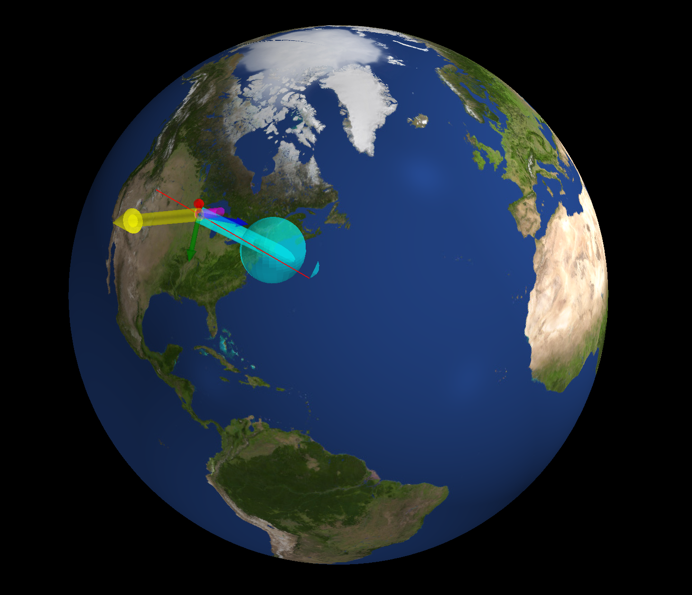

.. Generalized_ADCS documentation master file

Generalized Attitude Determination and Control System
=====================================================

GitHub repository: `nscheuer/Generalized_ADCS <https://github.com/nscheuer/Generalized_ADCS>`_

A Python-first framework for simulating spacecraft attitude dynamics,
estimation, and control in orbit.

**Generalized ADCS** is designed for aerospace students, researchers,
and engineers who want a flexible, transparent ADCS simulation
environment without black-box solvers.

Latest Release Notes
====================

.. raw:: html

   

     <a class="release-card release-card-featured" href="release_notes/0_2_2_visualization_and_environment.html">
       
       

         
Release 0.2.2

         <h3>Visualization and Environment</h3>
         
Godot animations, additional environmental models, and a new disturbance force stack.

         Explore release note 0.2.2
       

     </a>
     <a class="release-card" href="release_notes/0_2_1_attitude_determination_and_speed.html">
       
       

         
Release 0.2.1

         <h3>Attitude Determination and Performance</h3>
         
MEKF warm starts for large attitude errors, a 100x+ faster default geomagnetic field model, and robust estimator and simulation updates.

         Explore release note 0.2.1
       

     </a>
     <a class="release-card" href="release_notes/0_2_0_estimation_framework.html">
       
       

         
Release 0.2.0

         <h3>New Estimation Framework</h3>
         
Named state and covariance classes, a canonical measurement stack, shared process models and noise, a new attitude-estimator base, and eight new attitude estimators.

         Explore release note 0.2.0
       

     </a>
   

What you can do with Generalized ADCS
-------------------------------------
- Simulate rigid-body spacecraft attitude dynamics
- Combine reaction wheels, magnetorquers, and sensors
- Implement and test custom controllers and estimators
- Run closed-loop simulations using orbital states
- Visualize pointing performance and control effort

Spacecraft states use :class:`ADCS.State`, with named ``w``, ``q``, and ``h``
arrays. Estimator inputs and outputs use :class:`ADCS.EstimatorState`, which
adds named bias and disturbance parameters plus covariance matrices. Use
``from_array`` and ``as_array`` only at numerical-library boundaries; state
objects intentionally do not support NumPy indexing or implicit conversion.

.. code-block:: python

   import ADCS as ADCS
   import numpy as np
   import matplotlib.pyplot as plt

   acts = [ADCS.RW(axis=np.array([1, 0, 0]), max_torque=0.0023, J=5.7e-6, h=0.0, h_max=0.0036)]
   acts += [ADCS.MTQ(axis, max_torque=0.2) for axis in np.eye(3)]
   sens = [ADCS.MTM(axis) for axis in np.eye(3)]

   satellite = ADCS.Satellite(mass=10, J_0=np.diag([0.03, 0.03, 0.01]), actuators=acts, sensors=sens, boresight=np.array([0, 0, 1]))
   x_0 = ADCS.State.from_array(np.array([0.01, -0.02, 0.01] + [1, 0, 0, 0] + [0.0]))  # w, q, h

   controller = ADCS.controller.MTQ_w_RW_LP(est_sat=satellite, p_gain=0.00005, d_gain=0.002, c_gain=0.001, h_target=np.array([0, 0, 0]))

   goal = ADCS.goals.Coordinate_Goal(lat=42.36, lon=-71.06, alt=0)
   os0 = ADCS.Orbital_State(ephem=ADCS.Ephemeris(),J2000=0.22, R=np.array([5000, 0, 5000]), V=np.array([0, 7.5, 0]))

   results = ADCS.simulate(
      x=x_0,
      satellite=satellite,
      controller=controller,
      goal=goal,
      os0=os0,
      dt=1.0,
      tf=500.0
   )

   ADCS.plot(
      results,
      ADCS.plots.AnimationPlot(goal=goal),
      layout=(1,1),
      title="Underactuated Control Animation",
   )

   plt.show()
   

.. toctree::
   :maxdepth: 1
   :caption: Getting Started

   installation/index
   tutorials/index
   release_notes/index
   papers/index

.. toctree::
   :maxdepth: 1
   :caption: Function Documentation

   ADCS
   satellite_factory/index

.. toctree::
   :maxdepth: 1
   :caption: Contributing

   contributing/index
   contributing/testing
   contributing/documentation
   contributing/citations
   contributing/about

Indices and tables
==================

* :ref:`genindex`
* :ref:`modindex`
* :ref:`search`
