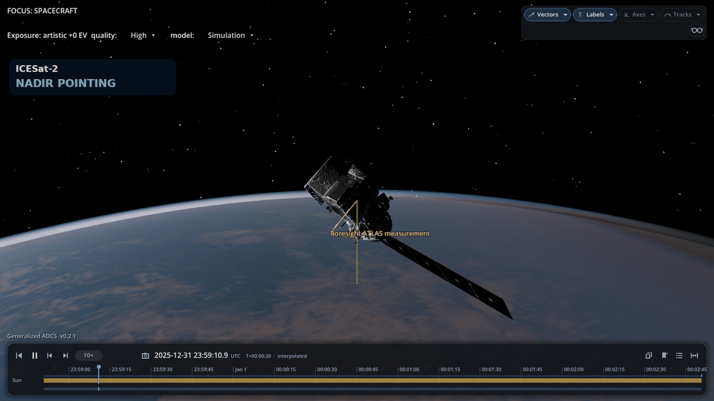

.. Generalized_ADCS documentation master file

Generalized ADCS
================

.. rst-class:: adcs-tagline

A Python-first framework for simulating spacecraft attitude dynamics,
estimation, and control in orbit.

**Generalized ADCS** is designed for aerospace students, researchers,
and engineers who want a flexible, transparent ADCS simulation
environment without black-box solvers. Spacecraft, actuators, sensors,
estimators, controllers and goals are interchangeable pieces that you combine
in a few lines of Python.

.. container:: adcs-buttons

   .. button-ref:: getting_started/quickstart
      :ref-type: doc
      :color: primary
      :class: sd-mr-2

      Get started

   .. button-ref:: tutorials/index
      :ref-type: doc
      :color: primary
      :outline:
      :class: sd-mr-2

      Tutorials

   .. button-link:: https://github.com/nscheuer/Generalized_ADCS
      :color: secondary
      :outline:

      :octicon:`mark-github` GitHub

.. code-block:: bash

   pip install generalized-adcs

Start here
----------

.. grid:: 1 2 2 4
   :gutter: 3

   .. grid-item-card:: :octicon:`download;1.3em` Installation
      :link: installation/index
      :link-type: doc

      pip or a source checkout, on Linux, WSL, Windows and macOS.

   .. grid-item-card:: :octicon:`rocket;1.3em` Quickstart
      :link: getting_started/quickstart
      :link-type: doc

      Run a first simulation, then close the loop with a controller and a goal.

   .. grid-item-card:: :octicon:`mortar-board;1.3em` Tutorials
      :link: tutorials/index
      :link-type: doc

      From coordinate frames to Monte Carlo campaigns and full missions.

   .. grid-item-card:: :octicon:`code;1.3em` API reference
      :link: ADCS
      :link-type: doc

      Every module, class and function, generated from the docstrings.

What you can do with Generalized ADCS
-------------------------------------

.. grid:: 1 2 2 3
   :gutter: 3

   .. grid-item-card:: Simulate attitude dynamics

      Rigid-body 6-DOF attitude propagation with configurable inertia,
      geometry and external disturbances, for underactuated and overactuated
      spacecraft.

   .. grid-item-card:: Combine hardware

      Combine reaction wheels, magnetorquers, and sensors (gyroscopes,
      magnetometers, sun sensors, star trackers, Earth horizon sensors and
      GPS) with configurable noise and bias, or start from the
      :doc:`satellite_factory/index`.

   .. grid-item-card:: Run closed-loop simulations in orbit

      Closed-loop simulations using orbital states initialized from position
      vectors, orbital elements or TLEs, with Keplerian, SGP4 and RK4
      propagation and drag, SRP and J2 perturbations.

   .. grid-item-card:: Implement and test controllers

      PD, LQR, projection-based and magnetorquer-only controllers, LP and QP
      allocation for underactuated systems, ALTRO-based trajectory
      optimization, or your own control law.

   .. grid-item-card:: Implement and test estimators

      Plug-and-play EKF, MEKF, UKF and SRUKF frameworks with sensor bias and
      disturbance estimation, or your own estimator.

   .. grid-item-card:: Visualize and scale up

      Visualize pointing performance and control effort with plots and the
      3-D Godot viewer, and run Monte Carlo campaigns for robustness testing.

See :doc:`getting_started/concepts` for how the pieces fit together.

Latest release notes
--------------------

.. grid:: 1 1 3 3
   :gutter: 3

   .. grid-item-card:: 0.2.2 · Visualization and Environment
      :img-top: _static/release_notes/0_2_2_animation_preview.png
      :img-alt: ICESat-2 maneuvering above Earth at sunset
      :link: release_notes/0_2_2_visualization_and_environment
      :link-type: doc

      Godot animations, additional environmental models, and a new disturbance
      force stack.

   .. grid-item-card:: 0.2.1 · Attitude Determination and Performance
      :img-top: _static/release_notes/0_2_1_filter_tradeoff.png
      :img-alt: EKF, MEKF, UKF, and SRUKF simulation time per step versus attitude error at 100 seconds
      :link: release_notes/0_2_1_attitude_determination_and_speed
      :link-type: doc

      MEKF warm starts for large attitude errors, a 100x+ faster default
      geomagnetic field model, and robust estimator and simulation updates.

   .. grid-item-card:: 0.2.0 · New Estimation Framework
      :img-top: _static/release_notes/0_2_0_advanced_MEKF.png
      :img-alt: Advanced MEKF estimation results
      :link: release_notes/0_2_0_estimation_framework
      :link-type: doc

      Named state and covariance classes, a canonical measurement stack, shared
      process models and noise, a new attitude-estimator base, and eight new
      attitude estimators.

:doc:`All release notes → <release_notes/index>`

Research
--------

Generalized ADCS is based on the PhD research of Patrick McKeen and is
described in papers at SmallSat Europe 2026 and the 40th Annual Small Satellite
Conference. See :doc:`papers/index` for the papers, posters and BibTeX, and
:doc:`contributing/citations` for the sources behind the package's algorithms
and models.

.. grid:: 2
   :gutter: 3

   .. grid-item::

      .. image:: _static/starlab_logo.svg
         :alt: MIT STARLab logo
         :height: 80px
         :class: adcs-logo
         :target: https://aeroastro.mit.edu/starlab/

   .. grid-item::

      .. image:: _static/ssc_logo.png
         :alt: MIT Small Satellite Collaborative logo
         :height: 80px
         :class: adcs-logo
         :target: https://aeroastro.mit.edu/small-satellite-collaborative/

GitHub repository: `nscheuer/Generalized_ADCS <https://github.com/nscheuer/Generalized_ADCS>`_

.. toctree::
   :hidden:
   :maxdepth: 1
   :caption: Getting Started

   installation/index
   getting_started/quickstart
   getting_started/examples
   getting_started/concepts

.. toctree::
   :hidden:
   :maxdepth: 1
   :caption: Learn

   tutorials/index

.. toctree::
   :hidden:
   :maxdepth: 1
   :caption: Reference

   ADCS
   satellite_factory/index
   contributing/citations

.. toctree::
   :hidden:
   :maxdepth: 1
   :caption: Research

   papers/index

.. toctree::
   :hidden:
   :maxdepth: 1
   :caption: Project

   release_notes/index
   contributing/index
   contributing/testing
   contributing/documentation
   contributing/about

Indices and tables
------------------

* :ref:`genindex`
* :ref:`modindex`
* :ref:`search`
