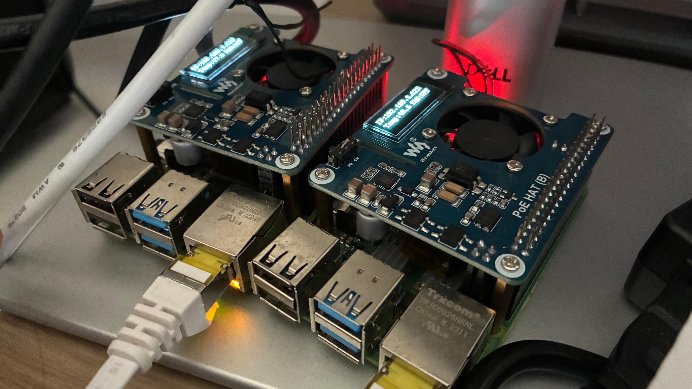
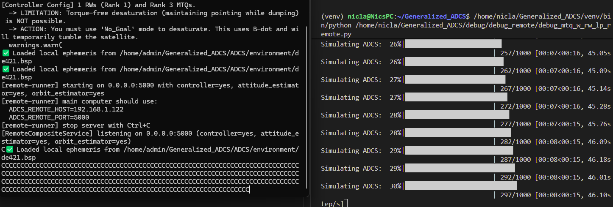

0.1.3 Hardware-in-the-loop Remote Execution (2026-04-18)
=========================================================

Generalized_ADCS now supports a practical hardware-in-the-loop style workflow
for distributed simulation across two machines, such as a main PC and a
Raspberry Pi. The primary use case is running selected ADCS components remotely
while preserving environment and dynamics propagation on the main computer.

New Functionalities
-------------------

- Added remote execution support for controller, attitude estimator, and orbit
  estimator components via configurable local/remote placement.
- Added universal remote server entry point for serving one or more ADCS
  components from a single endpoint.
- Added component placement configuration through
  ``RemoteSimulationConfig`` with host/port, timeout, and retry control.
- Added remote timing summary output in simulation runs to inspect wall-clock,
  communication, and server-side computation performance.
- Added complete setup tutorial with networking instructions and run steps:
  :doc:`Remote Execution tutorial <../tutorials/9_3_remote_execution>`.

Execution View
--------------

The image below shows the intended dual-terminal workflow: one terminal on the
Raspberry Pi running the remote server, and one terminal on the main PC running
``simulate_remote``.

Developer Notes
---------------

This feature enables incremental offloading. You can start with a controller-only
remote setup and later move attitude and orbit estimators remotely as needed,
without changing core environment propagation responsibilities on the main PC.
