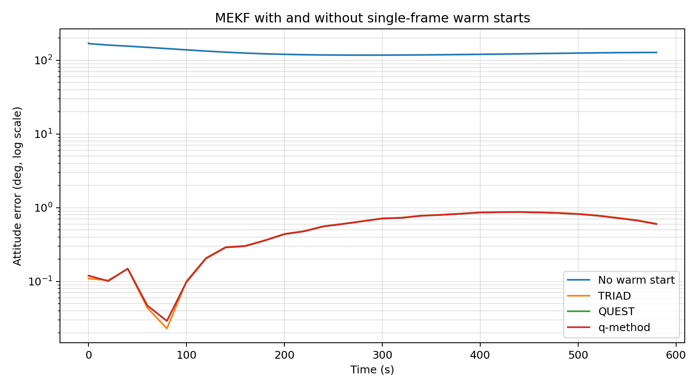
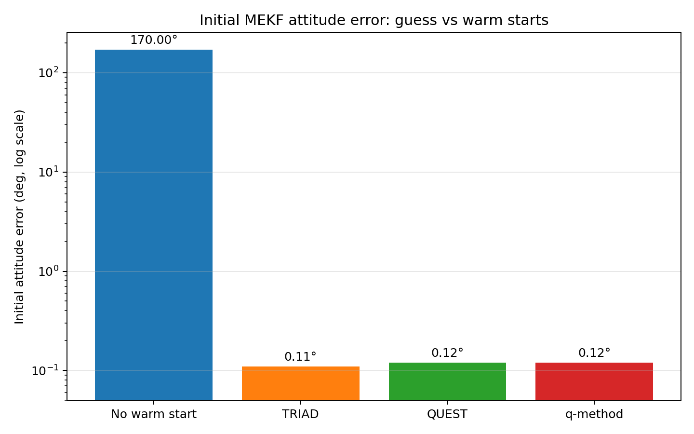
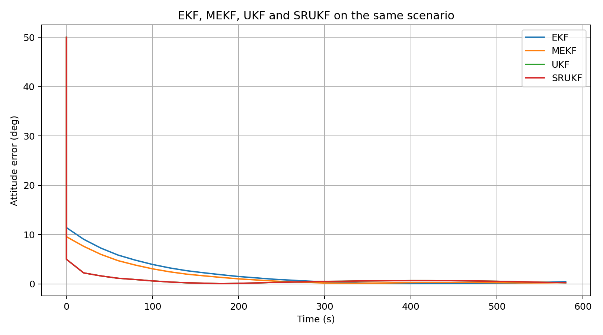
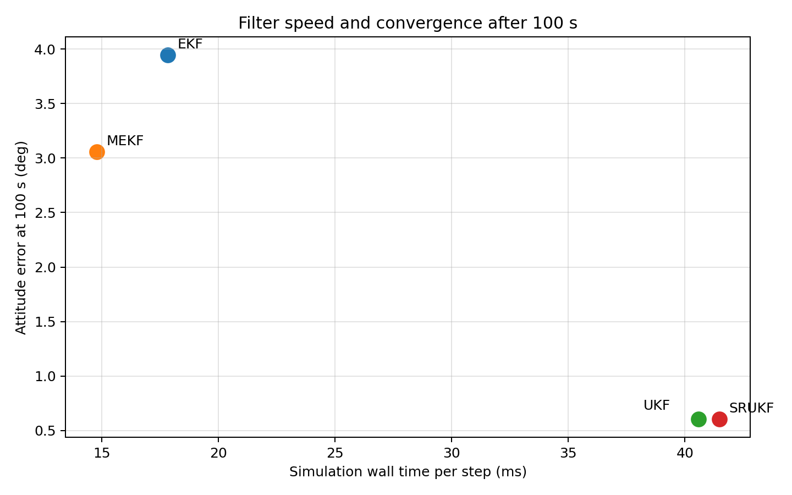
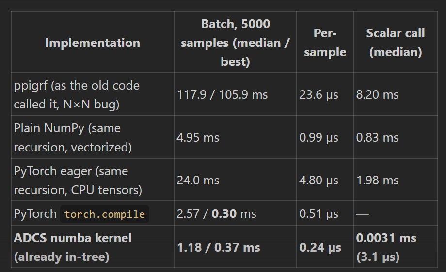

0.2.1 Attitude Determination and Performance
============================================

MEKF warm starts for large attitude errors
-------------------------------------------

TRIAD, QUEST, and Davenport's q-method now determine attitude from direction
observations in a single frame. Estimators can use these solutions to
initialize from their first sensor readings through
:class:`~ADCS.estimators.initialization.WarmStart`. The warm start also
derives angular rate and its initial covariance from the gyros. Select a solver
with ``WarmStart(method="triad")``, ``"quest"``, or ``"q_method"``;
``"auto"`` uses a quaternion star tracker when available and QUEST otherwise.

The MEKF is generally faster than the UKF because it propagates one estimate
and linearizes the dynamics and measurement model, while the UKF evaluates a
set of sigma points. That linearization is local, so a large initial attitude
error can make the MEKF fail to converge. Initializing the attitude from the
first sensor readings can move the estimate into a region where its local
corrections work well, as the example below shows.

The logarithmic scale shows the separation between the MEKF started from a
large attitude error and the three sensor-based warm starts.

The warm starts estimate the initial attitude to within about 0.12 degrees in
this seeded example, compared with the 170 degree supplied guess. The
`MEKF warm-start comparison script <https://github.com/nscheuer/Generalized_ADCS/blob/main/debug/debug_estimators/debug_compare_mekf_warm_starts.py>`_
produces both figures.

Filter speed and convergence
----------------------------

The four filters are also compared on the same seeded orbit and sensor
scenario. The first plot shows attitude error over time; the second compares
whole-simulation wall time per step with attitude error after 100 seconds.
Timing includes the common orbit and plant work and is measured after a warm-up
run to avoid JIT compilation overhead. Actual timing depends on the machine.

The `filter comparison script <https://github.com/nscheuer/Generalized_ADCS/blob/main/debug/debug_estimators/debug_compare_filters.py>`_
generates both plots.

100x+ faster geomagnetic fields and tests
-----------------------------------------

The in-tree ``igrf_numba`` implementation is now the default geomagnetic field
model for orbit and sensor calculations. The legacy ``ppigrf`` backend is an
optional extra; install it with ``pip install generalized-adcs[ppigrf]`` if
you import ``ppigrf`` directly or select ``magnetic_model="igrf_ppigrf"``.
In the simulation's inner loop, ``igrf_numba`` is more than 100 times faster
than the legacy ``ppigrf`` implementation.

The benchmark below compares batch and scalar-call performance across the
legacy ``ppigrf`` code, NumPy and PyTorch implementations, and the in-tree
Numba kernel. The Numba kernel's median scalar call is 3.1 microseconds.

Math operations, estimator calculations, and orbit tests have been optimized.
The orbit test directory is now roughly 100 times faster, and the test suite
has been reorganized by subsystem and behavior.

Public sensor observation protocol
-----------------------------------

Sensors can declare their public observation type through
``observation_kind`` and provide the corresponding inertial reference through
``reference_direction(orbital_state)``. The protocol is used by single-frame
attitude determination and estimator warm starts, and lets custom sensors
participate without hard-coded sensor-class checks.

Simulation and estimator behavior
----------------------------------

The ``simulate()`` history is now aligned with its timestamps:
``state_hist[k]`` is the real state at ``time_s[k]``. This is one integration
step earlier than before, so post-processing code that compares histories with
timestamps will see its values shift.

True disturbances now advance once per plant step, so time-varying disturbance
models evolve during simulation as intended.

The UKF now drops a sensor when some sigma points cannot see it instead of
aborting the update. Sigma-point spread is kept inside the configured
attitude chart. RK4 midpoint dynamics are averaged consistently in both
``update()`` and ``simulate()``. GPS noise is rotated into ECI using the
correct sensor's noise model.

Small improvements, changes, and bug fixes
-------------------------------------------

* `#207 <https://github.com/nscheuer/Generalized_ADCS/pull/207>`__: make UKF
  measurement updates robust to partially unavailable sensors.
* `#208 <https://github.com/nscheuer/Generalized_ADCS/pull/208>`__: keep
  sigma-point spread inside the attitude chart.
* `#209 <https://github.com/nscheuer/Generalized_ADCS/pull/209>`__: rotate GPS
  noise into ECI and use the corresponding sensor's noise.
* `#211 <https://github.com/nscheuer/Generalized_ADCS/pull/211>`__: average the
  RK4 midpoint in ``update()`` and ``simulate()``.
* `#212 <https://github.com/nscheuer/Generalized_ADCS/pull/212>`__: add guard
  rails and a timestep-versus-orbit check. The removal of
  ``ADCS.estimators.old_attitude_estimators`` is a breaking change for code
  importing that module.
* `#218 <https://github.com/nscheuer/Generalized_ADCS/pull/218>`__: expose the
  ``observation_kind`` / ``reference_direction`` sensor protocol.
* `#220 <https://github.com/nscheuer/Generalized_ADCS/pull/220>`__: align
  ``simulate()`` state history with ``time_s``.
