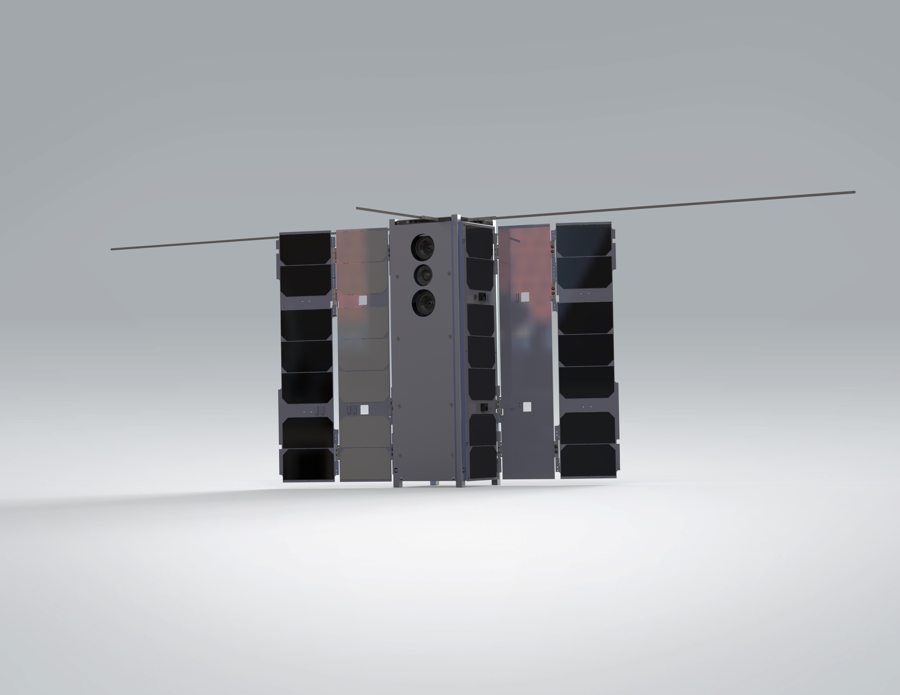
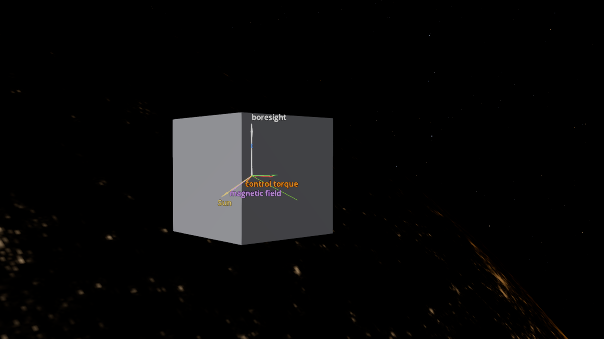
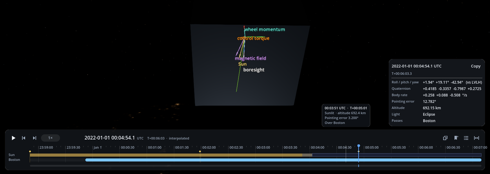
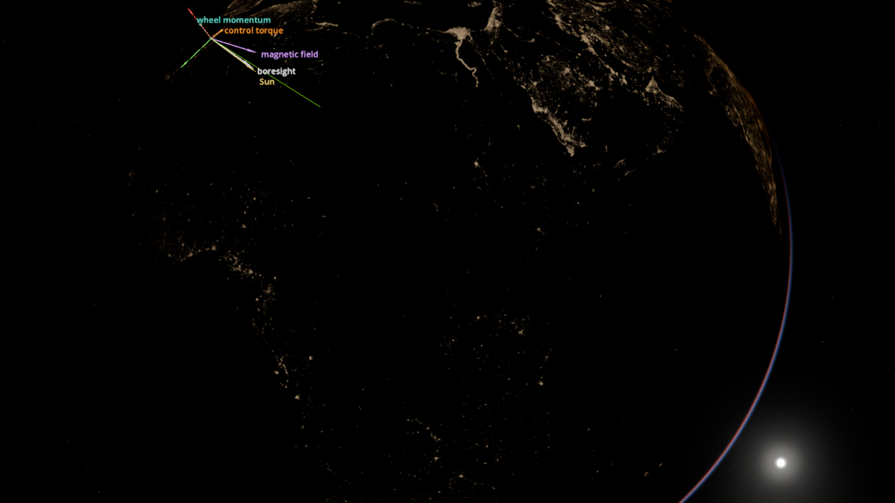
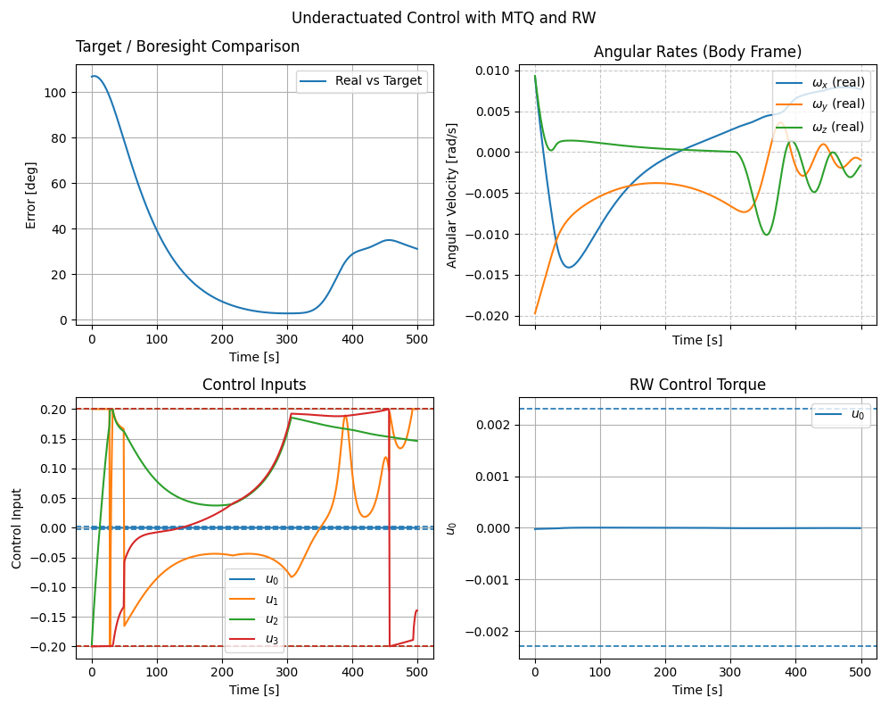

01: Underactuated Control
=========================

We consider the BeaverCube 2 CubeSat being built by the `MIT STAR Lab <https://aeroastro.mit.edu/starlab/>`_.

Notably, BeaverCube 2 has a heterogeneous actuator layout of 3 magnetorquers (MTQs) and 1 reaction wheel (RW). 
We will simulate the CubeSat tracking a ground target using an underactuated control law.

.. list-table:: Simulation Configuration
   :widths: 25 75
   :header-rows: 1

   * - Component
     - Description
   * - **Actuators**
     - Heterogeneous set of 3 Magnetorquers (MTQ) and 1 Reaction Wheel (RW), with parameters matching flight hardware.
   * - **Sensors**
     - Set of 3 Magnetometers (MTM).
   * - **Satellite**
     - Mass of 4 kg, Inertia Matrix :math:`J_0 = diag([0.03, 0.03, 0.01]) kg \cdot m^{2}`.
   * - **Initial State**
     - The starting attitude state vector consisting of angular velocity, quaternion orientation, and RW momentum: :math:`[\boldsymbol{\omega}, \mathbf{q}, \mathbf{h}]`.
   * - **Controller**
     - An underactuated control law with user-specified proportional, derivative, and coupling gains.
   * - **Goal**
     - A specific ground target (Latitude/Longitude) to track.
   * - **Orbital State**
     - The initial position and velocity of the spacecraft in orbit.

Following this definition, we simulate the environment, look at the run in the 3-D viewer, and analyse it
with the built-in plots.

.. code-block:: python

   import ADCS as ADCS
   import numpy as np
   import matplotlib.pyplot as plt
   from ADCS.viz import VizLog, results_to_vizlog
   from ADCS.viz import overlays as ov
   from ADCS.viz import timeline as tl
   from ADCS.viz.binary_manager import ViewerNotFoundError
   from ADCS.viz.launcher import view

   acts: list[ADCS.Actuator] = [ADCS.RW(axis=np.array([1, 0, 0]), max_torque=0.0023, J=5.7e-6, h=0.0, h_max=0.0036)]
   acts += [ADCS.MTQ(axis, max_torque=0.2) for axis in np.eye(3)]
   sens = [ADCS.MTM(axis) for axis in np.eye(3)]

   satellite = ADCS.Satellite(mass=4, J_0=np.diag([0.03, 0.03, 0.01]), actuators=acts, sensors=sens, boresight=np.array([0, 0, 1]))
   x_0 = ADCS.State.from_array(np.array([0.01, -0.02, 0.01] + [1, 0, 0, 0] + [0.0]))  # w, q, h

   controller = ADCS.controller.MTQ_w_RW_LP(est_sat=satellite, p_gain=0.00005, d_gain=0.002, c_gain=0.001, h_target=np.array([0, 0, 0]))

   goal = ADCS.goals.Coordinate_Goal(lat=42.36, lon=-71.06, alt=0)
   os0 = ADCS.Orbital_State(ephem=ADCS.Ephemeris(),J2000=0.22, R=np.array([5000, 0, 5000]), V=np.array([0, 7.5, 0]))

   results = ADCS.simulate(
      x=x_0,
      satellite=satellite,
      controller=controller,
      goal=goal,
      os0=os0,
      dt=1.0,
      tf=500.0
   )

Viewing the run in 3-D
----------------------

The simulation results are written to a *visualization log* (``tutorial_1.vizlog``), which the
:doc:`3-D viewer <../viz/viewer>` opens. Two things are chosen in Python and stored in the log: the
**overlays** drawn on top of the scene, and the **ground sites** whose passes appear on the timeline.

.. code-block:: python

   log_path = "tutorial_1.vizlog"
   boston = tl.GroundSite("Boston", lat_deg=42.36, lon_deg=-71.06, min_elev_deg=10.0)
   overlays = [
      ov.Triad("body"),                                                         # body axes (X red, Y green, Z blue)
      ov.Arrow("@boresight:default", label="boresight", color="#ffffff", scale="fixed_px", px=110),
      ov.TargetLine(),                                                          # toward the ground target
      ov.Arrow("tau_act_body", label="control torque", color="#ff8c1a"),        # log-scaled length
      ov.Arrow("b_field", label="magnetic field", color="#d47cff", scale="fixed_px", px=80),
      ov.Arrow("h_rw_body", label="wheel momentum", color="#33e0c8"),
      ov.Arrow("@sun", label="Sun", color="#ffe066", scale="fixed_px", px=100),
      ov.OrbitTrack(past_s=500, future_s=500),
      ov.GroundTrack(past_s=500, future_s=500),
   ]
   results_to_vizlog(results, log_path, overwrite=True, overlays=overlays, sites=[boston])

The log is also a data set. Here we find the moments worth looking at, the first time the pointing error
drops below 10° and the highest point of the pass over Boston, and add them as **bookmarks**:

.. code-block:: python

   log = VizLog.open(log_path)
   t = log.read("0", "t_s")[:, 0]
   err_deg = np.degrees(log.read("0", "pointing_err")[:, 0])
   bookmarks = [tl.Bookmark(t_s=float(t[0]), label="start: tumbling")]
   on_target = np.nonzero(err_deg < 10.0)[0]
   if len(on_target):
      bookmarks.append(tl.Bookmark(t_s=float(t[on_target[0]]), label="pointing error < 10 deg"))
   for p in tl.ground_passes(log, boston):
      print(f"Boston pass: {p.t_rise:6.1f} s to {p.t_set:6.1f} s, highest {p.max_elev_deg:.1f} deg at {p.t_max:.1f} s"
            + ("  (cut off by the start or end of the run)" if p.partial else ""))
      bookmarks.append(tl.Bookmark(t_s=p.t_max, label="highest over Boston"))
   results_to_vizlog(results, log_path, overwrite=True, overlays=overlays, sites=[boston], bookmarks=bookmarks)

   try:
      view(log_path)                       # opens the viewer; returns when its window is closed
   except ViewerNotFoundError as e:
      print(f"3-D viewer not available ({e}).\nOpen the log later with:  python -m ADCS.viz view {log_path}")

.. code-block:: text

   Boston pass:   61.1 s to  499.0 s, highest 77.7 deg at 363.3 s  (cut off by the start or end of the run)

.. note::

   The viewer needs a Godot 4.7 binary (``export ADCS_VIEWER_BIN=/path/to/Godot_v4.7.2-stable_win64.exe``)
   and, once, the Earth, Moon and star imagery: ``python -m ADCS.viz.assets build``. Without them the
   script still runs and prints how to open the log later. See :doc:`../viz/viewer`.

         magnetic field and Sun direction drawn as labelled arrows, over the night-side Earth.
   :width: 100%

**The spacecraft and its vectors.** Without an imported model the viewer draws the spacecraft as a box.
The arrows start at its centre of mass and keep the same size on screen at any zoom:

* the **boresight** (white) should end up on the **target line** (green) toward Boston;
* the **control torque** (orange, logarithmic length) is what the magnetorquers and the wheel apply;
* the **magnetic field** (purple, direction only): a magnetorquer's torque :math:`\mathbf{m} \times \mathbf{B}`
  is always perpendicular to it. That is what *underactuated* means here: at any instant there is one axis
  the magnetorquers cannot push about, and the single wheel only adds torque about body X;
* the **wheel momentum** (teal) grows and shrinks as the wheel absorbs torque;
* the **Sun** direction (yellow), and the body axes (X red, Y green, Z blue).

Drag to orbit the camera, scroll to zoom out from the spacecraft to the whole Earth (the orbit and
ground tracks follow), and press 1 / 2 / 3 to orbit in the LVLH, inertial or body frame.

         state card showing roll, pitch and yaw at the highest point of the pass.
   :width: 100%

**The timeline.** The lanes show when the spacecraft is sunlit or in eclipse, and when Boston can see it
(the Boston pass begins about a minute into the run and is still under way when the run ends). The
diamonds are the bookmarks added above.

* Press Shift+→ to jump from bookmark to bookmark (and to eclipse and pass edges); ← / → step one
  sample at a time.
* Drag on the track to scrub, scroll on it to zoom in, and hover to read the time, altitude, light and
  pointing error at any point.
* While paused, the card on the right gives the attitude at that moment: roll, pitch and yaw relative to
  LVLH, the quaternion, body rates and pointing error. Compare it at ``start: tumbling`` and at
  ``highest over Boston``.
* Press B to bookmark a moment of your own; it is saved with this run and comes back next time.

**The wider view.** Press 4 for an Earth-centred camera. At the time of the pass (about 00:05 UTC on
1 January 2022) it is night over Boston: the city lights of the Americas, the lit atmosphere at the limb
with the Sun beyond it, and the spacecraft's vectors at the top of the view.

Analysing the run
-----------------

The 2-D plots give the same story as numbers:

.. code-block:: python

   ADCS.plot(
      results,
      ADCS.plots.TargetPlot(),
      ADCS.plots.AngularVelocityPlotCombined(sources=["real"]),
      ADCS.plots.ControlPlotCombined(),
      ADCS.plots.ControlPlotSingle(index=0, title="RW Control Torque"),
      layout=(2,2),
      title="Underactuated Control with MTQ and RW",
   )
   plt.show()

The results show that the satellite is able to perform a slew despite the underactuated configuration. For
most control laws and estimators, we try to make them satellite-agnostic, meaning they should work for most
configurations.

The full script is ``examples/tutorials/tutorial_1_underactuated_control.py``.
