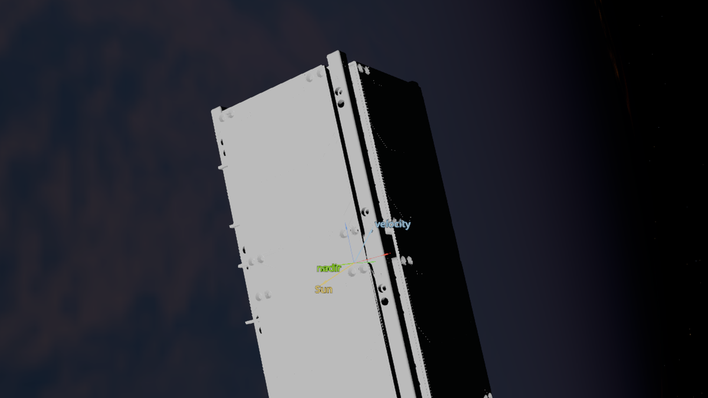
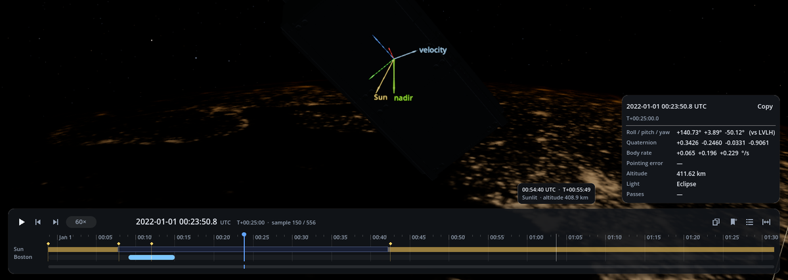

09: Your Own Spacecraft Model
=============================

The 3-D viewer can draw your team's spacecraft from its CAD model. In this tutorial we fly a 2U CubeSat for
one orbit and show it with the chassis of SPACE RACCOON, exported from CAD as an STL file
(``examples/tutorials/Custom_STLs/SPACE_RACCOON_Dummy_Chassis.stl``).

         Sun, nadir and velocity directions.
   :width: 100%

.. list-table:: Simulation Configuration
   :widths: 25 75
   :header-rows: 1

   * - Component
     - Description
   * - **Satellite**
     - 2U CubeSat (10 × 10 × 22.7 cm), 2.6 kg, inertia of a uniform box of that size; three magnetometers.
   * - **Model**
     - The chassis STL: 801 104 triangles, drawn in inches, not a closed solid.
   * - **Orbit**
     - Circular, 420 km, 51.6° inclination (like the ISS), for one orbit (93 min).
   * - **Attitude**
     - A slow tumble and no controller: the attitude evolves freely.

The full script is ``examples/tutorials/tutorial_9_custom_spacecraft_model.py``
(``pip install "generalized-adcs[viz-mesh]"`` for the model import).

Step 1: the spacecraft
----------------------

.. code-block:: python

   import numpy as np
   import ADCS as ADCS
   from pathlib import Path
   from ADCS.viz import VizLog, results_to_vizlog
   from ADCS.viz import overlays as ov
   from ADCS.viz import timeline as tl
   from ADCS.viz.binary_manager import ViewerNotFoundError
   from ADCS.viz.launcher import view
   from ADCS.viz.mesh_import import import_spacecraft

   STL = Path("examples/tutorials/Custom_STLs/SPACE_RACCOON_Dummy_Chassis.stl")
   OUT = Path("tutorial_9_output")
   OUT.mkdir(exist_ok=True)

   mass = 2.6
   a, b, c = 0.10, 0.10, 0.227
   J = mass / 12.0 * np.diag([b**2 + c**2, a**2 + c**2, a**2 + b**2])
   satellite = ADCS.Satellite(mass=mass, J_0=J, sensors=[ADCS.MTM(axis) for axis in np.eye(3)])

Step 2: import the model
------------------------

A model has to be put into the simulation's **body frame, in metres**, the frame in which the inertia,
actuator axes and boresights are written. The importer does that from a small description:

.. code-block:: python

   model_config = {
      "name": "space_raccoon",
      "mesh": str(STL),
      "units": "in",
      "cad_to_body": {"rotation": "identity", "translation_m": [0.0149, -0.0045, -0.0662]},
      "lods": [0.5, 0.15, 0.04],
   }
   model = import_spacecraft(model_config, OUT / "model", satellite=satellite)
   if not model.ok:
      raise SystemExit(f"model import failed: {model.errors}")
   for w in model.warnings:
      print("model:", w)

* ``units``: **STL files carry no units.** The chassis measures 4.34 × 4.31 × 8.94 in its file; 8.94 in is
  22.7 cm, the height of a 2U CubeSat, so the units are inches. Choose the wrong unit and the importer warns
  that the model's size does not match the satellite's inertia, and suggests the likely one.
* ``cad_to_body``: the CAD origin is off the centre of the part (6.6 cm along its length). The translation (in metres)
  moves the centre of the chassis onto the body origin, the centre of mass. CAD axes that differ from the body
  axes take a ``rotation`` (a 3 × 3 matrix). Here the long axis is already body Z.
* ``lods``: the levels of detail the viewer switches between with on-screen size, as fractions of the
  triangles. Here they come out at 400 k, 120 k and 89 k: the simplifier stops at about 89 k on this open
  mesh, which is still light enough for a spacecraft that is a few pixels on screen.

The import takes about 20 s and reports two warnings, both expected:

.. code-block:: text

   model: node 'SPACE_RACCOON_Dummy_Chassis.stl' is not a closed volume (holes or inconsistent normals);
          it is drawn but left out of the mass-property check
   model: model has 801104 triangles (budget 500000); the viewer will use reduced levels of detail by default

A CAD chassis is a shell rather than a solid, so its mass properties cannot be compared with the satellite's.
With a closed model the importer also checks the centre of mass and inertia, and with a glTF (``.glb``) model
with named parts, reaction-wheel and sensor alignment, spinning wheels and deploying panels (see
:doc:`../viz/spacecraft_models`).

Step 3: one orbit
-----------------

.. code-block:: python

   mu = 398600.4418                       # km^3/s^2
   r = 6378.137 + 420.0                   # km
   v = np.sqrt(mu / r)
   inc = np.radians(51.6)
   os0 = ADCS.Orbital_State(ephem=ADCS.Ephemeris(), J2000=0.22,
                            R=np.array([r, 0.0, 0.0]), V=np.array([0.0, v * np.cos(inc), v * np.sin(inc)]))
   x_0 = ADCS.State.from_array(np.array([0.002, -0.003, 0.004] + [1, 0, 0, 0]))  # w [rad/s], q
   period = 2 * np.pi * np.sqrt(r**3 / mu)

   results = ADCS.simulate(x=x_0, satellite=satellite, os0=os0, dt=10.0, tf=round(period))

The orbit starts circular, but the simulation includes the Earth's oblateness, so the altitude varies by a few
kilometres around the orbit.

Step 4: the visualization log
-----------------------------

The log carries the model (``model=``), the overlays and a ground station. Then we read it back to find the
moments worth bookmarking: entering and leaving the Earth's shadow, and the closest approach to Boston.

.. code-block:: python

   log_path = OUT / "space_raccoon.vizlog"
   boston = tl.GroundSite("Boston", lat_deg=42.36, lon_deg=-71.06, min_elev_deg=10.0)
   overlays = [
      ov.Triad("body"),
      ov.Arrow("@sun", label="Sun", color="#ffe066", scale="fixed_px", px=100),
      ov.Arrow("@nadir", label="nadir", color="#7cfc00", scale="fixed_px", px=80),
      ov.Arrow("@velocity", label="velocity", color="#9fd3ff", scale="fixed_px", px=80),
      ov.OrbitTrack(past_s=period, future_s=period),
      ov.GroundTrack(past_s=period, future_s=period),
   ]
   results_to_vizlog(results, log_path, model=model.sidecar, overlays=overlays, sites=[boston], overwrite=True)

   log = VizLog.open(log_path)
   t = log.read("0", "t_s")[:, 0]
   lit = log.read("0", "shadow_factor")[:, 0] > 0.5
   bookmarks = [tl.Bookmark(t_s=float(t[0]), label="start")]
   for k in np.flatnonzero(lit[1:] != lit[:-1]) + 1:
      bookmarks.append(tl.Bookmark(t_s=float(t[k]), label="enters eclipse" if lit[k - 1] else "back in sunlight"))
   passes = tl.ground_passes(log, boston)
   for p in passes:
      bookmarks.append(tl.Bookmark(t_s=p.t_max, label=f"over Boston ({p.max_elev_deg:.0f} deg)"))
   results_to_vizlog(results, log_path, model=model.sidecar, overlays=overlays, sites=[boston],
                     bookmarks=bookmarks, overwrite=True)

   try:
      view(log_path)
   except ViewerNotFoundError as e:
      print(f"3-D viewer not available ({e}).\nOpen the log later with:  python -m ADCS.viz view {log_path}")

.. code-block:: text

   One orbit: 93.0 min, 37% of it in eclipse, 1 pass(es) over Boston

.. note::

   ``simulate(..., viz_log=...)`` writes a log without a model, so with a model write the log with
   ``results_to_vizlog(..., model=...)`` as above.

Exploring the orbit
-------------------

.. list-table::
   :widths: 50 50
   :header-rows: 0
   :class: borderless

   * - .. image:: ../_static/tutorials/tutorial_09_model_close2.png
          :width: 100%
     - .. image:: ../_static/tutorials/tutorial_09_orbit.png
          :width: 100%

* Scroll to zoom from the chassis (left) out to the whole orbit (right). The orbit track (white) and the
  ground track follow the spacecraft. The viewer switches to the lighter levels of detail as the model gets
  small on screen.
* The arrows show the Sun, nadir and velocity directions, and the body axes (X red, Y green, Z blue) turn with
  the tumble. Press 1 / 2 / 3 to orbit the camera in the LVLH, inertial or body frame; the chips at the top
  right (or V, A, G) hide the vectors, axes and tracks.

* The timeline's Sun lane shows the eclipse, from 9 to 44 minutes into the orbit. The Boston lane shows the
  pass, and the diamonds are the bookmarks. Shift+→ jumps from one to the next.
* While paused, the card gives the attitude relative to LVLH, the body rates and the altitude.

Making a video
--------------

Run the script with ``--video`` to also render ``tutorial_9_output/space_raccoon.mp4``: 12 seconds for the
whole orbit, starting close to the chassis, pulling back to show the orbit, then cutting to a view of the
Earth (see :doc:`../viz/viewer`, *Video*):

.. code-block:: python

   from ADCS.viz.render import CameraKey, RenderJob, render_video

   job = RenderJob(duration_s=12, fps=30, width=1920, height=1080, supersample=2, keys=[
      CameraKey(at=0, mode="orbit", frame="lvlh", dist_m=0.6, yaw_deg=-140, pitch_deg=18),
      CameraKey(at=7, mode="orbit", frame="lvlh", dist_m=3.0e6, yaw_deg=-70, pitch_deg=35),
      CameraKey(at=7.5, mode="earth", dist_m=2.2e7, yaw_deg=20, pitch_deg=25),
      CameraKey(at=12, mode="earth", dist_m=1.8e7, yaw_deg=80, pitch_deg=20),
   ])
   render_video(log_path, job, OUT / "space_raccoon.mp4")

Using your own model
--------------------

1. Export the spacecraft from CAD as STL, or, better, as glTF (``.glb``) with named parts, without mesh
   compression.
2. Put it in the body frame: set ``units`` (STL), and a ``cad_to_body`` rotation and translation so the body
   origin is the centre of mass and the axes match the ones your satellite is defined in.
3. Import it against your ``Satellite`` and read the warnings: units, centre of mass, inertia and panel areas
   are checked when the model allows.
4. Pass ``model=model.sidecar`` to ``results_to_vizlog``, or ``--model`` to ``python -m ADCS.viz convert``.
