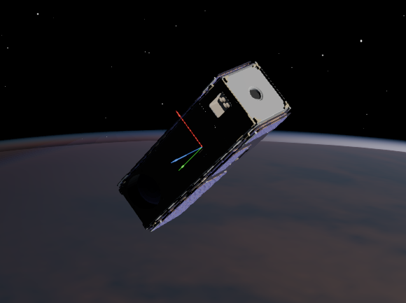
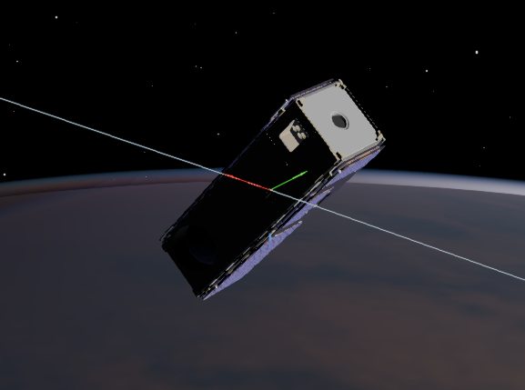

Spacecraft Coordinate Frames
============================

We use three coordinate frames to describe spacecraft motion:

* :math:`\mathcal{I}` — inertial frame, fixed with the stars.
* :math:`\mathcal{B}` — spacecraft body frame.
* :math:`\mathcal{O}` — orbital frame.

Other frames, such as an Earth frame for Earth pointing, are introduced later.

:math:`\mathcal{I}` is fixed relative to the distant stars.

:math:`\mathcal{B}` is fixed relative to the satellite body.

:math:`\mathcal{O}` has :math:`x` along-track, :math:`z` nadir, and :math:`y`
completing the right-handed frame.

Notation
--------

Several notation conventions are used across the literature. Here, a vector
superscript denotes the frame in which its components are expressed, and
:math:`\mathbf{R}_{\mathcal{B}\leftarrow\mathcal{I}}` maps components from
:math:`\mathcal{I}` to :math:`\mathcal{B}`. We often abbreviate this matrix as
:math:`\mathbf{R}_{\mathcal{B}\mathcal{I}}`.

Thus, the same vector expressed in the two frames is related by

.. math::

   \mathbf{v}^{\mathcal{B}}
   = \mathbf{R}_{\mathcal{B}\leftarrow\mathcal{I}}\,
     \mathbf{v}^{\mathcal{I}}.
