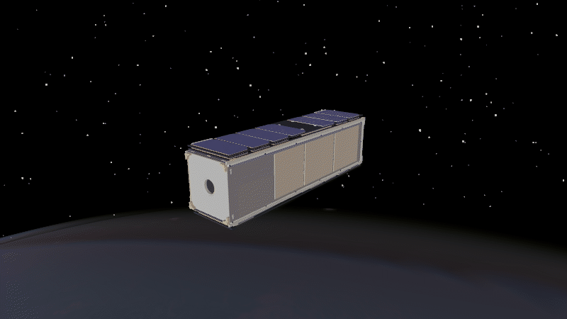

Euler Equations
===============

For a rigid spacecraft without reaction wheels, Euler's rotational equation is

.. math::

   \mathbf{J}^{\mathcal{B}}\dot{\boldsymbol{\omega}}^{\mathcal{B}}
   + \boldsymbol{\omega}^{\mathcal{B}} \times
     (\mathbf{J}^{\mathcal{B}}\boldsymbol{\omega}^{\mathcal{B}})
   = \boldsymbol{\tau}^{\mathcal{B}}.

All vectors are expressed in the spacecraft body frame :math:`\mathcal{B}`.
:math:`\mathbf{J}^{\mathcal{B}}` is the inertia matrix,
:math:`\boldsymbol{\omega}^{\mathcal{B}}` is the angular velocity, and
:math:`\boldsymbol{\tau}^{\mathcal{B}}` is the total applied torque. The
implementation, including the reaction-wheel case and quaternion kinematics,
is documented in
:meth:`ADCS.satellite_hardware.satellite.satellite.Satellite.dynamics_core`.

The example approximates a uniform 4 kg, 10 × 10 × 30 cm 3U spacecraft, with
principal inertias of :math:`0.0333`, :math:`0.0333`, and :math:`0.00667`
kg·m². It starts with a five-degree-per-second spin about a largest principal
axis. Both runnable scripts use this same setup.

.. code-block:: python
   :caption: euler_equations.py

   import numpy as np
   import ADCS

   satellite = ADCS.Satellite(
       mass=4.0,
       J_0=np.diag([0.0333, 0.0333, 0.00667]),
   )
   initial_state = ADCS.State(
       w=np.deg2rad([5.0, 0.0, 0.0]),
       q=np.array([1.0, 0.0, 0.0, 0.0]),
   )
   orbit = ADCS.Orbital_State(
       ephem=ADCS.Ephemeris(),
       J2000=0.22,
       R=np.array([7000.0, 0.0, 0.0]),
       V=np.array([0.0, 7.5, 0.0]),
   )
   results = ADCS.simulate(
       x=initial_state, satellite=satellite, os0=orbit,
       dt=1.0, tf=30.0,
   )

Choose a visualization:

.. raw:: html

   

     <section class="installation-card">
       <h3>Attitude plot</h3>
       <pre><code>import matplotlib.pyplot as plt

   ADCS.plot(results, ADCS.plots.AttitudePlot(), layout=(1, 1))
   plt.show()</code></pre>
     </section>
     <section class="installation-card">
       <h3>Godot animation</h3>
       <pre><code>from ADCS.helpers.animations import animate_orbit_godot

   animate_orbit_godot(
       results=results,
       model="mirata",
       overlays=[],
       graphics_quality="high",
   )</code></pre>
     </section>
   

Initial quaternion
------------------

Changing :math:`q` changes the starting orientation.

.. raw:: html

   

     <section class="installation-card">
       <pre><code>q=np.array([1.0, 0.0, 0.0, 0.0])</code></pre>
       
     </section>
     <section class="installation-card">
       <pre><code>q=np.array([2**-0.5, 0.0, 2**-0.5, 0.0])</code></pre>
       
     </section>
   

Principal-axis spin
-------------------

For this inertia matrix, :math:`x` and :math:`y` share the largest principal
moment; :math:`z` is the smallest. The quaternion is unchanged in these runs.

.. raw:: html

   

     <section class="installation-card">
       <pre><code>w=np.deg2rad([5.0, 0.0, 0.0])</code></pre>
       
     </section>
     <section class="installation-card">
       <pre><code>w=np.deg2rad([0.0, 0.0, 5.0])</code></pre>
       
     </section>
   

.. admonition:: Tips and tricks
   :class: tutorial-tip

   The first simulation run gives access to the saved attitude states:

   .. code-block:: python

      run = results.first()
      attitude = run.state_hist[0].q
