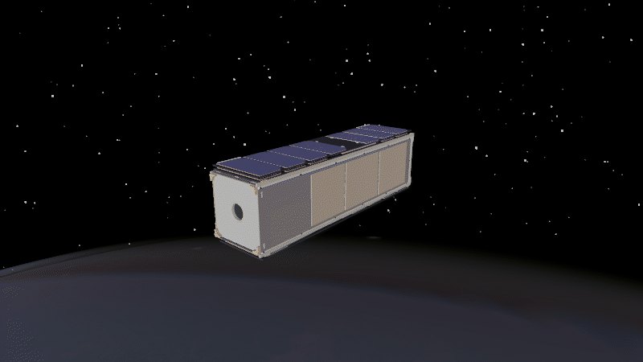

Euler Equations
===============

For a rigid spacecraft without reaction wheels, Euler's rotational equation is

.. math::

   \mathbf{J}^{\mathcal{B}}\dot{\boldsymbol{\omega}}^{\mathcal{B}}
   + \boldsymbol{\omega}^{\mathcal{B}} \times
     (\mathbf{J}^{\mathcal{B}}\boldsymbol{\omega}^{\mathcal{B}})
   = \boldsymbol{\tau}^{\mathcal{B}}.

All vectors are expressed in the spacecraft body frame :math:`\mathcal{B}`.
:math:`\mathbf{J}^{\mathcal{B}}` is the inertia matrix,
:math:`\boldsymbol{\omega}^{\mathcal{B}}` is the angular velocity, and
:math:`\boldsymbol{\tau}^{\mathcal{B}}` is the total applied torque. The
implementation, including the reaction-wheel case and quaternion kinematics,
is documented in
:meth:`ADCS.satellite_hardware.satellite.satellite.Satellite.dynamics_core`.

The example approximates a uniform 4 kg, 10 × 10 × 30 cm 3U spacecraft, with
principal inertias of :math:`0.0333`, :math:`0.0333`, and :math:`0.00667`
kg·m². It starts with a five-degree-per-second spin about a largest principal
axis. Both runnable scripts use this same setup.

.. admonition:: Run it
   :class: run-it

   From the root of a clone of the repository. The ``examples/`` folder
   is not part of the pip package; see :doc:`../getting_started/examples`.

   .. code-block:: bash

      python examples/tutorials/spacecraft_dynamics/euler_equations.py

      # the same simulation in the 3-D Godot viewer
      python examples/tutorials/spacecraft_dynamics/euler_equations_godot.py

   Scripts ending in ``_godot.py`` open the 3-D Godot viewer.

.. literalinclude:: ../../../examples/tutorials/spacecraft_dynamics/euler_equations.py
   :language: python
   :caption: examples/tutorials/spacecraft_dynamics/euler_equations.py
   :start-at: import numpy as np
   :end-before: ADCS.plot(

Choose a visualization:

.. grid:: 1 1 2 2
   :gutter: 3

   .. grid-item-card:: Attitude plot

      .. code-block:: python

         import matplotlib.pyplot as plt

         ADCS.plot(results, ADCS.plots.AttitudePlot(), layout=(1, 1))
         plt.show()

   .. grid-item-card:: Godot animation

      .. code-block:: python

         from ADCS.helpers.animations import animate_orbit_godot

         animate_orbit_godot(
             results=results,
             overlays=[],
             graphics_quality="high",
         )

Initial quaternion
------------------

Changing :math:`q` changes the starting orientation.

.. grid:: 1 1 2 2
   :gutter: 3

   .. grid-item-card::

      .. code-block:: python

         q=np.array([1.0, 0.0, 0.0, 0.0])

      .. image:: ../_static/tutorials/spacecraft_dynamics/euler_equations/initial_identity.png
         :alt: MiRaTa with the identity initial quaternion
         :width: 100%

   .. grid-item-card::

      .. code-block:: python

         q=np.array([2**-0.5, 0.0, 2**-0.5, 0.0])

      .. image:: ../_static/tutorials/spacecraft_dynamics/euler_equations/initial_rotated.png
         :alt: MiRaTa rotated 90 degrees about its body y axis
         :width: 100%

Principal-axis spin
-------------------

For this inertia matrix, :math:`x` and :math:`y` share the largest principal
moment; :math:`z` is the smallest. The quaternion is unchanged in these runs.

.. grid:: 1 1 2 2
   :gutter: 3

   .. grid-item-card::

      .. code-block:: python

         w=np.deg2rad([5.0, 0.0, 0.0])

      .. image:: ../_static/tutorials/spacecraft_dynamics/euler_equations/largest_principal_axis.gif
         :alt: MiRaTa spinning about its largest principal axis
         :width: 100%

   .. grid-item-card::

      .. code-block:: python

         w=np.deg2rad([0.0, 0.0, 5.0])

      .. image:: ../_static/tutorials/spacecraft_dynamics/euler_equations/smallest_principal_axis.gif
         :alt: MiRaTa spinning about its smallest principal axis
         :width: 100%

.. admonition:: Tips and tricks
   :class: tutorial-tip

   The first simulation run gives access to the saved attitude states:

   .. code-block:: python

      run = results.first()
      attitude = run.state_hist[0].q

