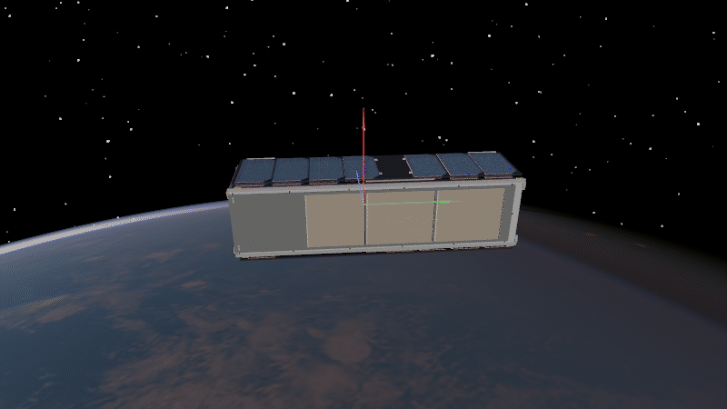

Dzhanibekov Effect
==================

The red, green, and blue arrows show the spacecraft body :math:`x`, :math:`y`,
and :math:`z` axes. The Dzhanibekov effect is the instability of torque-free
rotation near the intermediate principal axis. Here, the off-diagonal inertia
terms tilt that axis; a small perturbation grows through the
:doc:`Euler Equations <1_2_euler_equations>`:

.. math::

   \dot{\boldsymbol{\omega}}^{\mathcal{B}}
   = -(\mathbf{J}^{\mathcal{B}})^{-1}
     \left(\boldsymbol{\omega}^{\mathcal{B}} \times
     \mathbf{J}^{\mathcal{B}}\boldsymbol{\omega}^{\mathcal{B}}\right).

The initial rate is nearly along that intermediate axis, with a small
:math:`z` component.

.. admonition:: Run it
   :class: run-it

   From the root of a clone of the repository. The ``examples/`` folder
   is not part of the pip package; see :doc:`../getting_started/examples`.

   .. code-block:: bash

      python examples/tutorials/spacecraft_dynamics/dzhanibekov_effect.py

      # the same simulation in the 3-D Godot viewer
      python examples/tutorials/spacecraft_dynamics/dzhanibekov_effect_godot.py

   Scripts ending in ``_godot.py`` open the 3-D Godot viewer.

.. literalinclude:: ../../../examples/tutorials/spacecraft_dynamics/dzhanibekov_effect.py
   :language: python
   :caption: examples/tutorials/spacecraft_dynamics/dzhanibekov_effect.py
   :start-at: import matplotlib.pyplot as plt
   :end-before: ADCS.plot(

Choose a visualization:

.. grid:: 1 1 2 2
   :gutter: 3

   .. grid-item-card:: Attitude plot

      .. code-block:: python

         import matplotlib.pyplot as plt

         ADCS.plot(results, ADCS.plots.AttitudePlot(), layout=(1, 1))
         plt.show()

   .. grid-item-card:: Godot animation

      .. code-block:: python

         from ADCS.helpers.animations import animate_orbit_godot
         from ADCS.helpers.animations.godot.overlays import Triad

         animate_orbit_godot(
             results=results,
             overlays=[Triad(frame="body", px=110)],
             graphics_quality="high",
         )

Full and diagonal inertia
-------------------------

Run the same initial state with either matrix. The diagonal version removes
the coupling between the body :math:`x` and :math:`y` axes.

.. grid:: 1 1 2 2
   :gutter: 3

   .. grid-item-card:: Full inertia

      .. code-block:: python

         inertia = np.array([
             [0.0333, 0.0060, 0.0],
             [0.0060, 0.0333, 0.0],
             [0.0,    0.0,    0.00667],
         ])

      .. image:: ../_static/tutorials/spacecraft_dynamics/dzhanibekov_effect/full_inertia.gif
         :alt: MiRaTa flips with the full inertia matrix
         :width: 100%

   .. grid-item-card:: Diagonal only

      .. code-block:: python

         inertia = np.diag([
             0.0333, 0.0333, 0.00667,
         ])

      .. image:: ../_static/tutorials/spacecraft_dynamics/dzhanibekov_effect/diagonal_inertia.gif
         :alt: MiRaTa rotates without an intermediate-axis flip using diagonal inertia
         :width: 100%

Angular velocity
----------------

Plot all three body-frame angular velocity components for each run:

.. code-block:: python

   import matplotlib.pyplot as plt

   ADCS.plot(results, ADCS.plots.AngularVelocityPlotCombined(), layout=(1, 1))
   plt.show()

.. grid:: 1 1 2 2
   :gutter: 3

   .. grid-item-card:: Full inertia

      .. image:: ../_static/tutorials/spacecraft_dynamics/dzhanibekov_effect/full_inertia_rates.png
         :alt: Body angular velocity components with full inertia showing a flip
         :width: 100%

   .. grid-item-card:: Diagonal only

      .. image:: ../_static/tutorials/spacecraft_dynamics/dzhanibekov_effect/diagonal_inertia_rates.png
         :alt: Body angular velocity components with diagonal inertia remaining nearly constant
         :width: 100%

.. admonition:: Tips and tricks
   :class: tutorial-tip

   Inspect the angular velocity at any saved step:

   .. code-block:: python

      run = results.first()
      omega_body = run.state_hist[0].w
