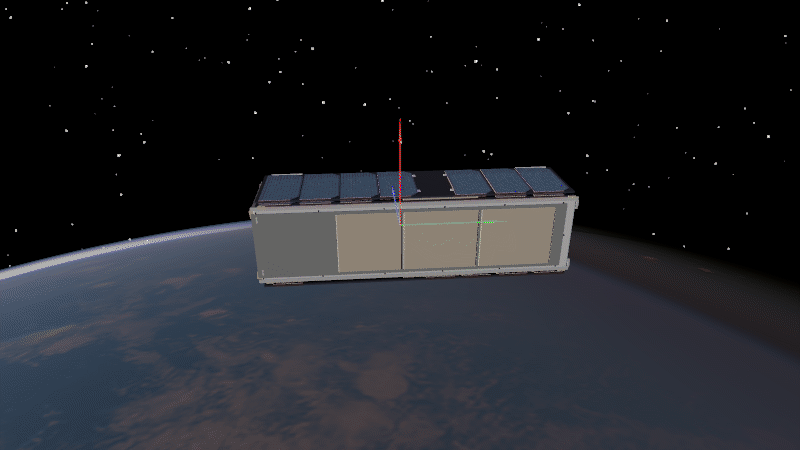

Dzhanibekov Effect
==================

The red, green, and blue arrows show the spacecraft body :math:`x`, :math:`y`,
and :math:`z` axes. The Dzhanibekov effect is the instability of torque-free
rotation near the intermediate principal axis. Here, the off-diagonal inertia
terms tilt that axis; a small perturbation grows through the
:doc:`Euler Equations <1_2_euler_equations>`:

.. math::

   \dot{\boldsymbol{\omega}}^{\mathcal{B}}
   = -(\mathbf{J}^{\mathcal{B}})^{-1}
     \left(\boldsymbol{\omega}^{\mathcal{B}} \times
     \mathbf{J}^{\mathcal{B}}\boldsymbol{\omega}^{\mathcal{B}}\right).

The initial rate is nearly along that intermediate axis, with a small
:math:`z` component.

.. code-block:: python
   :caption: dzhanibekov_effect.py

   import numpy as np
   import ADCS

   inertia = np.array([
       [0.0333, 0.0060, 0.0],
       [0.0060, 0.0333, 0.0],
       [0.0,    0.0,    0.00667],
   ])
   satellite = ADCS.Satellite(mass=4.0, J_0=inertia)
   initial_state = ADCS.State(
       w=np.deg2rad([3.5, -3.5, 0.1]),
       q=np.array([1.0, 0.0, 0.0, 0.0]),
   )
   orbit = ADCS.Orbital_State(
       ephem=ADCS.Ephemeris(),
       J2000=0.22,
       R=np.array([7000.0, 0.0, 0.0]),
       V=np.array([0.0, 7.5, 0.0]),
   )
   results = ADCS.simulate(
       x=initial_state, satellite=satellite, os0=orbit,
       dt=1.0, tf=180.0,
   )

Choose a visualization:

.. raw:: html

   

     <section class="installation-card">
       <h3>Attitude plot</h3>
       <pre><code>import matplotlib.pyplot as plt

   ADCS.plot(results, ADCS.plots.AttitudePlot(), layout=(1, 1))
   plt.show()</code></pre>
     </section>
     <section class="installation-card">
       <h3>Godot animation</h3>
       <pre><code>from ADCS.helpers.animations import animate_orbit_godot
   from ADCS.helpers.animations.godot.overlays import Triad

   animate_orbit_godot(
       results=results,
       overlays=[Triad(frame="body", px=110)],
       graphics_quality="high",
   )</code></pre>
     </section>
   

Full and diagonal inertia
-------------------------

Run the same initial state with either matrix. The diagonal version removes
the coupling between the body :math:`x` and :math:`y` axes.

.. raw:: html

   

     <section class="installation-card">
       <h3>Full inertia</h3>
       <pre><code>inertia = np.array([
       [0.0333, 0.0060, 0.0],
       [0.0060, 0.0333, 0.0],
       [0.0,    0.0,    0.00667],
   ])</code></pre>
       
     </section>
     <section class="installation-card">
       <h3>Diagonal only</h3>
       <pre><code>inertia = np.diag([
       0.0333, 0.0333, 0.00667,
   ])</code></pre>
       
     </section>
   

Angular velocity
----------------

Plot all three body-frame angular velocity components for each run:

.. code-block:: python

   import matplotlib.pyplot as plt

   ADCS.plot(results, ADCS.plots.AngularVelocityPlotCombined(), layout=(1, 1))
   plt.show()

.. raw:: html

   

     <section class="installation-card">
       <h3>Full inertia</h3>
       
     </section>
     <section class="installation-card">
       <h3>Diagonal only</h3>
       
     </section>
   

.. admonition:: Tips and tricks
   :class: tutorial-tip

   Inspect the angular velocity at any saved step:

   .. code-block:: python

      run = results.first()
      omega_body = run.state_hist[0].w
