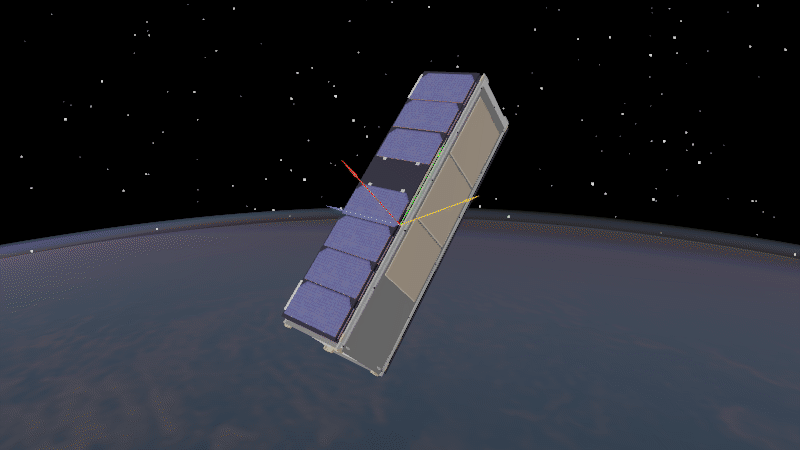

Drag Torque
===========

Atmospheric drag acts on the spacecraft's surfaces. When the centre of pressure
and centre of mass differ, it also produces a torque. Here we follow that torque
over several minutes. Drag force on the orbit is left for *Forces on a Spacecraft*.

At an illustrative altitude of 300 km, the 10 × 30 × 10 cm 3U body starts 45°
from its flight direction, without a spin. Its centre of mass is offset 2 cm
along the long axis, and drag is its only applied torque. In the animation,
green is the long body axis and yellow is the flight direction.
This simple model shows the first turn toward the flow, without rotational damping.

.. admonition:: Run it
   :class: run-it

   From the root of a clone of the repository. The ``examples/`` folder
   is not part of the pip package; see :doc:`../getting_started/examples`.

   .. code-block:: bash

      python examples/tutorials/torques_on_a_spacecraft/drag_torque.py

      # the same simulation in the 3-D Godot viewer
      python examples/tutorials/torques_on_a_spacecraft/drag_torque_godot.py

   Scripts ending in ``_godot.py`` open the 3-D Godot viewer.

.. literalinclude:: ../../../examples/tutorials/torques_on_a_spacecraft/drag_torque.py
   :language: python
   :caption: examples/tutorials/torques_on_a_spacecraft/drag_torque.py
   :start-at: import matplotlib.pyplot as plt
   :end-before: run = results.first()

.. admonition:: Geometry tip
   :class: tutorial-tip

   Specify a drag coefficient for each face in the geometry. A commonly used
   value is :math:`C_D=2.2` [1]_.

   .. code-block:: python

      face = ADCS.disturbances.GeometryFace(
          area=area, centroid=centroid, normal=normal, CD=2.2,
      )

.. [1] D. L. Oltrogge and K. Leveque, `An Evaluation of CubeSat Orbital Decay
   <https://digitalcommons.usu.edu/smallsat/2011/all2011/48/>`_,
   Small Satellite Conference, SSC11-VII-2 (2011).

Plots
-----

The dashed line shows the same initial attitude held fixed without torque.

.. code-block:: python

   run = results.first()
   time = np.asarray(run.time_s) / 60

   def angle_to_velocity(states):
       velocity = np.array([
           orbital_state.get_state_vector(x=state)["v"]
           for state, orbital_state in zip(states, run.os_hist)
       ])
       cosine = velocity[:, 1] / np.linalg.norm(velocity, axis=1)
       return np.rad2deg(np.arccos(np.clip(cosine, -1.0, 1.0)))

   plt.figure()
   plt.plot(time, angle_to_velocity(run.state_hist), label="With drag")
   plt.plot(time, angle_to_velocity([initial_state] * len(run.os_hist)),
            "--", label="Without drag")
   plt.xlabel("Time [min]")
   plt.ylabel("Long axis to velocity [deg]")
   plt.legend()

   torques = np.array([
       drag.torque(satellite, state, orbital_state)
       for state, orbital_state in zip(run.state_hist, run.os_hist)
   ])
   plt.figure()
   for axis, label in enumerate(("x", "y", "z")):
       plt.plot(time, torques[:, axis] * 1e9, label=label)
   plt.xlabel("Time [min]")
   plt.ylabel("Drag torque [nN m]")
   plt.legend()
   plt.show()

.. grid:: 1 1 2 2
   :gutter: 3

   .. grid-item-card:: Alignment with flight direction

      .. image:: ../_static/tutorials/torques_on_a_spacecraft/alignment_plot.png
         :alt: The long axis approaches the flight direction with drag, compared with a fixed attitude without drag
         :width: 100%

   .. grid-item-card:: Drag torque

      .. image:: ../_static/tutorials/torques_on_a_spacecraft/drag_torque_plot.png
         :alt: Drag torque components during the turn
         :width: 100%

Godot animation
---------------

.. code-block:: python

   from ADCS.helpers.animations import animate_orbit_godot
   from ADCS.helpers.animations.godot.overlays import Arrow, Triad

   animate_orbit_godot(
       results=results,
       overlays=[
           Triad(frame="body", px=110),
           Arrow("@velocity", color="#facc15", scale="fixed_px", px=150),
       ],
       graphics_quality="high",
   )

.. admonition:: Tips and tricks
   :class: tutorial-tip

   A run stores its states and orbital states at each saved time. Query the
   drag model for the torque at one of those steps:

   .. code-block:: python

      run = results.first()
      state = run.state_hist[0]
      orbital_state = run.os_hist[0]
      drag_torque = drag.torque(satellite, state, orbital_state)

