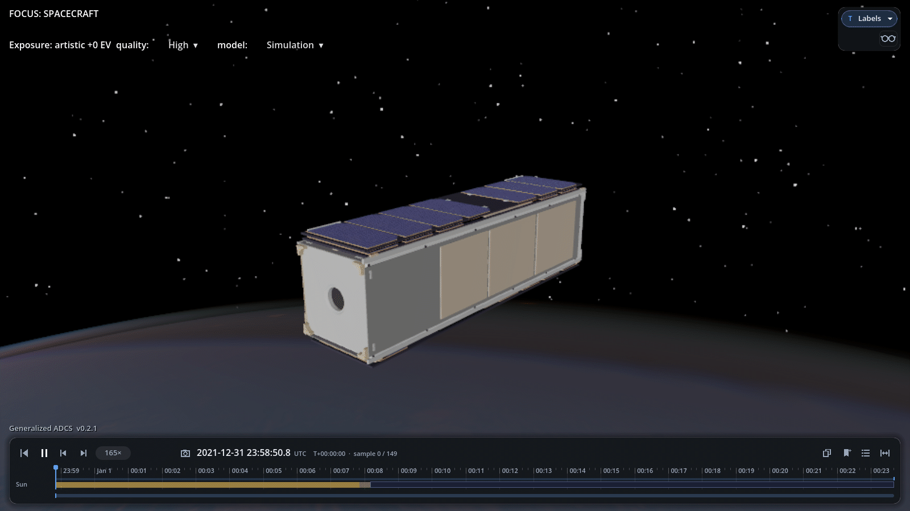
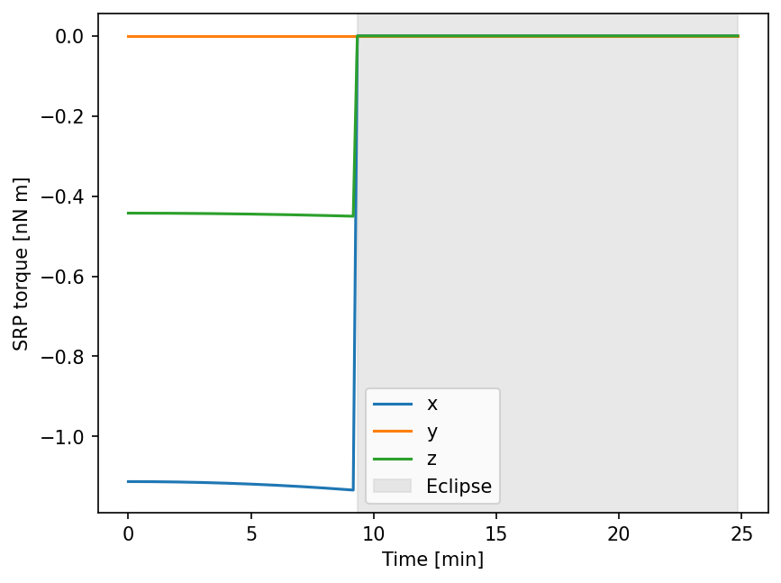

SRP Disturbance
===============

Solar radiation pressure (SRP) is the push from sunlight on a spacecraft's
surfaces. This animation follows a 3U spacecraft at 500 km from sunlight into
eclipse; the Godot timeline shows its sunlit status.

.. code-block:: python

   import numpy as np
   import ADCS
   from ADCS.helpers.animations import animate_orbit_godot

   environment = ADCS.Environment(atmosphere=ADCS.SMADAtmosphere())

   size = np.array([0.1, 0.3, 0.1])
   faces = []
   for axis in range(3):
       for sign in (-1.0, 1.0):
           normal = sign * np.eye(3)[axis]
           faces.append(ADCS.disturbances.GeometryFace(
               area=np.prod(np.delete(size, axis)),
               centroid=0.5 * size[axis] * normal,
               normal=normal,
               eta_s=0.3, eta_d=0.3, eta_a=0.4,
           ))
   geometry = ADCS.disturbances.GeometryConfig(faces)
   srp = ADCS.disturbances.SRP_Disturbance(geometry)
   satellite = ADCS.Satellite(
       mass=4.0,
       COM=np.array([0.0, 0.02, 0.0]),
       J_0=np.diag([0.0333, 0.00667, 0.0333]),
       disturbances=[srp],
   )
   initial_state = ADCS.State(
       w=np.zeros(3), q=np.array([1.0, 0.0, 0.0, 0.0]),
   )
   orbit = ADCS.Orbital_State(
       environment=environment, J2000=0.22,
       R=np.array([6878.1363, 0.0, 0.0]),
       V=np.array([0.0, np.sqrt(398600.4415 / 6878.1363), 0.0]),
   )
   results = ADCS.simulate(
       x=initial_state, satellite=satellite, os0=orbit,
       environment=environment, dt=10.0, tf=1500.0,
   )

   animate_orbit_godot(
       results=results, model="mirata", overlays=[], graphics_quality="high",
   )

External torque
---------------

The SRP torque falls to zero when the spacecraft enters eclipse.

.. code-block:: python

   import matplotlib.pyplot as plt

   run = results.first()
   time = np.asarray(run.time_s) / 60
   torques = np.array([
       srp.torque(satellite, state, orbital_state)
       for state, orbital_state in zip(run.state_hist, run.os_hist)
   ])
   sunlit = np.array([orbital_state.is_sunlit() for orbital_state in run.os_hist])

   for axis, label in enumerate(("x", "y", "z")):
       plt.plot(time, torques[:, axis] * 1e9, label=label)
   plt.fill_between(
       time, 0, 1, where=~sunlit,
       transform=plt.gca().get_xaxis_transform(),
       color="lightgray", alpha=0.5, label="Eclipse",
   )
   plt.xlabel("Time [min]")
   plt.ylabel("SRP torque [nN m]")
   plt.legend()
   plt.show()

