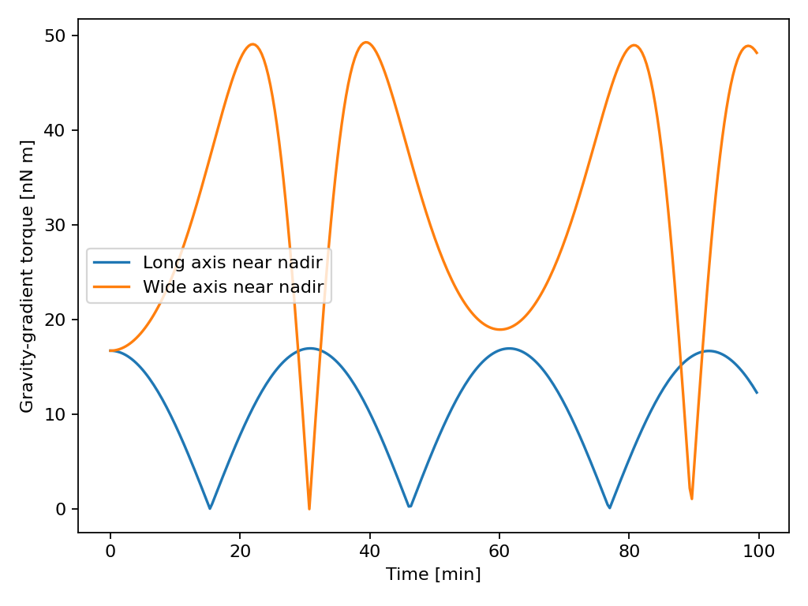

Gravity Gradient Torque
=======================

.. raw:: html

   

     <section class="installation-card">
       <h3>Long axis near nadir</h3>
       
     </section>
     <section class="installation-card">
       <h3>Wide axis near nadir</h3>
       
     </section>
   

Earth pulls slightly more strongly on the near side of an elongated spacecraft.
The resulting gravity-gradient torque can passively keep its long axis near
nadir. Here both cases start 10° from alignment at 500 km altitude and rotate
with the orbit. Green marks the long body axis; yellow points to nadir. With
no damping, the stable case librates rather than settling exactly at nadir.

The body-frame gravity-gradient torque is

.. math::

   \boldsymbol{\tau}_{\mathrm{GG}}^{\mathcal B}
   = \frac{3\mu_{\oplus}}{r^3}\,
     \hat{\mathbf n}^{\mathcal B}\times
     \left(\mathbf J^{\mathcal B}\hat{\mathbf n}^{\mathcal B}\right),

where :math:`r` is the distance from Earth's centre and
:math:`\hat{\mathbf n}^{\mathcal B}` points toward Earth. See
:meth:`ADCS.satellite_hardware.disturbances.gg_disturbance.GG_Disturbance.torque`.

.. literalinclude:: ../../../examples/tutorials/torques_on_a_spacecraft/gravity_gradient_godot.py
   :language: python
   :caption: gravity_gradient_godot.py

.. admonition:: Night vision
   :class: tutorial-tip night-vision-tip

   .. image:: ../_static/tutorials/torques_on_a_spacecraft/night_vision.svg
      :alt: Godot night vision button, shaped like binoculars.
      :class: night-vision-icon

   Click the binoculars button at the top right of the Godot viewer to keep
   the spacecraft visible while it passes through Earth's shadow.

Torque magnitude
----------------

The torque magnitude is small near alignment. In the unstable case, it initially
grows as the spacecraft turns away.

.. code-block:: python

   import matplotlib.pyplot as plt

   for label, run in runs.items():
       magnitude = [
           np.linalg.norm(gravity_gradient.torque(satellite, state, orbital_state))
           for state, orbital_state in zip(run.state_hist, run.os_hist)
       ]
       plt.plot(np.asarray(run.time_s) / 60, np.asarray(magnitude) * 1e9,
                label=label)
   plt.xlabel("Time [min]")
   plt.ylabel("Gravity-gradient torque [nN m]")
   plt.legend()
   plt.show()

.. admonition:: Tips and tricks
   :class: tutorial-tip

   Query the body-frame torque at a saved simulation step:

   .. code-block:: python

      run = runs["Long axis near nadir"]
      torque_body = gravity_gradient.torque(
          satellite, run.state_hist[0], run.os_hist[0]
      )
