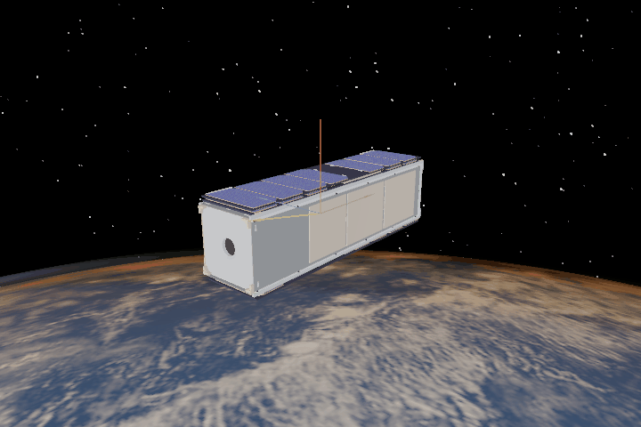

Residual Dipole Torque
======================

A residual magnetic dipole interacts with Earth's magnetic field:

.. math::

   \boldsymbol{\tau}^{\mathcal{B}}
   = \mathbf{m}^{\mathcal{B}} \times \mathbf{B}^{\mathcal{B}}.

This is the law used by :meth:`ADCS.satellite_hardware.disturbances.dipole_disturbance.Dipole_Disturbance.torque`.
The dipole can come from magnetized materials and hysteresis, or from currents
in spacecraft electronics. The satellite starts with zero angular velocity;
the changing geomagnetic field sets it rotating. In the animation, yellow is
the magnetic field and the colored arrows are body axes.

.. literalinclude:: ../../../examples/tutorials/torques_on_a_spacecraft/residual_dipole_godot.py
   :language: python
   :caption: residual_dipole_godot.py

.. admonition:: Tips and tricks
   :class: tutorial-tip

   Query the body-frame magnetic torque at a saved step:

   .. code-block:: python

      run = results.first()
      torque_body = dipole.torque(run.state_hist[0], run.os_hist[0])
