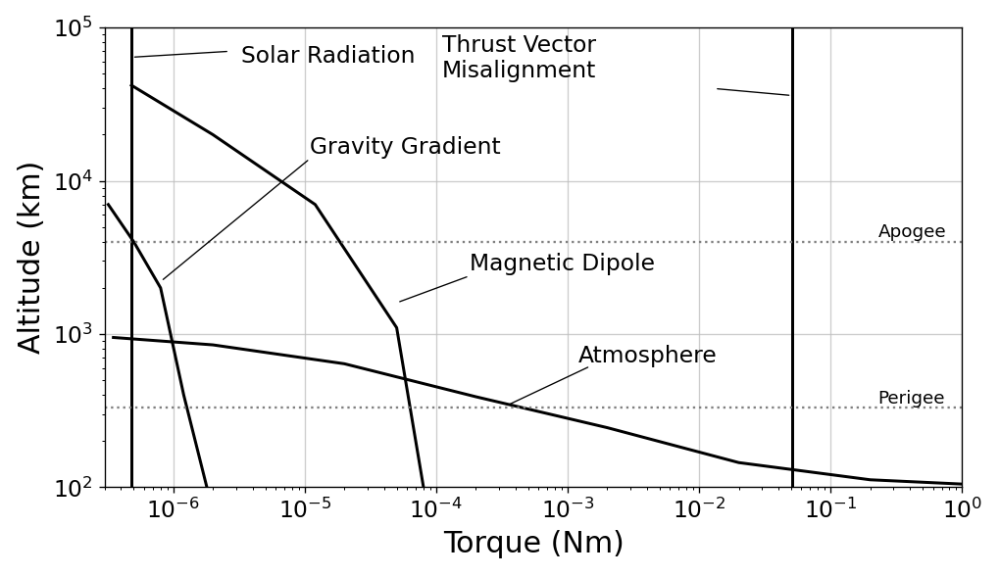
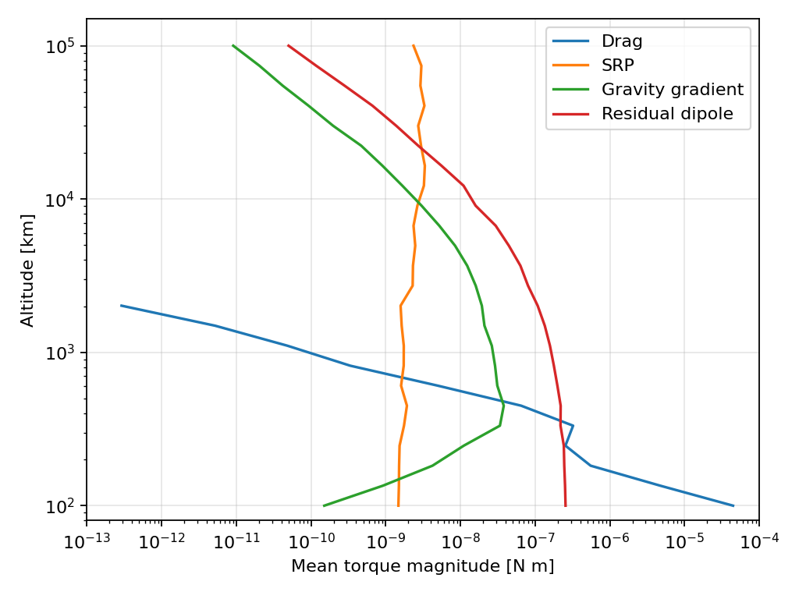

Environmental Torques
=====================

We model four environmental torques: :doc:`drag <2_2_drag_torque>`,
:doc:`SRP torque <2_3_srp_disturbance>`,
:doc:`gravity gradient torque <2_4_gravity_gradient>`, and
:doc:`residual dipole torque <2_5_residual_dipole_disturbance>`.
Their relative sizes depend on altitude and spacecraft properties.

Schematic comparison redrawn from the supplied figure in F. Tuttas,
*Design and Verification of the
Attitude Control for Orbital Manoeuvre Phases of the Small Satellite ROMEO*,
Master's thesis, December 2021, `doi:10.13140/RG.2.2.31214.89927
<https://doi.org/10.13140/RG.2.2.31214.89927>`_. The figure also includes
thrust-vector misalignment, which is outside these four environmental models.

For the same 3U spacecraft, the script simulates one idealized circular orbit at each
altitude from 100 to 100,000 km, then averages the magnitude of each torque
over that orbit. The smaller spacecraft gives different absolute magnitudes
from the ROMEO comparison. The 500 km animations compare its attitude with
and without disturbances.

.. literalinclude:: ../../../examples/tutorials/torques_on_a_spacecraft/environmental_torques.py
   :language: python
   :caption: environmental_torques.py

.. raw:: html

   

     <section class="installation-card">
       <h3>With disturbances</h3>
       
     </section>
     <section class="installation-card">
       <h3>Without disturbances</h3>
       
     </section>
   

For high-accuracy pointing, a controller can compensate predicted torques with
feedforward, estimate them with an onboard Kalman filter, or combine both.

.. admonition:: Tips and tricks
   :class: tutorial-tip

   Keep the same orbit and initial attitude when comparing disturbance models:

   .. code-block:: python

      run = results.first()
      quiet_run = quiet_results.first()

.. admonition:: Mission Recommendations
   :class: mission-recommendations

   * **Aerodynamic drag:** Place the centre of mass near the aerodynamic centre
     of pressure; for a symmetric bus, this is often near its geometric centre.
     Reduce projected area along the flight direction and avoid unnecessary
     exposed area. A higher orbit reduces atmospheric density and drag torque.

   * **Solar radiation pressure:** Keep the centre of mass near the optical
     centre of pressure and limit exposed area where the mission permits.
     Less specular reflection can reduce the normal force on a sunlit face;
     check the complete surface model because the net torque also depends on
     illumination and geometry.

   * **Gravity gradient:** Choose a mass distribution with smaller differences
     between principal moments if the aim is to reduce this torque. Aligning a
     principal axis with nadir also reduces the torque at the intended attitude.
     A deliberately elongated spacecraft may instead use gravity gradient for
     passive stabilization.

   * **Residual magnetic dipole:** Minimize current-loop area, route outgoing
     and return currents close together, and control magnetic materials and
     component placement. Some residual moment remains, so measure it and
     include it in the pointing budget.

   These are design directions, not universal optima: projected area, coatings,
   altitude, and inertia also serve mission requirements. See the
   `spacecraft attitude reference hosted by NASA
   <https://ntrs.nasa.gov/api/citations/20240009554/downloads/Space%20Attitude%20Development%20Control.pdf>`_
   (Chapter 5) and NASA SP-8018, `Spacecraft Magnetic Torques
   <https://ntrs.nasa.gov/api/citations/19690020961/downloads/19690020961.pdf>`_.
