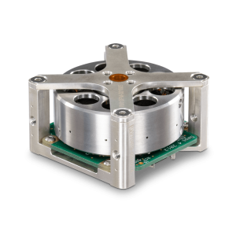
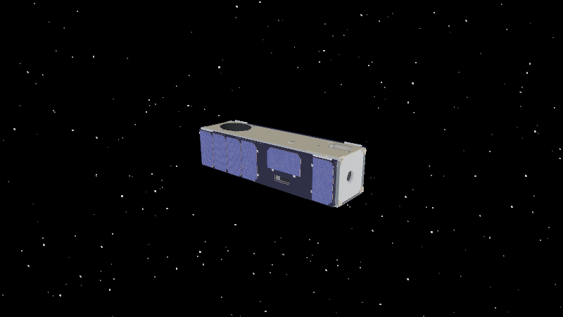
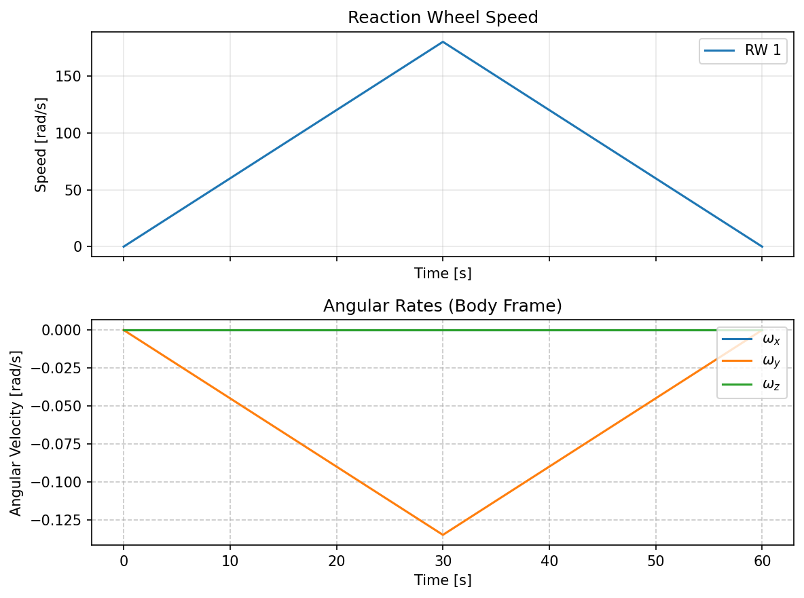

Reaction Wheel
==============

Photo: `Rocket Lab reaction wheels <https://rocketlabcorp.com/space-systems/satellite-components/reaction-wheels/>`_.

Accelerating a wheel transfers angular momentum to it and gives the spacecraft
an equal and opposite change. Braking the wheel transfers momentum back. With
no external torque, the total angular momentum is conserved.

For the coupled body and wheels, :meth:`ADCS.satellite_hardware.satellite.satellite.Satellite.dynamics`
implements

.. math::

   \begin{aligned}
   \dot{\boldsymbol\omega}^{\mathcal B}
   &= J_{\mathrm{noRW}}^{-1}\!\left[
      -\boldsymbol\omega^{\mathcal B}\times
       \left(J_{\mathrm{COM}}\boldsymbol\omega^{\mathcal B}
       + A_{\mathrm{rw}}\boldsymbol h^{\mathcal B}\right)
      +\boldsymbol\tau_c^{\mathcal B}\right], \\
   \dot{\boldsymbol h}^{\mathcal B}
   &= -\boldsymbol u_{\mathrm{rw}}
      -D_{\mathrm{rw}} A_{\mathrm{rw}}^{\mathsf T}
       \dot{\boldsymbol\omega}^{\mathcal B}.
   \end{aligned}

Here, :math:`J_{\mathrm{noRW}}` excludes the wheel spin inertias from the
spacecraft inertia :math:`J_{\mathrm{COM}}`;
:math:`A_{\mathrm{rw}}` has the wheel axes as columns;
:math:`D_{\mathrm{rw}}=\operatorname{diag}(J_{\mathrm{rw},1},\ldots,J_{\mathrm{rw},N})`;
and :math:`\boldsymbol h^{\mathcal B}` is the vector of stored wheel momenta.
:math:`\boldsymbol\tau_c` includes the torque applied to the body by the wheels.
The cross product includes gyroscopic coupling to wheel momentum. The
:math:`D_{\mathrm{rw}} A_{\mathrm{rw}}^{\mathsf T}\dot{\boldsymbol\omega}`
term accounts for the body's acceleration in the wheel momentum state.

The controller commands body torque for 30 seconds, then reverses it. The
wheel speeds up and slows down while the 3U body rotates in response. No
disturbance torques are configured.

.. literalinclude:: ../../../examples/tutorials/torques_on_a_spacecraft/reaction_wheel.py
   :language: python
   :caption: reaction_wheel.py

.. admonition:: Building a controller
   :class: tutorial-tip

   Subclass :class:`ADCS.controller.Controller` and implement ``find_u`` to return
   one command per actuator. Use ``__init__(self, satellite)`` and
   ``super().__init__(satellite)`` when storing setup data. ``simulate()`` passes
   the current state as ``x_hat`` (the true state when no estimator is used).

.. admonition:: Tips and tricks
   :class: tutorial-tip

   Wheel speed is stored through momentum: :math:`\omega_{\mathrm{wheel}}=h^{\mathcal B}/J_{\mathrm{rw}}`.

   .. code-block:: python

      speed = results.first().state_hist[-1].h[0] / wheel.J

.. admonition:: Mission Recommendations
   :class: mission-recommendations

   * Align the wheel's spin axis through the spacecraft centre of mass.
   * Mount the wheel near the centre of mass to limit its contribution to total inertia.
   * Choose wheel axes to provide control authority about the required pointing axes,
     especially the boresight, and account for the spacecraft's largest inertia directions.
