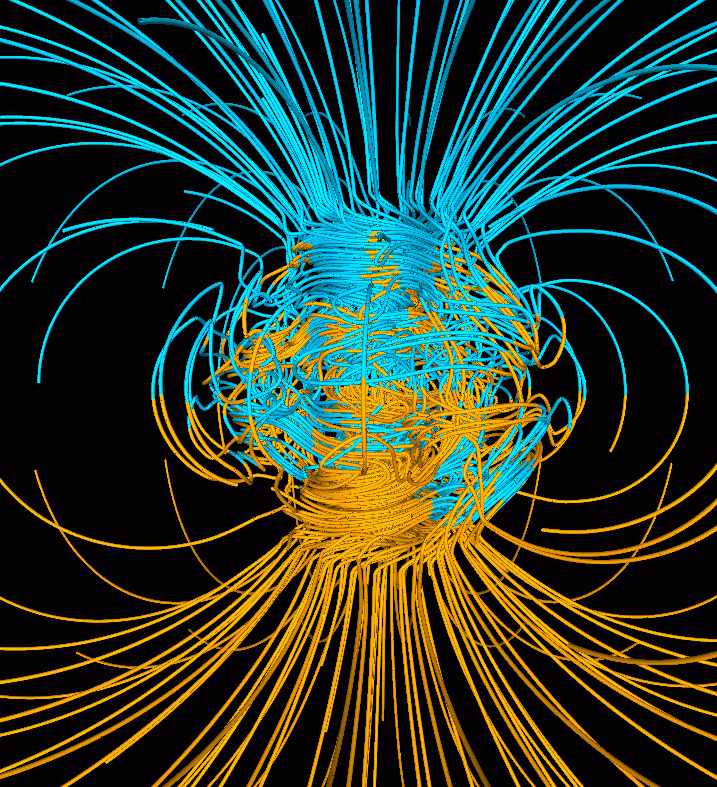
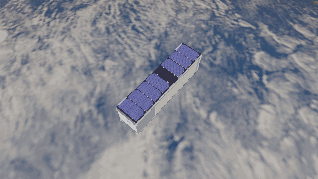
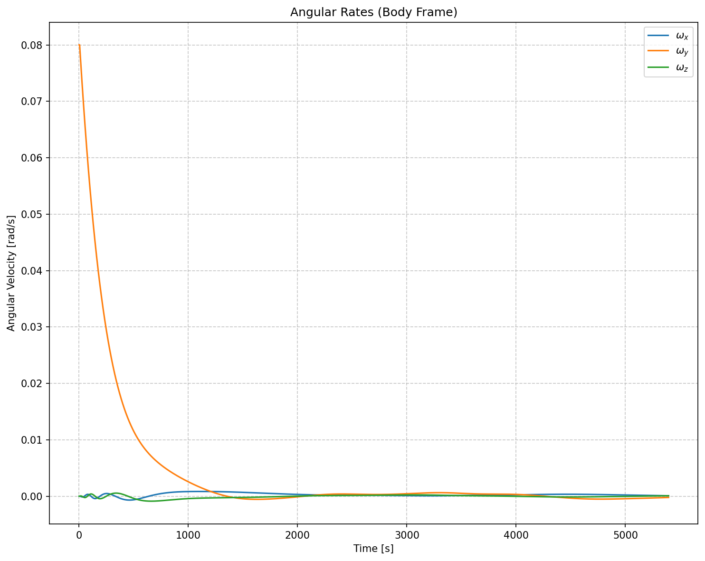

Magnetorquer
============

Geodynamo field lines, `Wikimedia Commons <https://commons.wikimedia.org/w/index.php?curid=1712490>`_
(public domain).

A magnetorquer creates a magnetic dipole :math:`\mathbf m^{\mathcal B}`. Its torque
comes from the local field :math:`\mathbf B^{\mathcal B}`:

.. math::

   \boldsymbol\tau_{\mathrm{MTQ}}^{\mathcal B}
   = \mathbf m^{\mathcal B}\times\mathbf B^{\mathcal B}.

See :meth:`ADCS.satellite_hardware.actuators.magnetotorquer.MTQ.torque`.
The cross product gives torque perpendicular to the field, so there is no
instantaneous torque along :math:`\mathbf B^{\mathcal B}`.
The simple :class:`ADCS.controller.bdot.BDot` controller commands
:math:`\mathbf m^{\mathcal B}=-K\dot{\mathbf B}^{\mathcal B}`
to slow a tumbling spacecraft. The field changes along the orbit, so the
available torque direction changes too.

The plot covers roughly one orbit. The animation shows the first 30 minutes, with
Earth visible and the spacecraft kept lit by Godot's night vision mode.

.. literalinclude:: ../../../examples/tutorials/torques_on_a_spacecraft/magnetorquer_godot.py
   :language: python
   :caption: magnetorquer_godot.py

.. admonition:: Tips and tricks
   :class: tutorial-tip

   B-dot uses magnetometer readings; one sensor and one torquer along each body axis
   make the three-dimensional field and dipole accessible.
   Click the viewer's night vision button to match the animation.

   .. code-block:: python

      sensors = [ADCS.MTM(axis) for axis in np.eye(3)]
      actuators = [ADCS.MTQ(axis, max_torque=0.2) for axis in np.eye(3)]
