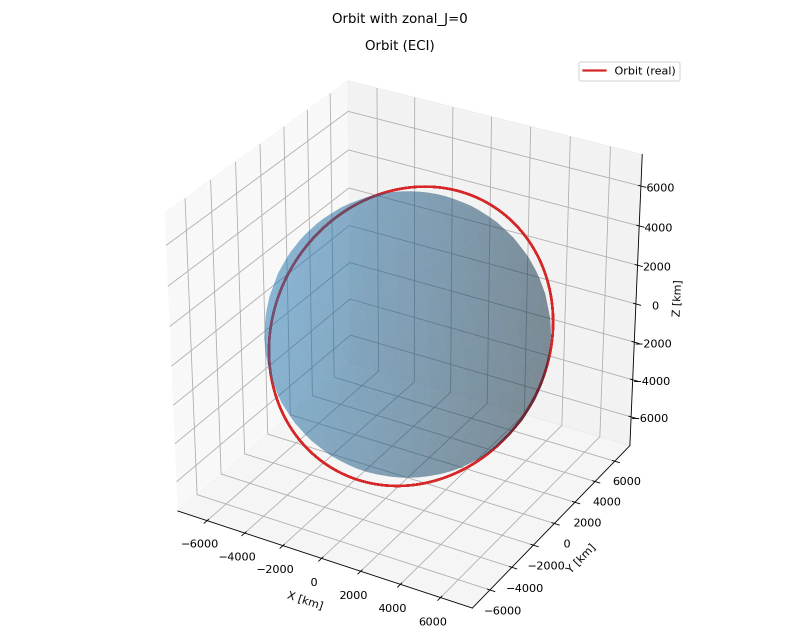
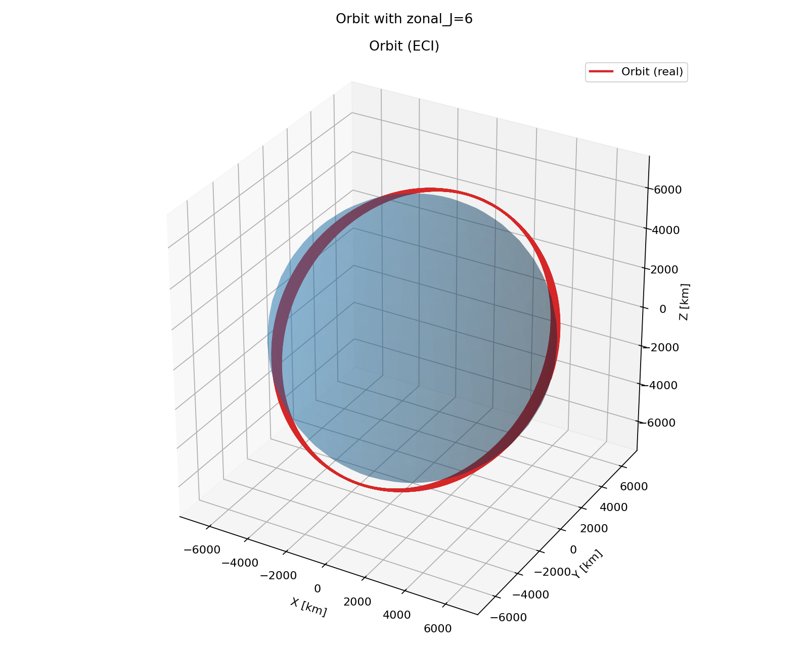

J2 Perturbation
===============

Earth is slightly wider at the equator than at the poles. Its gravity therefore
differs from the gravity of a perfect sphere. The largest correction is called
:math:`J_2`; it slowly turns the orbital plane of an inclined spacecraft.

This example starts at about 500 km altitude and propagates the same orbit for
two days with three gravity models. ``zonal_J=0`` uses two-body gravity,
``zonal_J=2`` includes J2, and ``zonal_J=6`` includes J2 through J6.
Increasing the degree adds *terms* to Earth's gravity model; it does not
multiply the J2 coefficient.

.. literalinclude:: ../../../examples/tutorials/forces_on_a_spacecraft/j2_perturbation.py
   :language: python
   :caption: j2_perturbation.py

.. admonition:: Set the gravity model
   :class: tutorial-tip

   Set ``zonal_J`` when creating the orbit propagator. A value of ``2`` includes
   J2; ``0`` disables zonal terms, and ``6`` includes J2 through J6.

   .. code-block:: python

      orbit = Orbit(os0=orbit_start, end_time=end_time, dt=60.0, zonal_J=2)

The orbit plot shows the path in an Earth-centred inertial frame. Over two
days, J2 produces the main change in the orbital plane; the additional terms
make much smaller changes.

.. admonition:: Effect on Keplerian elements
   :class: tutorial-tip

   For an inclined orbit, J2 causes the ascending node :math:`\Omega` and
   argument of perigee :math:`\omega` to drift over time. In the averaged J2
   model, the semi-major axis :math:`a`, eccentricity :math:`e`, and inclination
   :math:`i` stay approximately constant; in a propagated orbit they show small
   periodic variations. The mean anomaly also advances at a slightly changed
   rate.
