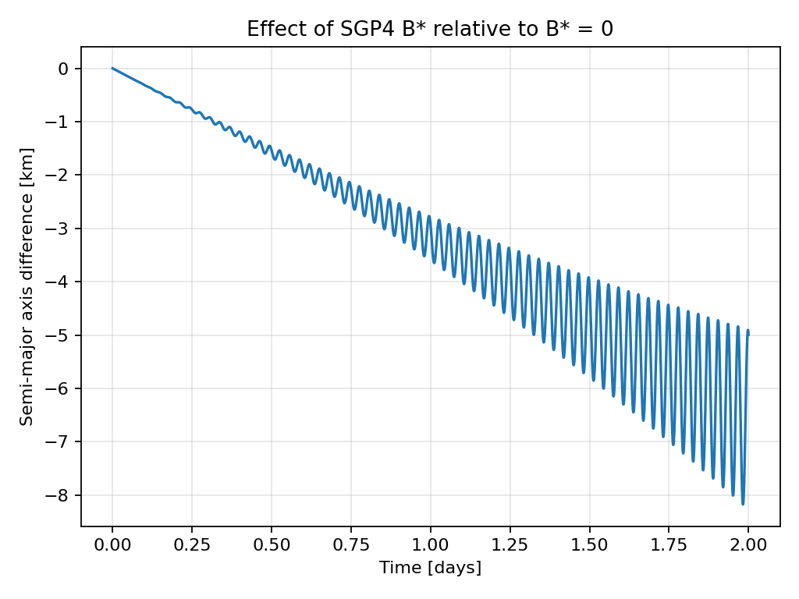
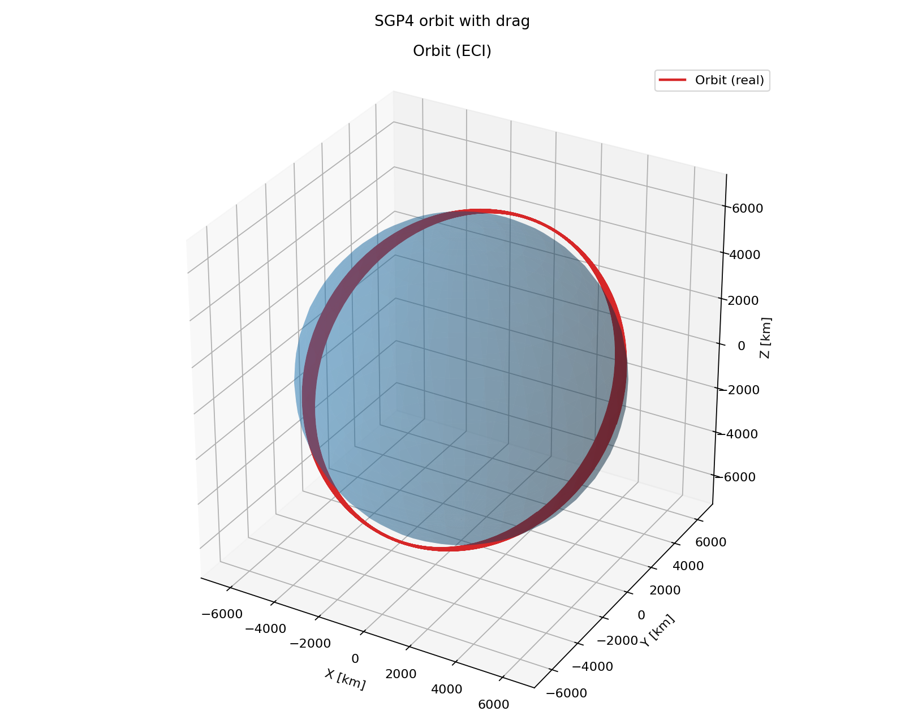

Drag with SGP4
==============

Atmospheric drag gradually removes orbital energy. This example compares two
SGP4 trajectories from the same initial state: one with an estimated drag term
and one with that term set to zero. The difference in semi-major axis grows
over two days.

The B* term
-----------

SGP4 stores its drag term :math:`B^*` in line 1 of the two-line element set
(TLE). Its usual relation to the ballistic coefficient is

.. math::

   B^* = \frac{\rho_0}{2}\frac{C_D A}{m},

where :math:`C_D` is drag coefficient, :math:`A` is effective area, and
:math:`m` is spacecraft mass. :math:`\rho_0` is SGP4's reference-density
constant, so :math:`B^*` has units of inverse Earth radii. See
`CelesTrak's TLE format guide <https://celestrak.org/columns/v04n03/>`_
for the TLE field and its units.

The script starts a 4 kg, 3U spacecraft in an inclined orbit at 300 km. It
uses the spacecraft geometry to estimate :math:`B^*`, then propagates a second
orbit with ``bstar=0`` for comparison.

.. literalinclude:: ../../../examples/tutorials/forces_on_a_spacecraft/sgp4_drag.py
   :language: python
   :caption: sgp4_drag.py

.. admonition:: How SGP4Orbit calculates B*
   :class: tutorial-tip

   When ``bstar`` is omitted, ``SGP4Orbit`` uses the first
   ``Drag_Disturbance`` on the satellite and averages its face areas over all
   flight directions:

   .. math::

      \overline{C_D A}=\frac14\sum_i C_{D,i}A_i,\qquad
      B^*=\frac12\rho_0\frac{\overline{C_D A}}{m},\qquad
      \rho_0=0.15696615\;\mathrm{kg\,m^{-2}\,ER^{-1}}.

   It writes this value into the fitted TLE and holds it fixed during SGP4
   propagation. Pass ``bstar=`` to set it explicitly; without a drag
   disturbance, the default is zero. ``ADCS.simulate(...,
   orbit_integrator=SGP4Orbit)`` passes its satellite to the propagator.

Orbit view
----------

The same example also renders the drag trajectory in an Earth-centred inertial
frame.

