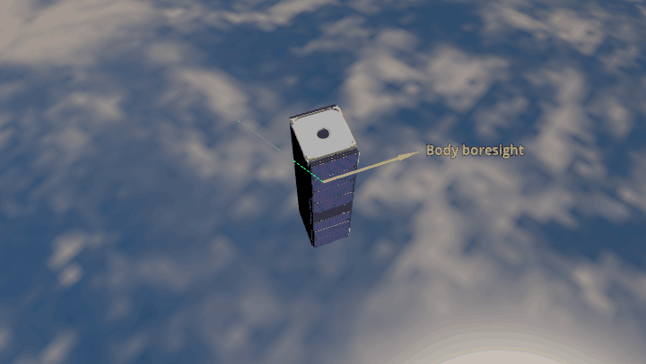
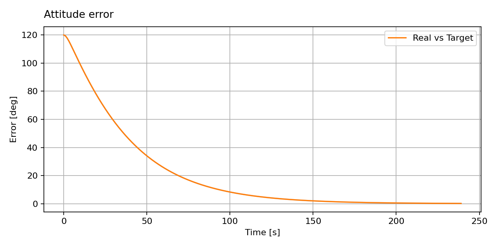

Reaction Wheel PD Controller
============================

The MiRaTa model starts 120° from a fixed inertial attitude and turns toward
it. The existing
``MTQ_w_RW`` controller requests a body torque using proportional–derivative
(PD) feedback with gyroscopic compensation:

.. math::

   \boldsymbol{\tau}_{\mathrm{cmd}}
   =-K_p\,\mathbf q_{\mathrm{err},v}-K_d\,\boldsymbol\omega
   +\boldsymbol\tau_{\mathrm{gyro}}.

Reaction wheels produce the pointing torque. The magnetorquers are available
for momentum unloading, which is disabled here with ``c_gain=0`` to keep the
example focused on pointing. The controller allocates wheel torque through the
Moore–Penrose pseudoinverse of the wheel-axis matrix :math:`A`:

.. math::

   \mathbf u_{\mathrm{RW}}=A^{\dagger}\boldsymbol{\tau}_{\mathrm{RW}}.

This supports any wheel arrangement whose axes span three-dimensional torque
space, including the four-wheel pyramid in this example, subject to actuator
limits. The controller checks the desired body-frame wheel momentum against
the per-wheel limits using the same pseudoinverse.

The yellow line marks MiRaTa's body boresight; green marks the fixed target
direction. They start far apart and approach one another as the spacecraft
turns above Earth.

.. literalinclude:: ../../../examples/tutorials/controlling_spacecraft/reaction_wheel_pd.py
   :language: python
   :caption: reaction_wheel_pd.py

Angle error
-----------

``ADCS.plots.TargetPlot`` shows the angle between the true attitude and the
fixed quaternion target. The error decreases as the wheels turn the spacecraft.

.. admonition:: Simulation timing
   :class: tutorial-tip

   Use ``dt=1.0`` second or less for this controller example. A smaller step
   resolves the wheel commands and attitude response more closely.
