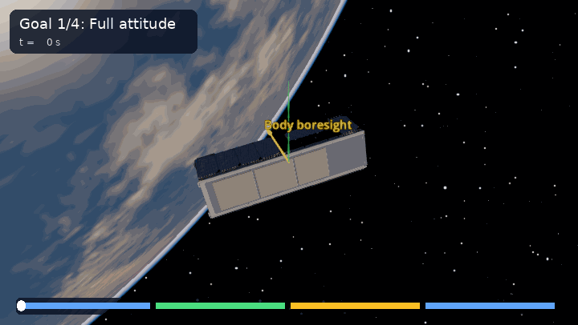

GoalList
========

:class:`~ADCS.CONOPS.goallist.goallist.GoalList` selects the active goal from
a timeline. The controller follows that goal until the next scheduled time;
it then starts steering toward the new target. The same MiRaTa satellite and
``MTQ_w_RW`` controller run through all four phases below.

The green line shows the active target direction; yellow shows MiRaTa's body
boresight. The label and progress strip in the animation identify the active
goal. The camera is fixed in an inertial frame.

.. literalinclude:: ../../../examples/tutorials/controlling_spacecraft/goal_list_godot.py
   :language: python
   :caption: goal_list_godot.py

.. admonition:: How GoalList selects a goal
   :class: tutorial-tip

   Each ``goal_timeline`` key is the time when its goal becomes active. With
   ``time_units="seconds"`` and ``start_juliantime=orbit.J2000``, the keys
   ``0``, ``300``, ``600``, and ``900`` mean seconds after the simulation starts.
   The selected goal stays active until the next key; the satellite and
   controller continue from their current state at every switch.

The final entry returns to the initial full-attitude goal, showing how to
revisit a previous pointing mode.
