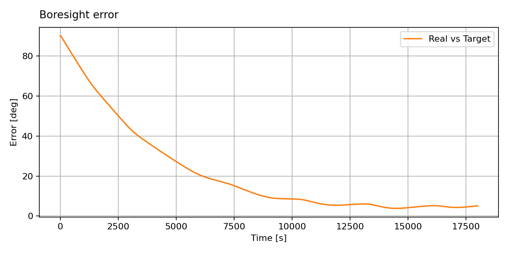
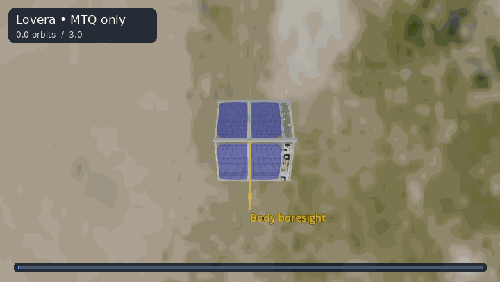

Magnetorquer-Only Control
=========================

Three magnetorquers can steer a spacecraft without reaction wheels, but each
instantaneous control torque must be perpendicular to the local magnetic
field: :math:`\boldsymbol{\tau}=\boldsymbol{m}\times\boldsymbol{B}`.
As the spacecraft orbits, the field direction changes and the missing
torque direction becomes available at other times. The
:class:`~ADCS.controller.mtq_lovera.MTQ_Lovera` controller uses this changing
field to reduce pointing error.

The headless simulation below runs for 18,000 seconds, about three orbits,
before the Godot view opens. For this undisturbed example, the boresight
error falls from 90° to about 5°. Magnetic control can need many orbits to
settle, especially when disturbance torques are present.

The GIF compresses the long run. Yellow marks the 1U CubeSat's body boresight and
green marks the fixed inertial target direction. The camera is fixed in an
inertial frame.

.. literalinclude:: ../../../examples/tutorials/controlling_spacecraft/magnetorquer_lovera.py
   :language: python
   :caption: magnetorquer_lovera.py

The three ``MTQ`` actuators are the only actuators on this satellite. The
controller's gains and dipole limit are chosen for this inertia and orbit;
other hardware and disturbance models may need different values. The package
also offers :class:`~ADCS.controller.mtq_wisniewski.MTQ_Wisniewski` for
magnetorquer-only sliding-mode control. When reaction wheels are available,
:class:`~ADCS.controller.mtq_w_rw_QP.MTQ_w_RW_QP` combines wheel and magnetic
commands through bounded quadratic-programming allocation.
