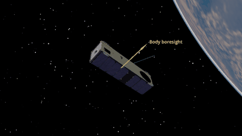

Underactuated Control: 3+1
==========================

Three magnetorquers and one reaction wheel track a daylight ground target
at 16° S, 160° W, offset from nadir. The initial pointing error is about
30°. Yellow marks the body boresight; green marks the target direction.
This 3+1 architecture is discussed in [1]_.

Simulation and animation
------------------------

.. admonition:: Run it
   :class: run-it

   From the root of a clone of the repository. The ``examples/`` folder
   is not part of the pip package; see :doc:`../getting_started/examples`.

   .. code-block:: bash

      python examples/tutorials/controlling_spacecraft/underactuated_3plus1_godot.py

   Scripts ending in ``_godot.py`` open the 3-D Godot viewer.

.. literalinclude:: ../../../examples/tutorials/controlling_spacecraft/underactuated_3plus1_godot.py
   :language: python
   :caption: examples/tutorials/controlling_spacecraft/underactuated_3plus1_godot.py

Add plots
---------

.. grid:: 1 1 2 2
   :gutter: 3

   .. grid-item-card:: Pointing error

      .. image:: ../_static/tutorials/controlling_spacecraft/underactuated_3plus1_angle_error.png
         :alt: Pointing error falls below 20 degrees early and converges near zero.
         :width: 100%

      .. code-block:: python

         import matplotlib.pyplot as plt

         ADCS.plot(
             results,
             ADCS.plots.TargetPlot(
                 modes=["real_target"], title="Ground-target pointing error"
             ),
             layout=(1, 1), figsize=(8, 4),
         )
         plt.show()

   .. grid-item-card:: MTQ and reaction-wheel commands

      .. image:: ../_static/tutorials/controlling_spacecraft/underactuated_3plus1_controls.png
         :alt: Magnetorquer and reaction-wheel control torques during the simulation.
         :width: 100%

      .. code-block:: python

         import matplotlib.pyplot as plt

         ADCS.plot(
             results,
             ADCS.plots.ControlPlotCombined(),
             ADCS.plots.ControlPlotSingle(
                 index=0, title="Reaction-wheel control torque"
             ),
             layout=(2, 1),
         )
         plt.show()

The single wheel cannot unload momentum while preserving pointing, so the
example sets ``c_gain=0``.

.. [1] N. Scheuer, P. McKeen, and K. Cahoy, “One Wheel Is Enough: Control
   Strategies for the 3+1 Actuator Architecture Across Small Satellite
   Mission Profiles”.
