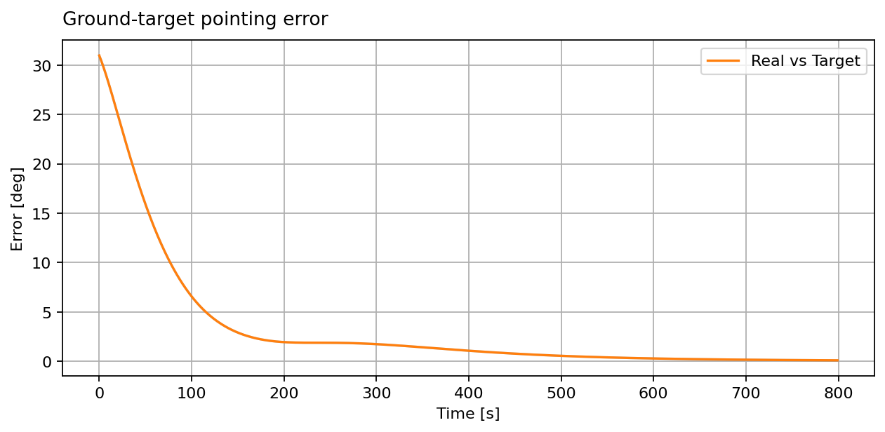

Underactuated Control: 3+1
==========================

This **3+1** spacecraft has three orthogonal magnetorquers and one reaction
wheel along its body X axis. The wheel controls only one axis directly, and
magnetorquers cannot produce torque along the current magnetic field. Their
combined torque authority changes over the orbit, so this is an
underactuated control problem.

:class:`~ADCS.controller.mtq_w_rw_LP.MTQ_w_RW_LP` requests a pointing torque
and uses a linear program to find the largest feasible torque **in that
direction**, subject to the wheel and magnetorquer limits. In this example,
MiRaTa tracks a fixed ground point at 42° N, 80° W using
:class:`~ADCS.CONOPS.goals.vector_goals.coordinate_goal.Coordinate_Goal`.

.. image:: ../_static/tutorials/controlling_spacecraft/underactuated_3plus1.gif
   :alt: MiRaTa turns to track a ground location using one wheel and three magnetorquers.
   :width: 100%

Yellow shows MiRaTa's body boresight; green shows the direction to the
ground target. The GIF uses an inertial camera and compresses the 800-second
simulation. The boresight starts about 80° from the target and ends within
1°. The interim rise in error shows the limited instantaneous torque
authority of this actuator set.

.. literalinclude:: ../../../examples/tutorials/controlling_spacecraft/underactuated_3plus1.py
   :language: python
   :caption: underactuated_3plus1.py

The single wheel stores momentum, and this short example keeps it below its
limit. A single wheel cannot generally be unloaded without disturbing the
pointing objective, so this script sets ``c_gain=0``.

.. [1] P. McKeen, N. Scheuer, and K. Cahoy, “Generalized Attitude Control
   for Small Spacecraft,” 40th Annual Small Satellite Conference,
   SSC26-P2-54, 2026. `Paper and DOI
   <https://digitalcommons.usu.edu/smallsat/2026/all2026/253/>`__.
