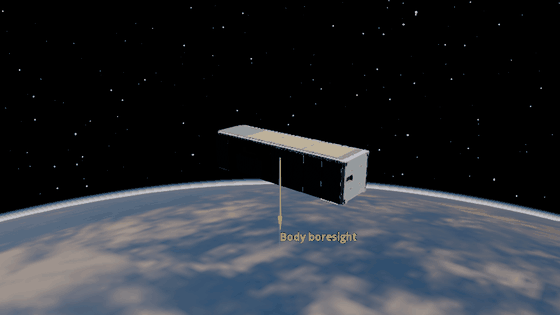
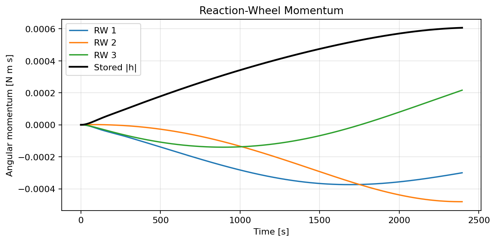

Wheel Momentum Accumulation
===========================

Three orthogonal reaction wheels hold nadir pointing through drag, solar
radiation pressure, gravity-gradient torque, and residual magnetic torque.
The wheels accumulate momentum because this controller does not unload it.

The black line is the magnitude of the combined wheel momentum.

.. literalinclude:: ../../../examples/tutorials/controlling_spacecraft/wheel_momentum_accumulation.py
   :language: python
   :caption: wheel_momentum_accumulation.py
