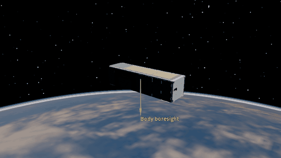
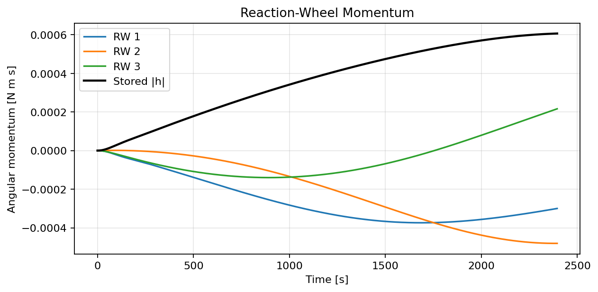

Wheel Momentum Accumulation
===========================

Three orthogonal reaction wheels hold nadir pointing through drag, solar
radiation pressure, gravity-gradient torque, and residual magnetic torque.
The wheels accumulate momentum because this controller does not unload it.

The black line is the magnitude of the combined wheel momentum.

.. admonition:: Run it
   :class: run-it

   From the root of a clone of the repository. The ``examples/`` folder
   is not part of the pip package; see :doc:`../getting_started/examples`.

   .. code-block:: bash

      python examples/tutorials/controlling_spacecraft/wheel_momentum_accumulation_godot.py

   Scripts ending in ``_godot.py`` open the 3-D Godot viewer.

.. literalinclude:: ../../../examples/tutorials/controlling_spacecraft/wheel_momentum_accumulation_godot.py
   :language: python
   :caption: examples/tutorials/controlling_spacecraft/wheel_momentum_accumulation_godot.py
