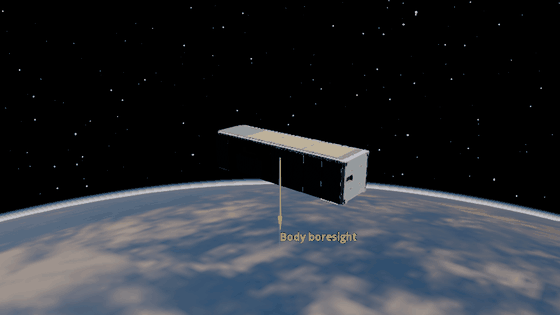

Wheel Momentum Dumping
======================

The Hogan–Schaub ``MTQ_w_RW`` law uses three reaction wheels for nadir
pointing and three magnetorquers for continuous momentum dumping. Drag,
solar radiation pressure, gravity-gradient torque, and residual magnetic
torque remain active. The wheels start with stored momentum and target zero.

.. container:: dynamics-visualization-grid

   .. container:: installation-card

      .. rubric:: Wheel momentum

      .. image:: ../_static/tutorials/controlling_spacecraft/wheel_momentum_dumping.png
         :alt: Combined wheel momentum falls while the three signed wheel momenta approach zero.
         :width: 100%

   .. container:: installation-card

      .. rubric:: Nadir pointing

      .. image:: ../_static/tutorials/controlling_spacecraft/wheel_momentum_dumping_pointing.png
         :alt: Nadir pointing error stays below one degree during momentum dumping.
         :width: 100%

.. container:: dynamics-visualization-grid

   .. container:: installation-card

      .. rubric:: Magnetorquer commands

      .. image:: ../_static/tutorials/controlling_spacecraft/wheel_momentum_dumping_mtq.png
         :alt: Three magnetorquers command magnetic dipole moments to unload the wheels.
         :width: 100%

   .. container:: installation-card

      .. rubric:: Reaction-wheel commands

      .. image:: ../_static/tutorials/controlling_spacecraft/wheel_momentum_dumping_rw.png
         :alt: Three reaction wheels command torque at the same time as the magnetorquers.
         :width: 100%

.. literalinclude:: ../../../examples/tutorials/controlling_spacecraft/wheel_momentum_dumping_godot.py
   :language: python
   :caption: wheel_momentum_dumping_godot.py

The control allocation follows Hogan and Schaub [1]_.

.. [1] E. A. Hogan and H. Schaub, “Three-Axis Attitude Control Using Redundant
   Reaction Wheels with Continuous Momentum Dumping,” *Journal of Guidance,
   Control, and Dynamics*, 38(10), 1865–1871, 2015.
   `doi:10.2514/1.G000812 <https://doi.org/10.2514/1.G000812>`__.
