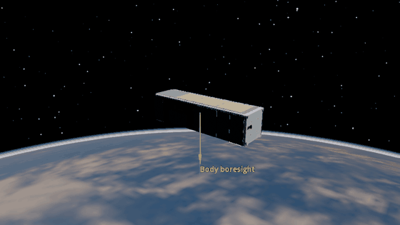

Wheel Momentum Dumping
======================

The Hogan–Schaub ``MTQ_w_RW`` law uses three reaction wheels for nadir
pointing and three magnetorquers for continuous momentum dumping. Drag,
solar radiation pressure, gravity-gradient torque, and residual magnetic
torque remain active. The wheels start with stored momentum and target zero.

.. grid:: 1 1 2 2
   :gutter: 3

   .. grid-item-card:: Wheel momentum

      .. image:: ../_static/tutorials/controlling_spacecraft/wheel_momentum_dumping.png
         :alt: Combined wheel momentum falls while the three signed wheel momenta approach zero.
         :width: 100%

   .. grid-item-card:: Nadir pointing

      .. image:: ../_static/tutorials/controlling_spacecraft/wheel_momentum_dumping_pointing.png
         :alt: Nadir pointing error stays below one degree during momentum dumping.
         :width: 100%

.. grid:: 1 1 2 2
   :gutter: 3

   .. grid-item-card:: Magnetorquer commands

      .. image:: ../_static/tutorials/controlling_spacecraft/wheel_momentum_dumping_mtq.png
         :alt: Three magnetorquers command magnetic dipole moments to unload the wheels.
         :width: 100%

   .. grid-item-card:: Reaction-wheel commands

      .. image:: ../_static/tutorials/controlling_spacecraft/wheel_momentum_dumping_rw.png
         :alt: Three reaction wheels command torque at the same time as the magnetorquers.
         :width: 100%

.. admonition:: Run it
   :class: run-it

   From the root of a clone of the repository. The ``examples/`` folder
   is not part of the pip package; see :doc:`../getting_started/examples`.

   .. code-block:: bash

      python examples/tutorials/controlling_spacecraft/wheel_momentum_dumping_godot.py

   Scripts ending in ``_godot.py`` open the 3-D Godot viewer.

.. literalinclude:: ../../../examples/tutorials/controlling_spacecraft/wheel_momentum_dumping_godot.py
   :language: python
   :caption: examples/tutorials/controlling_spacecraft/wheel_momentum_dumping_godot.py

The control allocation follows Hogan and Schaub [1]_.

.. [1] E. A. Hogan and H. Schaub, “Three-Axis Attitude Control Using Redundant
   Reaction Wheels with Continuous Momentum Dumping,” *Journal of Guidance,
   Control, and Dynamics*, 38(10), 1865–1871, 2015.
   `doi:10.2514/1.G000812 <https://doi.org/10.2514/1.G000812>`__.
