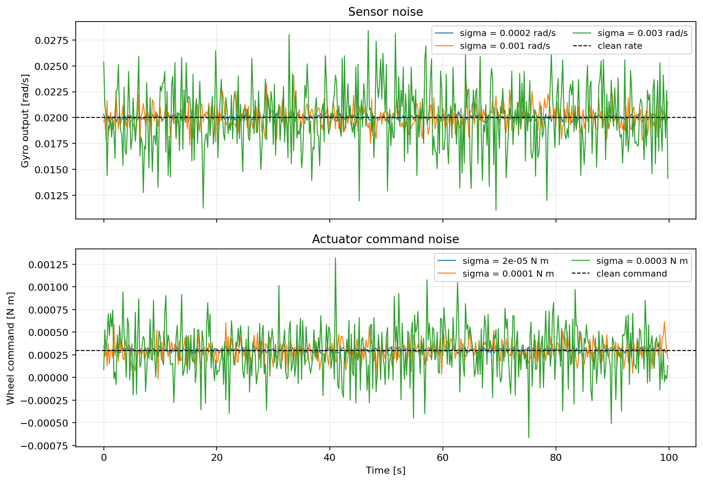

Noise
=====

``ADCS.Noise`` adds a Gaussian sample to each sensor reading or actuator
command. ``std_noise`` is the per-sample standard deviation :math:`\sigma`;
``bounds`` optionally clips the sampled value. The plots compare several
values of :math:`\sigma` around the same clean signal.

Configure the noise on a sensor or an actuator by passing a ``Noise`` object
to its ``noise`` argument:

.. container:: dynamics-visualization-grid

   .. container:: installation-card

      .. rubric:: Gyroscope

      .. code-block:: python

         gyro_noise = ADCS.Noise(std_noise=2e-3)  # rad/s
         gyro = ADCS.Gyro(axis=np.array([1, 0, 0]), noise=gyro_noise)

   .. container:: installation-card

      .. rubric:: Reaction wheel actuator

      .. code-block:: python

         rw_noise = ADCS.Noise(std_noise=2e-5)  # N m
         rw = ADCS.RW(
             axis=np.array([1, 0, 0]), max_torque=1e-3,
             J=5e-6, h=0.0, h_max=0.02, noise=rw_noise,
         )

Use a separate ``Noise`` object for each unit or sensor family. For vector
readings, ``std_noise`` can be a scalar or one value per output component.
The covariance associated with the model is :math:`R=\sigma^2` for a scalar,
or a diagonal matrix for component-wise values.
