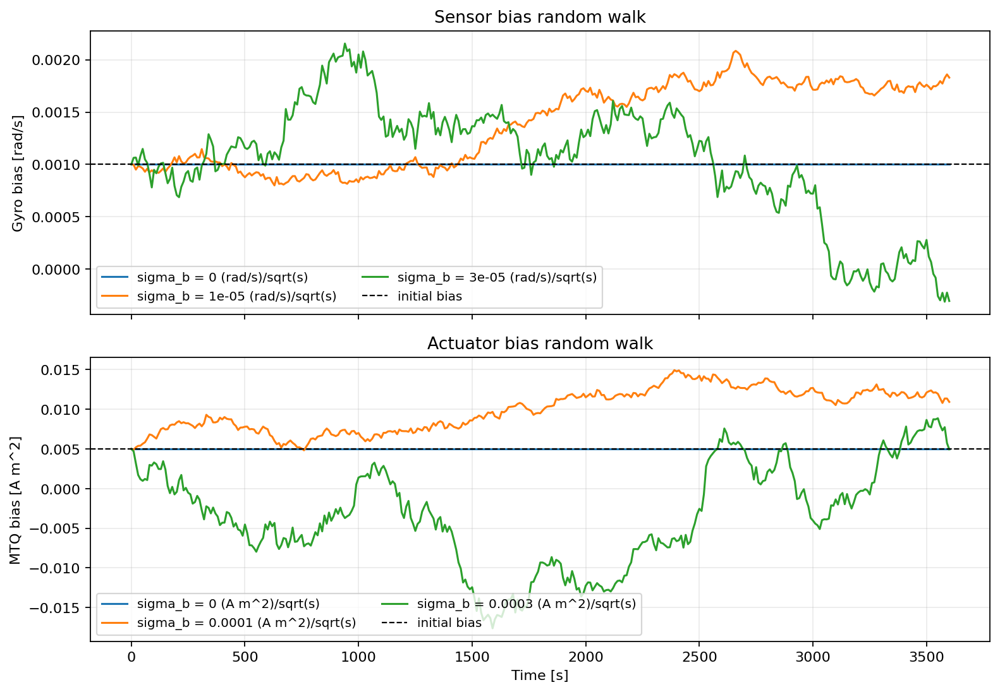

Bias
====

``ADCS.Bias`` starts at ``bias`` and evolves as a Gaussian random walk.
``std_bias`` is the standard-deviation rate :math:`\sigma_b`; after an
interval :math:`\Delta t`, the bias increment has standard deviation
:math:`\sigma_b\sqrt{\Delta t}`. Bounds can limit the allowed drift.

Pass a ``Bias`` object to a sensor or actuator's ``bias`` argument. Bias
values use the units of the corresponding sensor output or actuator command.

.. container:: dynamics-visualization-grid

   .. container:: installation-card

      .. rubric:: Gyroscope

      .. code-block:: python

         gyro_bias = ADCS.Bias(
             bias=1e-3, std_bias=2e-6,  # rad/s, rad/s / sqrt(s)
             bounds=(-0.02, 0.02),
         )
         gyro = ADCS.Gyro(axis=np.array([1, 0, 0]), bias=gyro_bias)

   .. container:: installation-card

      .. rubric:: Magnetorquer actuator

      .. code-block:: python

         mtq_bias = ADCS.Bias(
             bias=0.005, std_bias=1e-4,  # A m², A m² / sqrt(s)
             bounds=(-0.1, 0.1),
         )
         mtq = ADCS.MTQ(
             axis=np.array([1, 0, 0]), max_torque=0.1, bias=mtq_bias,
         )

Set ``std_bias=0`` for a fixed offset. Set both ``bias=0`` and
``std_bias=0`` to disable the bias model.
