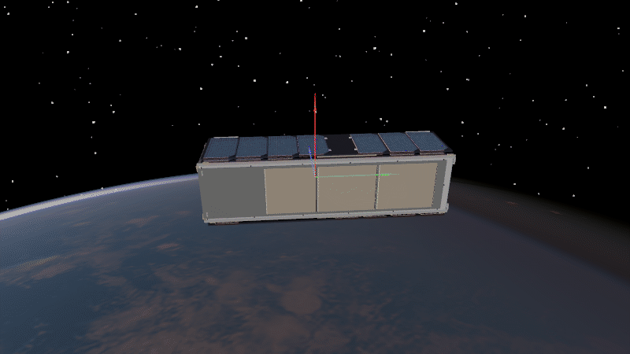
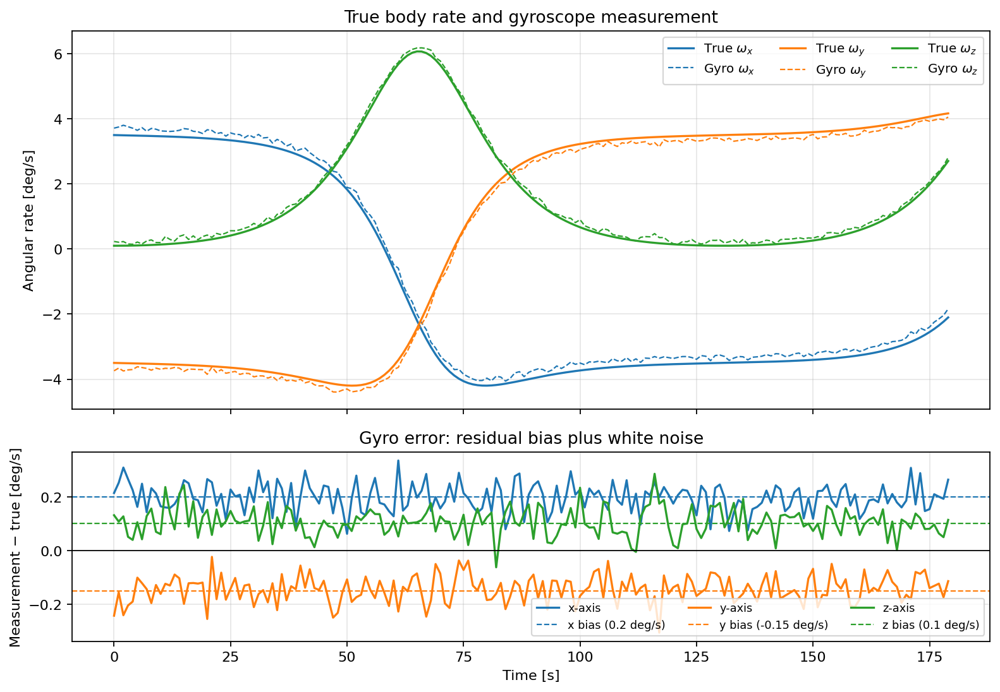

Gyroscope
=========

A gyroscope measures the body's angular velocity :math:`\boldsymbol{\omega}`.
By itself, it cannot determine absolute attitude; integrating its rate only
tracks relative rotation and accumulates drift from bias.

The example uses a deliberately poor gyro: 0.05°/s white noise per sample
and fixed axis offsets of 0.1–0.2°/s. The offsets do not random-walk
(``std_bias=0``).

.. literalinclude:: ../../../examples/tutorials/attitude_sensors/gyroscope.py
   :language: python
   :caption: gyroscope.py

The animation uses the same torque-free intermediate-axis tumble as the
:doc:`Dzhanibekov effect tutorial <1_3_dzhanibekov_effect>`.
