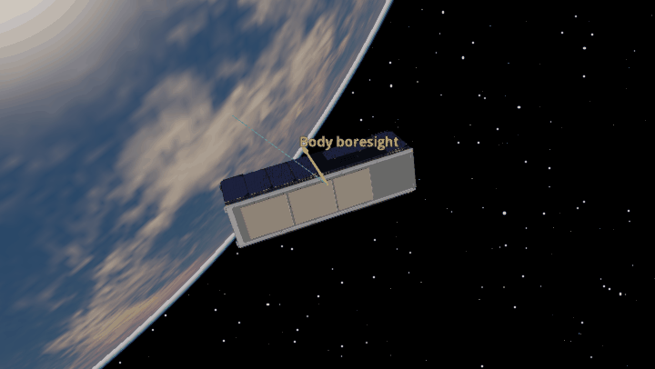
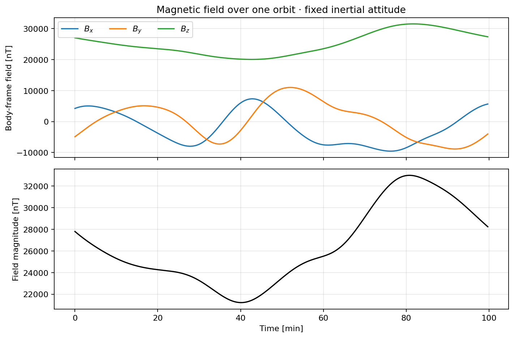
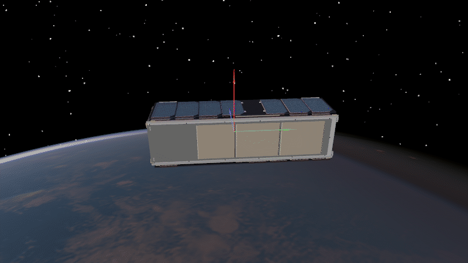
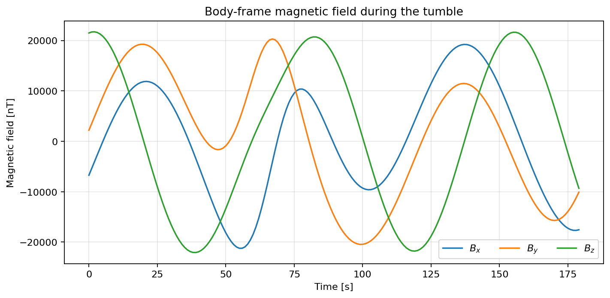

Magnetometer
============

A triad of magnetometers measures the local magnetic field in body
coordinates. Compare the slow orbital variation with the faster variation
caused by spacecraft spin.

Stable attitude
---------------

The field changes as the satellite moves through Earth's magnetic field, even
while its inertial attitude is fixed.

.. literalinclude:: ../../../examples/tutorials/attitude_sensors/magnetometer_stable.py
   :language: python
   :caption: magnetometer_stable.py

Tumbling attitude
-----------------

The rapid body-frame change is related to
:math:`\boldsymbol{\omega}\times \mathbf{B}`. When spin is much faster than orbital field change, this gives
limited information about the rate perpendicular to :math:`\mathbf{B}`; it
does not recover the full angular rate. The :class:`B-Dot controller
<ADCS.controller.bdot.BDot>` uses the measured field derivative to detumble.

.. literalinclude:: ../../../examples/tutorials/attitude_sensors/magnetometer_tumbling.py
   :language: python
   :caption: magnetometer_tumbling.py
