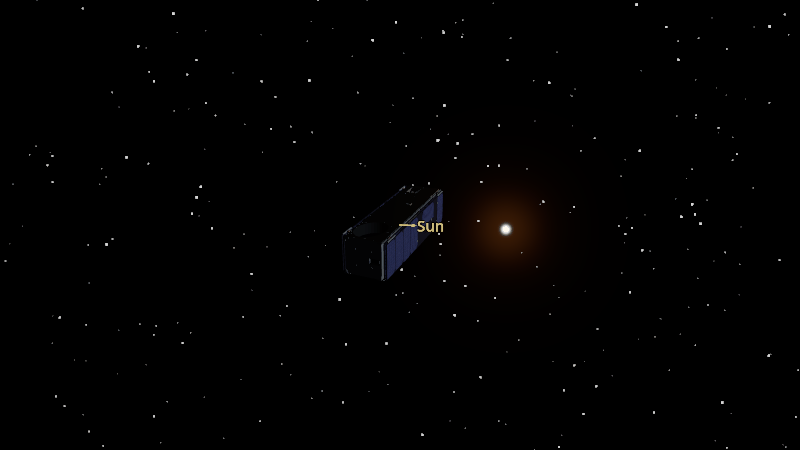
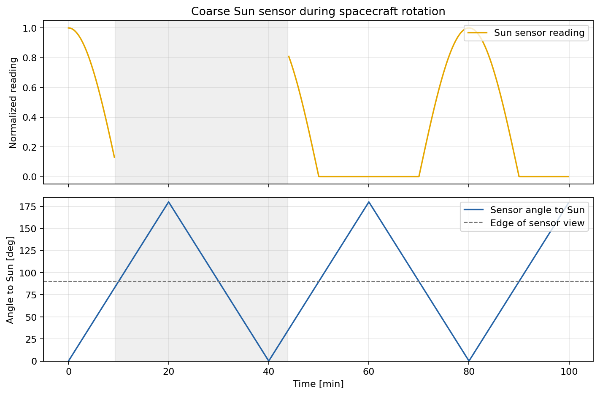

Coarse Sun Sensor
=================

A coarse Sun sensor measures the cosine of the angle between its body axis and
the Sun, clipped to zero when the Sun is behind the sensor. This example spins
the spacecraft so that angle changes. The Godot camera starts facing the Sun.
The upper plot shows the recorded sensor reading; the lower plot shows its
angle to the Sun. Shaded periods are eclipse, when the reading is invalid.

.. literalinclude:: ../../../examples/tutorials/attitude_sensors/coarse_sun_sensor.py
   :language: python
   :caption: coarse_sun_sensor.py
