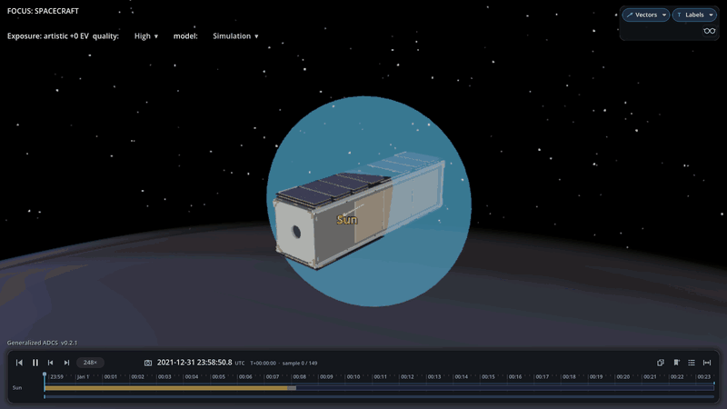
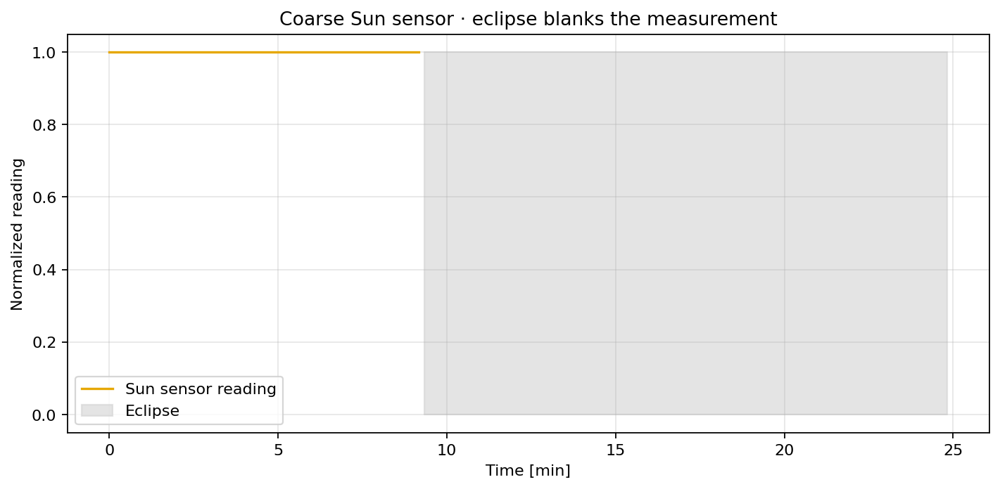

Sun Sensor
==========

A coarse Sun sensor measures light along its body axis. The Godot view shows
the Sun direction, sensor field of view, and eclipse; the plot shows the
measurement becoming invalid in shadow.

.. literalinclude:: ../../../examples/tutorials/attitude_sensors/sun_sensor.py
   :language: python
   :caption: sun_sensor.py
