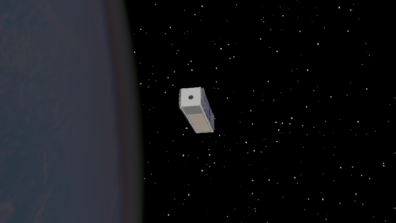
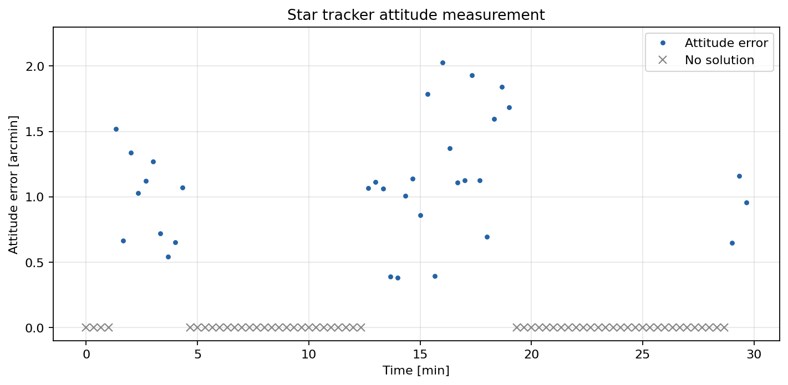

Star Tracker
============

A star tracker compares the directions of stars in its camera image with a
catalog of known star directions. In this repo, ``StarTracker`` returns the
body-frame direction of the brightest usable star. ``StarTrackerQuaternion``
uses multiple stars to return a full attitude quaternion. This example uses
the quaternion model and requires at least two usable stars.

The plot compares each reported quaternion with the true simulated attitude.
Blue points show the measurement error. Gray crosses mark times when the
tracker returns ``NaN`` because too few stars are usable. The model filters
stars outside its field of view and stars blocked by Earth or Moon, and
rejects views too close to the Sun.

The script simulates the tracker, saves the plot, and opens the Godot animation.

.. literalinclude:: ../../../examples/tutorials/attitude_sensors/star_tracker.py
   :language: python
   :caption: star_tracker.py
