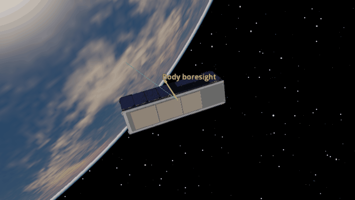
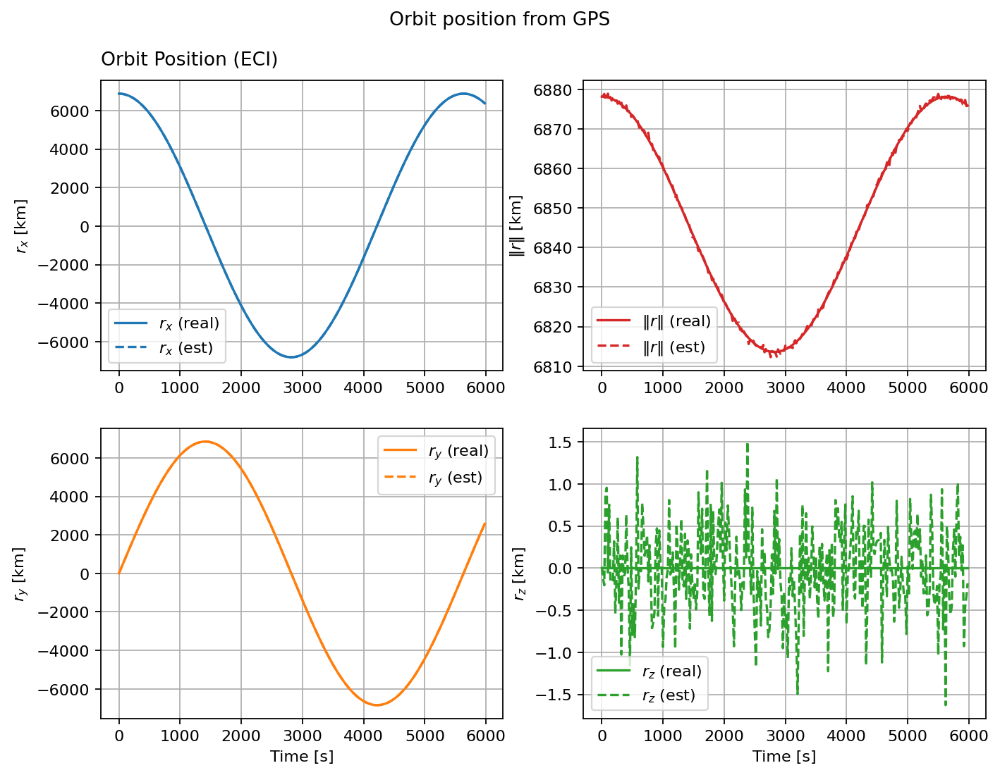

GPS
===

The animation shows a nadir-pointing spacecraft in orbit. The GPS model
measures position and velocity in Earth-fixed axes; ``Orbit_GPS`` converts
those readings into an inertial orbit estimate. The plot compares that
estimate with the simulated true position. The example uses 0.5 km position
noise so the difference is visible.

.. note::

   **Why position matters for attitude determination.**

   Knowing where the spacecraft is lets the environment model calculate the
   direction to the Sun and the local magnetic field. Those are reference
   directions used with Sun sensors and magnetometers to determine attitude.

.. literalinclude:: ../../../examples/tutorials/attitude_sensors/gps.py
   :language: python
   :caption: gps.py
