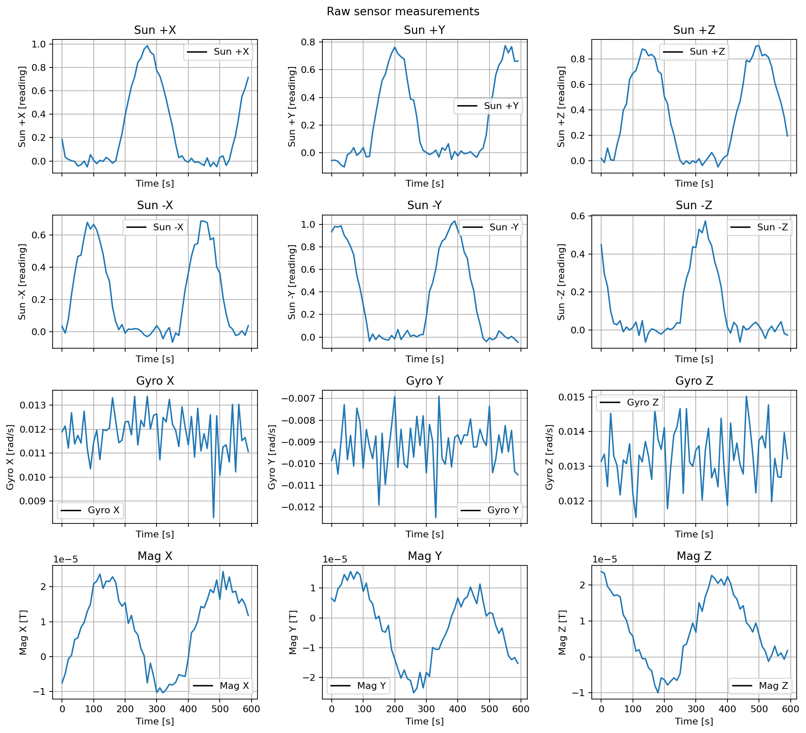

Filter Justification
====================

Can you determine the satellite's orientation from these raw measurements?
Six coarse Sun sensors face the positive and negative body axes. A gyroscope
and magnetometer measure along each body axis. Each trace shows one raw
measurement over time. The readings include sensor noise, and the gyro also
has a fixed bias. Try to work out which way the satellite is pointing, and
how it moves, using only these measurements.

Run the short script below to generate the plot. Does every possible
orientation produce a different set of readings?

.. literalinclude:: ../../../examples/tutorials/estimators/filter_justification.py
   :language: python
   :caption: filter_justification.py
