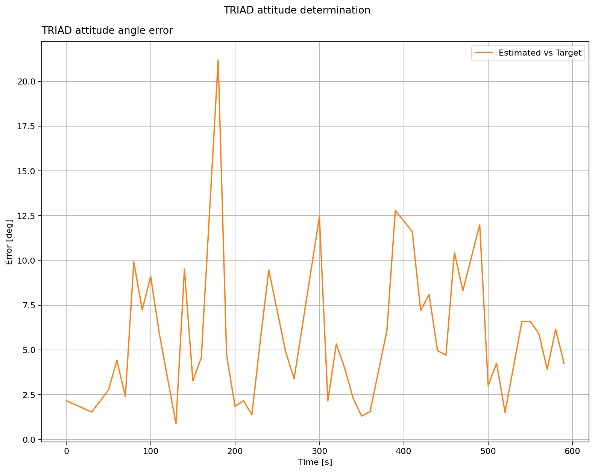

Attitude Determination
======================

The previous page showed six Sun sensor readings, three gyro readings, and
three magnetic field readings. Here, the same satellite uses the Sun and
magnetic field to determine its attitude with **TRIAD**.

The Sun sensors give the direction to the Sun in the satellite's body frame;
the magnetometers give the magnetic field direction in that frame. The orbit
model supplies both directions in the inertial frame. TRIAD builds a set of
three perpendicular axes from each pair of directions, then finds the
rotation that aligns the two sets. The directions must not be parallel, and
the Sun must be visible. The gyro readings provide angular rate, but TRIAD
does not need them for a single attitude solution.

The plot shows the angular error between the TRIAD result and the simulated
attitude at the times when both directions are available. The sensors have
noise, and the gyros have a fixed bias. TRIAD uses the Sun and magnetic
measurements, so the gyro bias does not affect this particular solution. In
a real spacecraft, the simulated attitude would not be known; it is used here
only to check the result.

.. literalinclude:: ../../../examples/tutorials/estimators/attitude_determination.py
   :language: python
   :caption: attitude_determination.py
