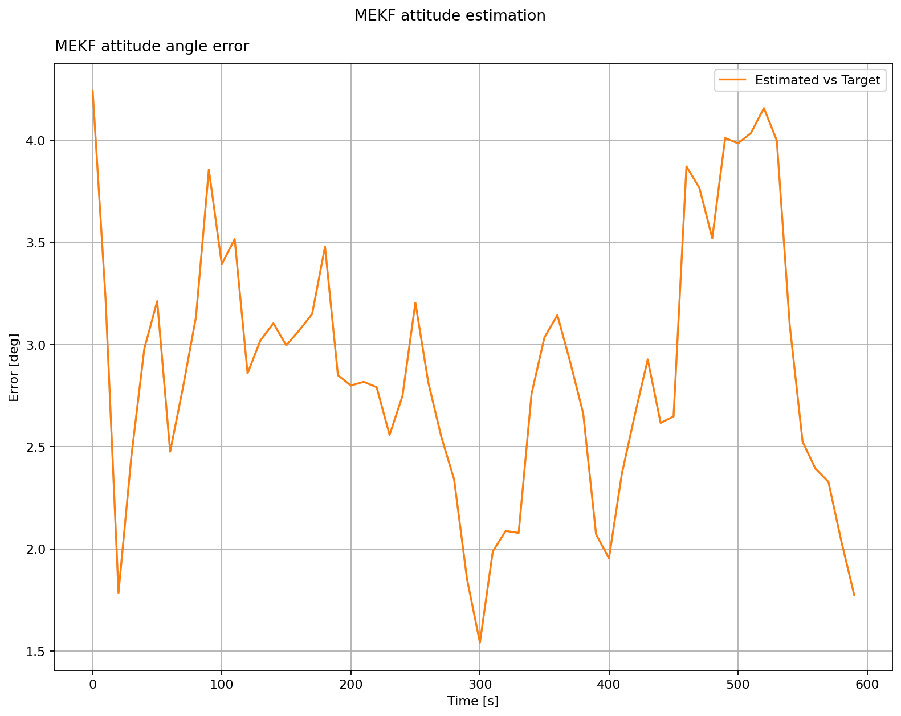

Extended Kalman Filter
======================

TRIAD determines attitude from two direction measurements at one instant.
A filter also propagates its estimate between measurements and corrects it
as new readings arrive. This example uses a multiplicative extended Kalman
filter (MEKF) with the same noisy Sun sensors, magnetometers, and biased gyros
as the previous pages. This first filter treats gyro bias as unknown but does
not estimate it; the next page adds bias estimation.

The plot shows the angle between the estimated and simulated attitudes. The
simulated attitude is used only to assess the estimator's error.

.. literalinclude:: ../../../examples/tutorials/estimators/extended_kalman_filter.py
   :language: python
   :caption: extended_kalman_filter.py

For the full derivations and implementation details, see the API pages for
:doc:`EKF <../ADCS.estimators.attitude_estimators.attitude_EKF>`,
:doc:`MEKF <../ADCS.estimators.attitude_estimators.attitude_MEKF>`,
:doc:`UKF <../ADCS.estimators.attitude_estimators.attitude_UKF>`, and
:doc:`SRUKF <../ADCS.estimators.attitude_estimators.attitude_SRUKF>`.
