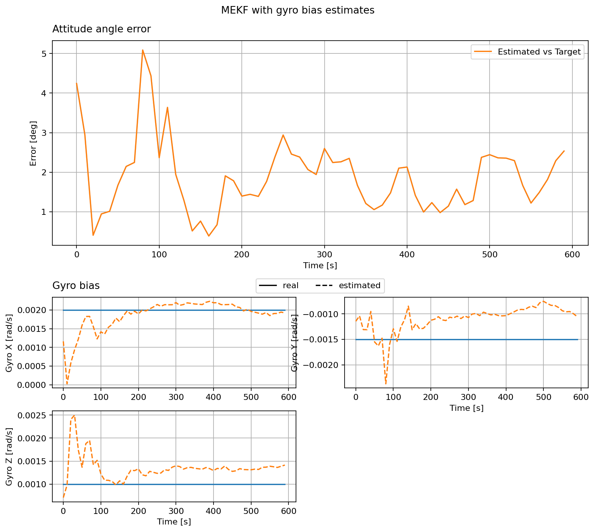

EKF with Bias Estimates
=======================

This example keeps the same satellite, sensor noise, and fixed gyro offsets
as the previous page. Here the MEKF also estimates the three gyro biases
while it estimates attitude. The bias starts at zero in the estimator and is
updated from incoming measurements.

The upper plot shows attitude angle error. The lower plot compares each
estimated gyro bias with the simulated bias. The true attitude and bias are
available here only because this is a simulation.

.. literalinclude:: ../../../examples/tutorials/estimators/ekf_with_bias_estimates.py
   :language: python
   :caption: ekf_with_bias_estimates.py
