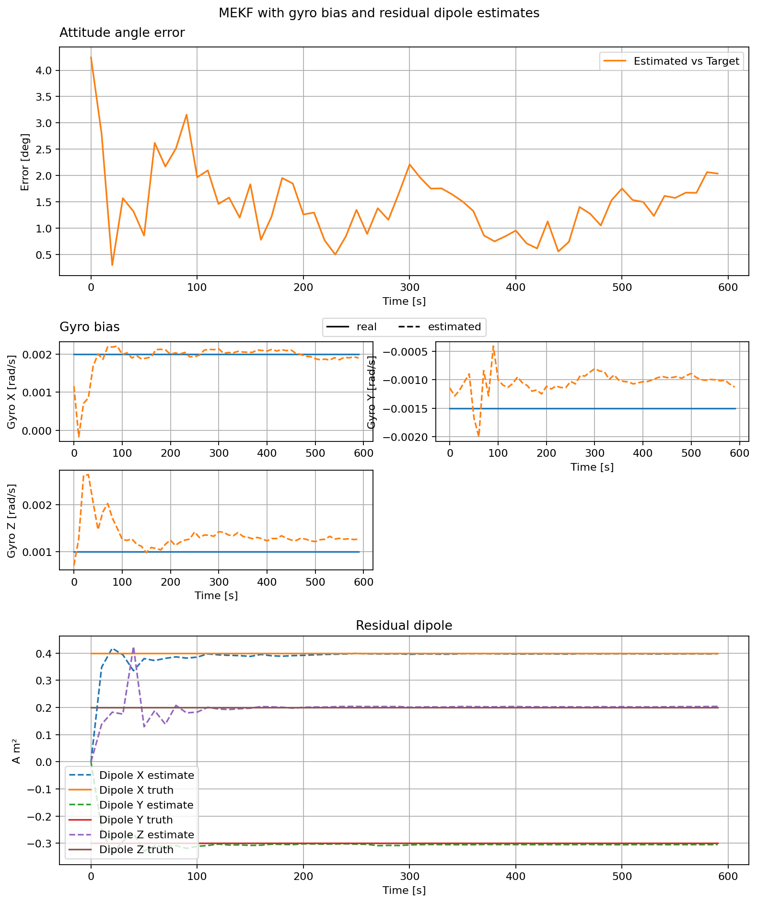

EKF with Residual Dipole Estimation
===================================

This example keeps the noisy sensors and gyro bias estimation from the
previous page. The satellite now has a fixed residual magnetic dipole. Its
interaction with Earth's magnetic field produces a torque that changes the
satellite's motion. The augmented MEKF starts with a zero dipole estimate and
updates its three components alongside attitude and gyro bias.

The plots show attitude angle error, true versus estimated gyro bias, and
true versus estimated residual dipole. The true values are available only
because this is a simulation.

.. literalinclude:: ../../../examples/tutorials/estimators/ekf_with_residual_dipole_estimation.py
   :language: python
   :caption: ekf_with_residual_dipole_estimation.py
