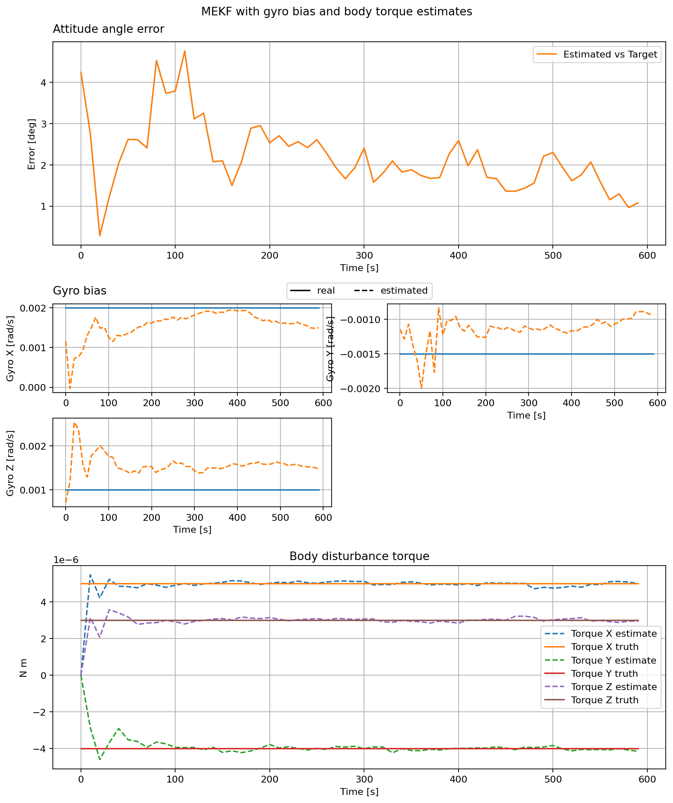

EKF with Disturbance Torque Estimation
======================================

This example uses the same noisy sensors and gyro bias estimator as the
previous page. It replaces the residual magnetic dipole with a constant
three-axis torque in the satellite's body frame. The augmented MEKF begins
with a zero torque estimate and updates the three torque components from the
measured motion.

The plots show attitude angle error, gyro bias, and the true and estimated
body torque. The true values are available only because this is a simulation.

.. literalinclude:: ../../../examples/tutorials/estimators/ekf_with_disturbance_torque_estimation.py
   :language: python
   :caption: ekf_with_disturbance_torque_estimation.py
