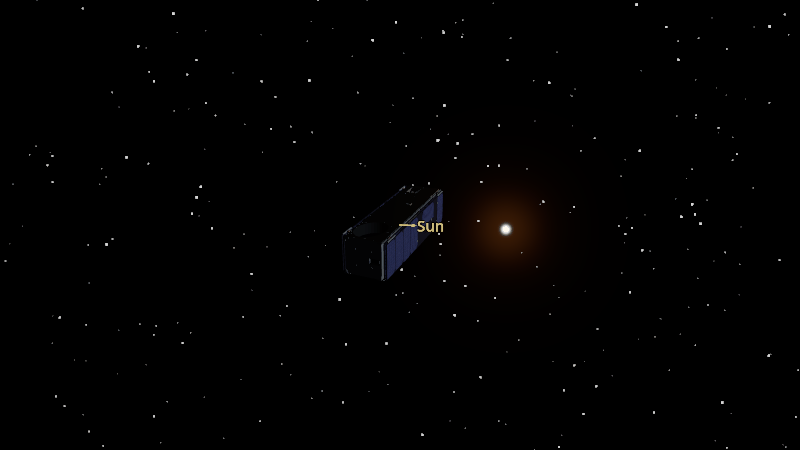
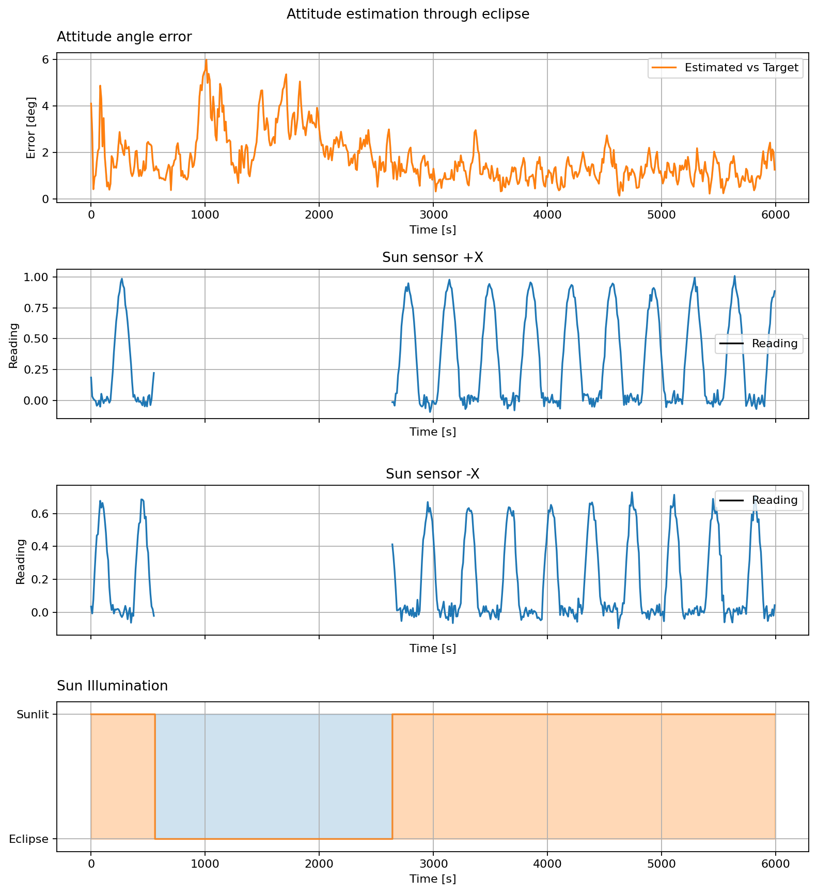

Sensor Occlusion
================

Sun sensors lose their view of the Sun when the satellite enters Earth's
shadow. The same noisy Sun, gyro, and magnetic sensors from the earlier
estimator examples are used here over a longer orbit segment. The MEKF
continues to estimate attitude during eclipse using the available gyro and
magnetometer readings, then receives Sun measurements again after eclipse.

The plots show the attitude angle error, two opposing Sun sensor readings,
and the sunlit/eclipsed intervals. A zero Sun sensor reading can also mean
that the Sun is behind that sensor; the illumination plot identifies when
the whole satellite is in eclipse.

.. literalinclude:: ../../../examples/tutorials/estimators/sensor_occlusion.py
   :language: python
   :caption: sensor_occlusion.py
